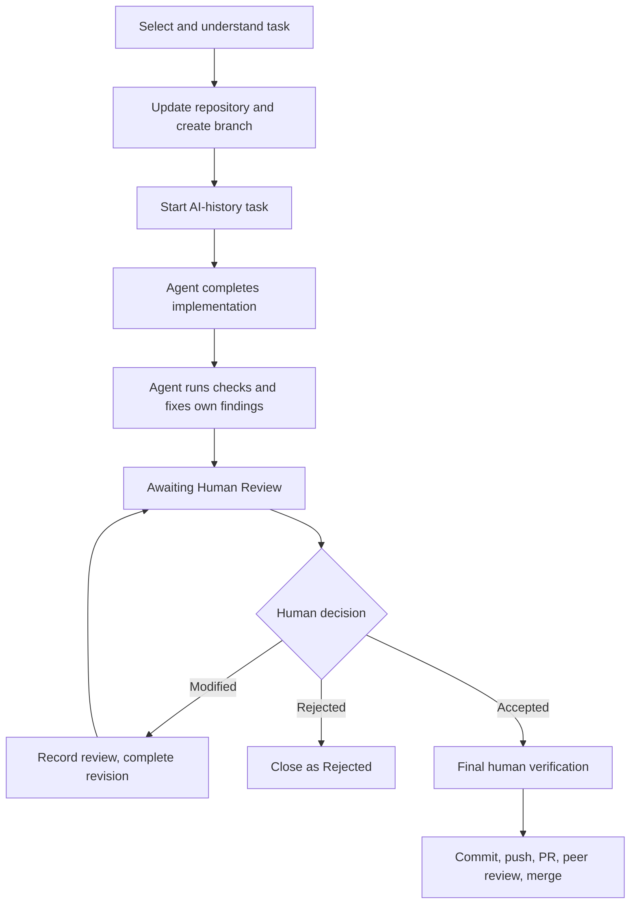

# Development Workflow

This handbook describes how one teammate takes one task from assignment to a
merged pull request. The repository is a Python 3.12 `uv` workspace with
`legacy_system`, `edge_gateway`, and `cloud_service`. Do not assume a service,
API, deployment command, or test exists until its task adds it.

## Why this workflow exists

The course combines modernization, ML-KEM, operations, and LLM-assisted work.
AI output is untrusted until a human evaluates it. Automated checks are useful
evidence, but do not replace correctness, security, maintainability,
testability, or operational review. Never place passwords, tokens, `.env`
content, private keys, shared secrets, or credentials in prompts, history,
commits, issues, or pull requests.

## End-to-end flow



```text
task → branch → AI record → implement and test → human review
     → final verification → commit → pull request → peer review → merge
```

## Before starting

Read `AGENTS.md`; it is the canonical policy for Codex, Claude Code, Grok
Build, GitHub Copilot, Cursor, Gemini, and other compatible agents. `CLAUDE.md`
and `GROK.md` defer to it. Architecture and protocol documents are
implementation constraints, not optional background reading.

Before coding, identify the affected components and read the required
architecture documents: always read the roadmap and the applicable component
design/member-task file; additionally read `04 - Shared Cross-Component
Protocol Specification.md` for every cross-component, API, security, session,
retry, status-code, configuration, storage, Docker, metrics, or E2E change.
Determine the current phase, prerequisites, acceptance gate, frozen contracts,
and required tests; inspect related implementation and tests. Existing code
describes state, not authority to override the frozen design. Clarify ambiguous
requirements before changing architecture or security behavior.

Before significant AI-assisted work, run:

```bash
uv run ai-history status
```

Do not begin a new task if another task is awaiting human review, revision, or
final verification. Resolve it or obtain explicit direction first.

Follow the roadmap's dependency order. Do not implement later-phase work just
because it appears in a design document: baseline Gateway-to-Cloud must work
before ML-KEM, and ML-KEM/session primitives must work before secure E2E. Keep
the course-sized baseline; do not add infrastructure such as Kubernetes, Kafka,
Redis, service mesh, distributed databases, or other expanded platform scope
without an explicit request and an approved architecture change.

If a task would change a frozen endpoint, field/schema, status code,
cryptographic/KDF/nonce/AAD parameter, retry/session/fallback behavior, or
storage mapping, stop and treat it as an architecture change. Update the shared
protocol specification, component designs, roadmap, member tasks, tests, and
only then implementation. Never silently adjust a protocol to match code.

## Choose, update, and branch

Use the team issue or assignment as the source of truth. Identify acceptance
criteria, affected workspace member(s), expected documentation/tests, failure
handling, and security concerns. For cryptographic tasks, identify inputs,
failure cases, secret boundaries, dependency provenance, and negative tests.

Synchronize the one shared environment from the root:

```bash
uv sync
```

The root development environment includes Graphify, a code-only local
repository-navigation tool. Its shared artifacts under `graphify-out/` are
maintained by CI for graph-relevant pull-request changes; contributors do not
install Graphify hooks or edit generated graph artifacts. See
`docs/development/graphify.md` for safe query examples and boundaries.

### Team branch model

The shared branches have distinct purposes:

```text
feature branch (feat/...) ──pull request──> develop ──planned release merge──> main
                                              ↑
                                  integration branch for completed features
```

- `main` is the primary branch. Keep it stable and merge `develop` into it as a
  coordinated release/integration step, not feature by feature.
- `develop` is the shared integration branch. Every completed feature pull
  request targets `develop`.
- Every feature branch starts from the current `develop` branch and its name
  begins with `feat/`, for example `feat/gateway-request-validation` or
  `feat/development-workflow`.
- Do not develop directly on `main` or `develop`. Do not open a feature PR to
  `main`.

When Git is initialized, start each feature branch from up-to-date `develop`:

```bash
git switch develop
git pull --ff-only
git switch -c feat/short-task-name
```

Before making **any** changes on a feature branch, merge current `develop` into
it. This is the first required synchronization point:

```bash
git switch feat/short-task-name
git fetch origin
git merge origin/develop
```

Resolve conflicts and run relevant checks before editing. If you have
uncommitted work, resolve or stash it before switching or merging. If Git has
not yet been initialized, coordinate with the team before using branch, commit,
push, or PR commands.

## Starting work after giving an AI agent a new prompt

Give the agent the task in plain language; you normally do **not** need to type
the AI-history commands yourself. A compatible agent must run the agent-owned
commands at the correct time. You retain responsibility for review decisions and
final verification.

```text
Human: update develop, create feat/... branch, then give the agent a task prompt
Agent: uv run ai-history status
Agent: uv run ai-history start ...
Agent: inspect, implement, test, fix its own findings
Agent: uv run ai-history output ... and stop
Human: inspect work; provide Problems Found + Accepted/Modified/Rejected
Agent: records review; if Modified, implements and records revision
Human: after Accepted, explicitly confirms final verification
Agent: records verify; task becomes Complete
Human: commit/push/open PR (or explicitly asks agent to do so, if appropriate)
```

You may run `status`, `show`, `list`, or `check` yourself at any time. Do not
run `review` or `verify` with invented text: those commands must contain your
own actual review and verification. If you prefer to run them yourself, use the
same exact wording you supplied to the agent.

## Start the AI-history record

The agent creates one history task before implementation. Record the actual
prompt, including multiline text when needed, but never secrets. A human may
also run this command, but should not create duplicate records.

```bash
uv run ai-history start \
  --title "Short human-readable title" \
  --task "Required change and boundaries." \
  --prompt "Exact instruction supplied to the agent." \
  --agent "Codex"
```

This creates the next file under `docs/ai/history/` and sets
`docs/ai/.state.json` to `in_progress`. History records summaries, paths, and
sanitized results, never source copies or Git diffs.

### Avoiding task-ID collisions on parallel branches

`ai-history start` assigns the next number from files in the local checkout; it
is not a distributed lock. Two teammates starting from the same `develop`
revision could both get `0003`. Before `start`, reserve the next task ID in the
shared issue board or team channel, with the branch and task title. Then update
from `develop` and confirm the ID is unused with `uv run ai-history list`.

If a collision is found before a PR, coordinate with the earlier reservation;
the later task must use the next available ID. If Git reports a simple same-ID
history conflict, preserve both entries with the implemented resolver:

```bash
uv run ai-history resolve-merge-conflict \
  docs/ai/history/0003-example-task.md
uv run ai-history check
```

It keeps the earlier-created entry at its original ID and writes the later-created
entry at the next sequential ID. It refuses active-task conflicts; resolve those
with the task owner because `.state.json` needs a deliberate decision. Never
discard or falsify either history. `uv run ai-history list` now displays history
in Created date/time order (oldest first), while IDs remain sequential identifiers.

## Prompt and implementation

Tell the agent the goal, acceptance criteria, relevant files, constraints,
required checks, and exclusions. Ask it to inspect existing code before editing.
The agent must finish the entire task—code, refactoring, requested docs, tests,
and relevant checks—before asking for review. It should fix failures it discovers
itself; do not send every intermediate failure to human review.

Current repository checks include:

```bash
uv run pytest tests/ai_history
uv run ruff check src/ai_history tests/ai_history
uv run ai-history check
```

Run component-specific checks only when the component/task supplies them; do not
invent service commands that do not yet exist.

## Human review gate

After implementation is complete, the agent records factual work and moves the
task to `Awaiting Human Review`:

```bash
uv run ai-history output \
  --summary "What was implemented" \
  --command "command actually run" \
  --result "actual sanitized result" \
  --notes "known limitations or assumptions"
```

The agent stops development. A human inspects the diff, correctness, security,
error paths, maintainability, tests, dependencies, and operational suitability.
Record the reviewer’s real finding and decision:

```bash
uv run ai-history review \
  --problems "No problems identified during manual review." \
  --decision Accepted
```

Allowed decisions are `Accepted`, `Modified`, and `Rejected`. `Modified` also
requires `--requested-modifications`; `Rejected` closes the task without
rewriting its history. Never fabricate human findings.

## Revisions and final verification

For `Modified`, complete every requested correction and all relevant checks, then
record the entire revision:

```bash
uv run ai-history revision --summary "What was corrected" \
  --command "..." --result "..." --notes "..."
```

The task returns to human review. Repeat until accepted. Acceptance is not
completion: the human must explicitly confirm final verification:

```bash
uv run ai-history verify \
  --human-confirmed "I inspected the final implementation and accept it."
```

Use `uv run ai-history check` to validate records. The state model is:

```text
In Progress → Awaiting Human Review → Accepted → Awaiting Final Verification → Complete
                                     ↘ Modified → Revision Requested → revision → review
                                     ↘ Rejected → Rejected
```

## Diff, commit, pull request, and merge

Inspect what will leave your machine before staging:

```bash
git status
git diff
git diff --cached
```

Confirm that no `.env`, secrets, caches, `.venv`, unrelated files, or fictional
results are staged. Then use the team’s commit convention, for example:

```bash
git add <reviewed paths>
git commit -m "docs: add development workflow"
git push -u origin HEAD
```

Before creating the pull/merge request, merge the latest `develop` into the
feature branch. This is the second required synchronization point:

```bash
git fetch origin
git merge origin/develop
uv run ai-history check
```

Resolve conflicts, rerun all relevant checks, then push the updated branch.

Open a PR **from `feat/...` into `develop`**, never directly into `main`. Include
the task purpose, affected components, summary, checks/results, AI-history task
ID, review status, limitations, and issue link. A teammate must
read the actual diff and history, verify claims against code, review security and
failure paths, and leave actionable comments. Resolve comments, rerun relevant
checks, and push follow-ups.

Current CI separates `quality`, `unit-tests`, `integration-tests`, `secure-e2e`,
`docker-build`, and `clean-environment` jobs. Each Python job uses Python 3.12,
the committed lockfile through `uv sync --frozen`, and the `setup-uv`
dependency cache. The workflow validates formatting and AI history; component,
contract, crypto, cross-component integration, and full E2E tests; and builds
the Legacy Device, Gateway, and Cloud images. The quality job also checks the
AI-history CLI and tracked records. Its final clean-runner job validates
Compose and runs the Compose recovery regression. See the
[developer testing guide](testing/DEVELOPER_TESTING_GUIDE.md) for the exact
local selections and current two-service Compose boundary.
Merge only when final human verification is recorded, peer review is approved,
CI is green, conflicts are resolved, and the branch contains only the intended
task. The team periodically merges reviewed `develop` into `main` as an
integration/release action.

## Definition of done and common mistakes

Done means: requirements met; relevant tests/checks passed; documentation and
AI history complete; final human verification recorded; PR approved; CI green;
and PR merged. Avoid starting while another task is active, treating tests as
human acceptance, omitting requested modifications, logging secrets, mixing
unrelated work, or relying on CI instead of reviewing the diff.

## Quick reference

```text
uv sync
uv run ai-history status
uv run ai-history start ...
uv run ai-history output ...
uv run ai-history review ...
uv run ai-history revision ...       # only after Modified
uv run ai-history verify ...         # only after Accepted
uv run ai-history check
```
