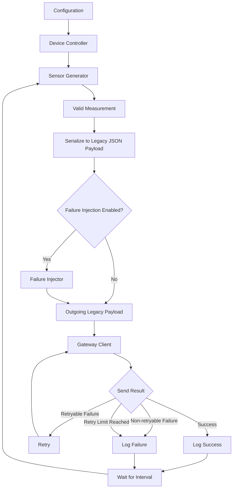
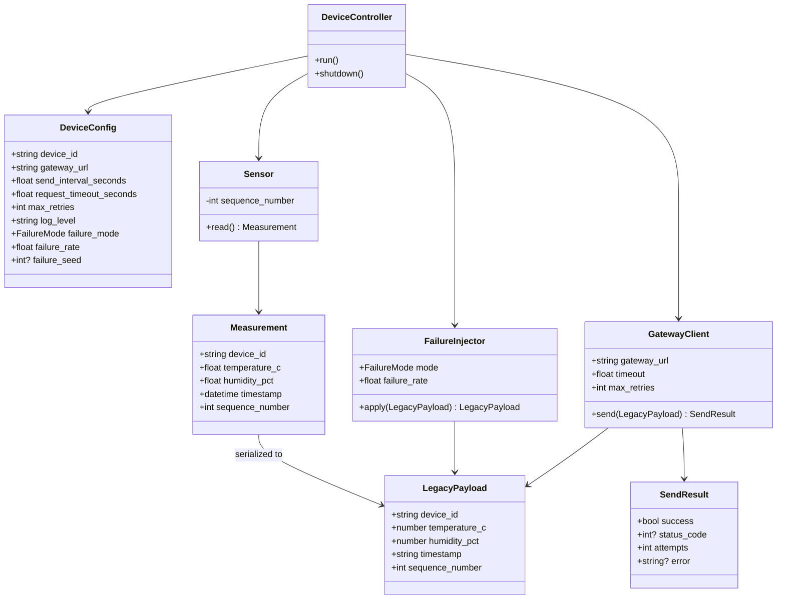
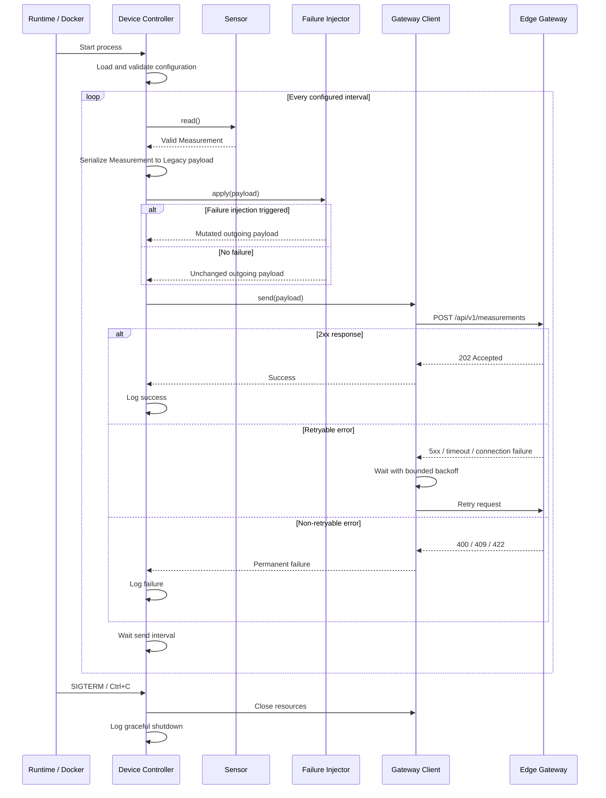
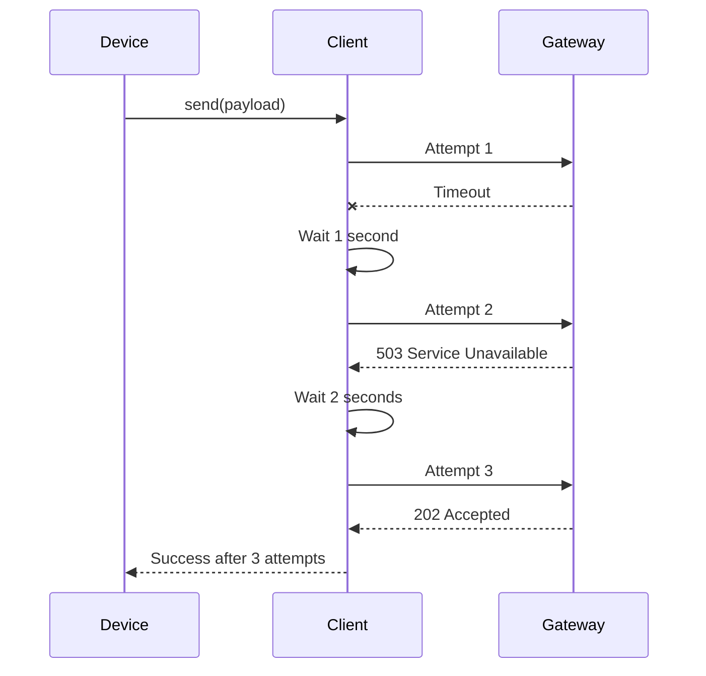
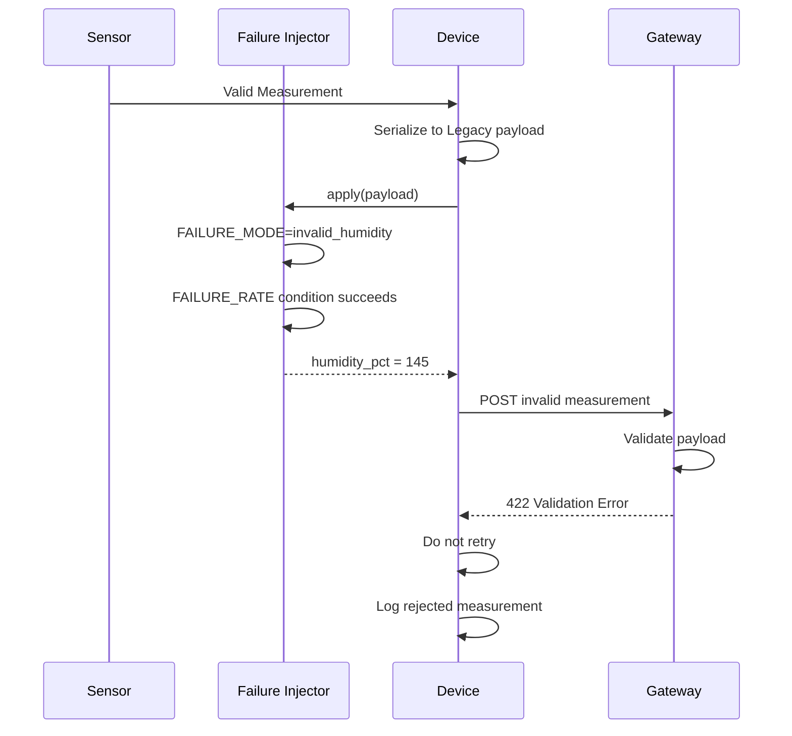
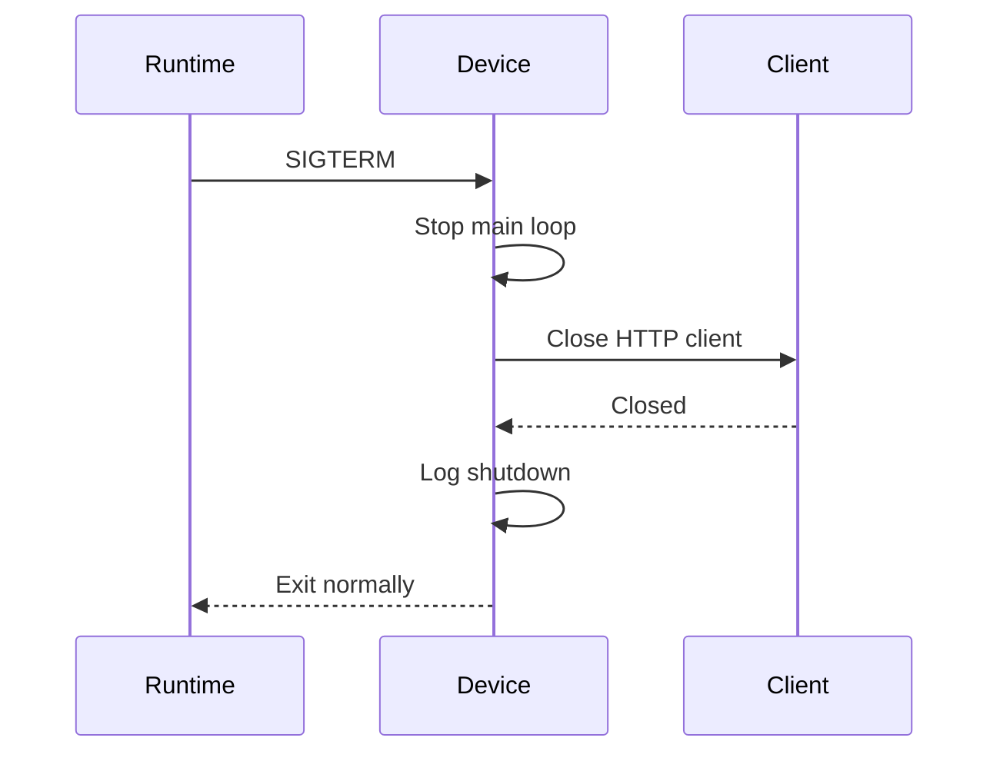
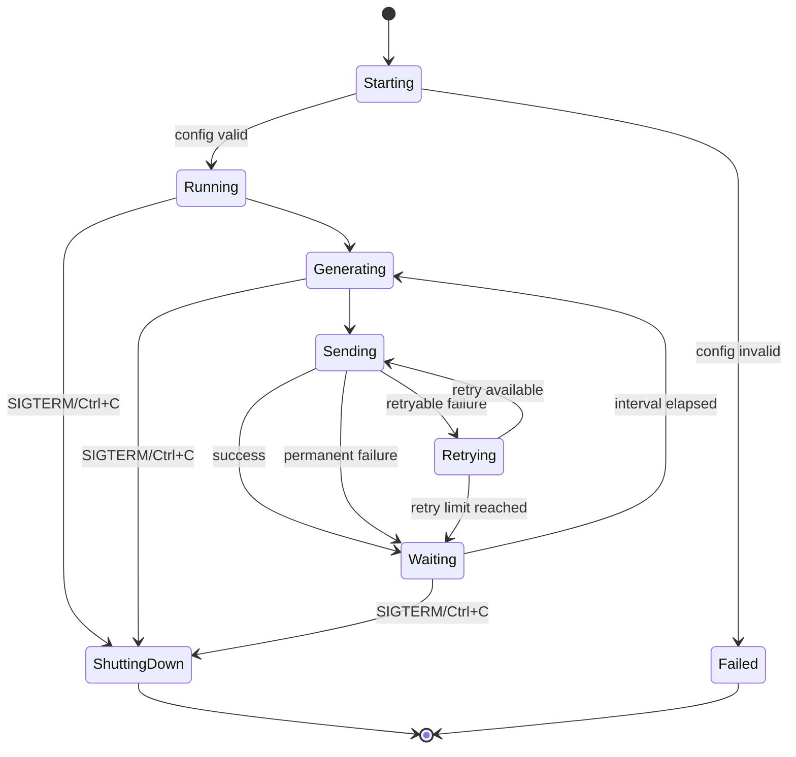
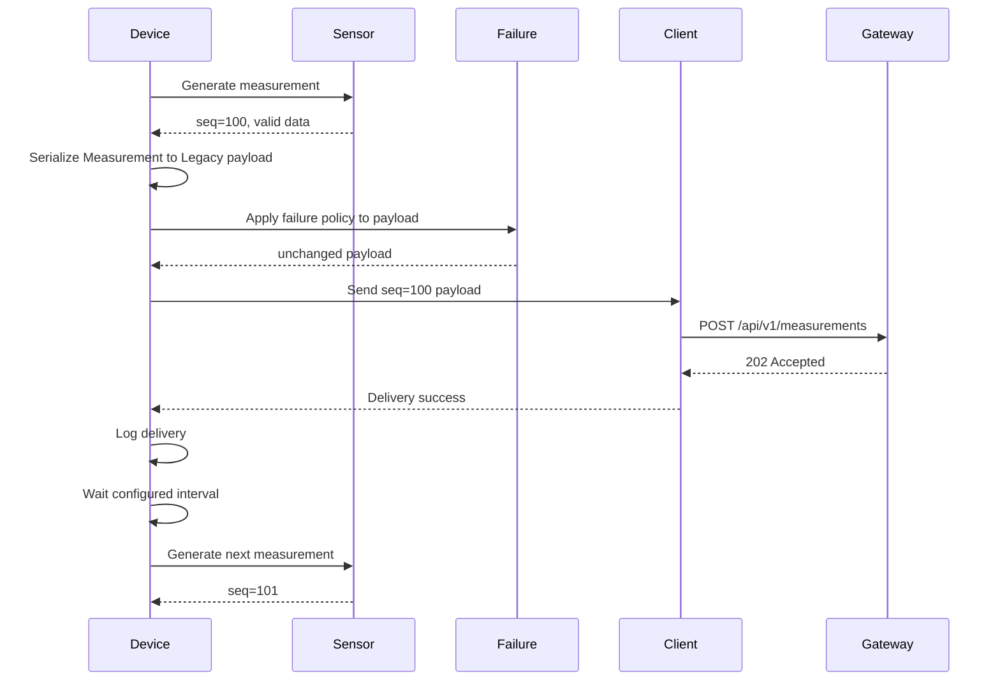
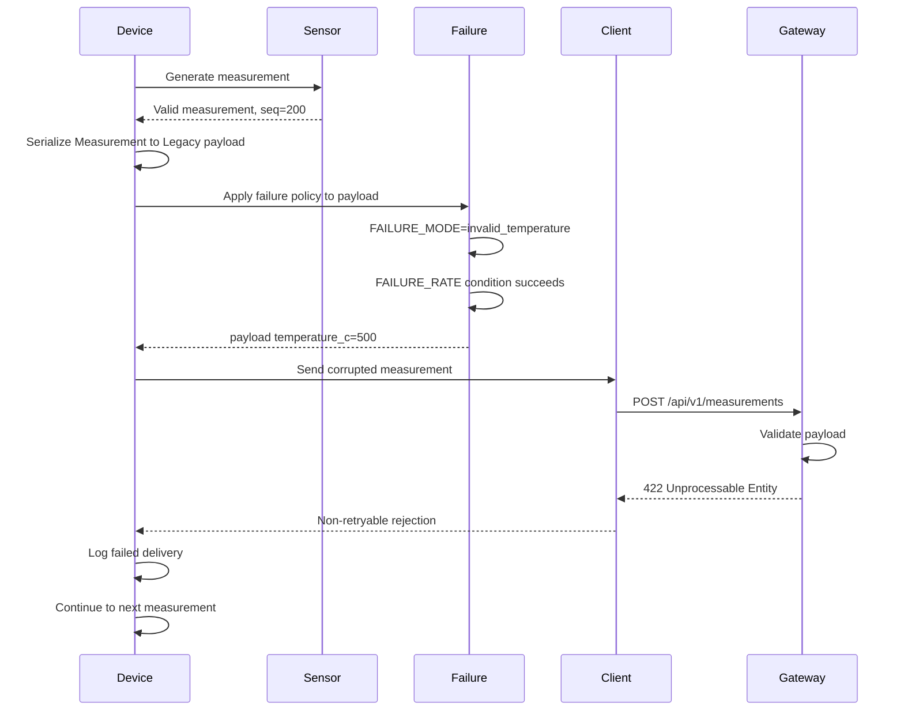
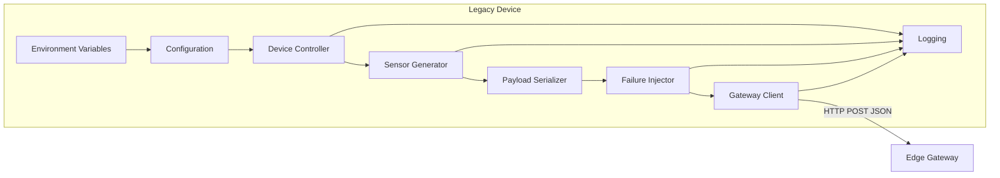

The course material requires a simulated legacy device as part of an edge–cloud system, baseline analysis, testing, AI-assisted development, legacy compatibility/migration considerations, operational improvements, and critical evaluation of generated artifacts. It does **not** prescribe the exact sensor type, protocol, data schema, retry policy, or fault-injection mechanism. Those details below are therefore our design choices made to satisfy the project objectives while keeping the implementation intentionally simple.

# Legacy Device Design Proposal

## 1. Purpose

The Legacy Device simulates an existing constrained IoT device that periodically produces environmental measurements and sends them to an Edge Gateway.

The component represents the **legacy side of the modernization project**.

Its main responsibilities are:

- generate simulated sensor measurements;
    
- identify itself using a configurable device identifier;
    
- timestamp and sequence measurements;
    
- serialize measurements into JSON;
    
- send measurements to the Edge Gateway using a simple legacy HTTP protocol;
    
- handle communication failures with bounded retries;
    
- log relevant operational events;
    
- shut down gracefully;
    
- optionally inject controlled failures for testing;
    
- remain independent of cloud-specific and post-quantum logic.
    

The component intentionally does **not** implement ML-KEM. Post-quantum modernization will occur primarily between the Edge Gateway and Cloud Service, which preserves the conceptual legacy boundary requested by the assignment.

---

# 2. Architectural role

The Legacy Device is the first component in the three-part system:

```text
┌──────────────────────────┐
│      Legacy Device       │
│                          │
│  Simulated old sensor    │
│  HTTP + JSON             │
│  No ML-KEM               │
└────────────┬─────────────┘
             │
             │ Legacy communication
             ▼
┌──────────────────────────┐
│       Edge Gateway       │
│                          │
│ Modernization boundary   │
│ Validation               │
│ ML-KEM                   │
│ Secure cloud transport   │
└────────────┬─────────────┘
             │
             │ Modern/PQC communication
             ▼
┌──────────────────────────┐
│      Cloud Service       │
└──────────────────────────┘
```

The architectural principle is:

> The Legacy Device should behave like an existing deployed device that cannot easily be redesigned. The Edge Gateway adapts this legacy communication to the modernized cloud-facing architecture.

This gives the project a realistic modernization story instead of treating all three components as equally modern.

---

# 3. Scope

The Legacy Device is responsible for:

|Area|Responsibility|
|---|---|
|Sensor simulation|Generate realistic temperature and humidity readings|
|Device identity|Provide a stable configurable device identifier|
|Timestamping|Timestamp measurements in UTC|
|Sequencing|Assign monotonically increasing sequence numbers|
|Serialization|Produce a JSON-compatible representation|
|Communication|Send measurements to the Edge Gateway|
|Retry handling|Retry selected temporary communication failures|
|Failure simulation|Deliberately generate controlled faulty measurements|
|Logging|Record meaningful device events|
|Configuration|Load and validate runtime settings|
|Shutdown|Stop cleanly on termination|

The Legacy Device is explicitly **not** responsible for:

```text
ML-KEM
post-quantum key establishment
cloud communication
cloud storage
database access
Prometheus server
user authentication
web frontend
message broker
persistent offline queue
fleet management
firmware updates
real hardware integration
```

---

# 4. High-level component architecture



The normal sensor generator always produces valid `Measurement` domain objects.

Before transmission, the valid `Measurement` is serialized into a JSON-compatible **Legacy payload**. Failure injection operates on this serialized payload rather than on the validated domain object.

This distinction is important because some required failure scenarios, such as `missing_field` and `invalid_timestamp`, cannot be represented cleanly by a valid typed `Measurement`. Keeping the domain object valid while mutating only the outgoing wire payload prevents testing-specific malformed state from leaking back into the sensor model.

The resulting pipeline is therefore:

```text
Sensor
  ↓
valid Measurement domain object
  ↓
serialize
  ↓
Legacy JSON payload
  ↓
optional Failure Injector mutation
  ↓
Gateway Client
```

That separation prevents normal sensor-generation logic from becoming polluted with testing-specific behavior.

---

# 5. Internal module design

Recommended structure:

```text
legacy_system/
├── pyproject.toml
│
├── src/
│   └── legacy_system/
│       ├── __init__.py
│       ├── device.py
│       ├── sensor.py
│       ├── failure.py
│       ├── client.py
│       └── config.py
│
├── tests/
│   ├── test_sensor.py
│   ├── test_failure.py
│   ├── test_client.py
│   ├── test_config.py
│   └── test_device.py
│
└── Dockerfile
```

### `device.py`

Acts as the application orchestrator.

Responsibilities:

```text
load configuration
initialize components
control main execution loop
request measurements
apply optional failure injection
send measurements
coordinate shutdown
```

It should contain very little business logic.

Conceptually:

```python
while running:
    measurement = sensor.read()
    payload = measurement.to_payload()
    outgoing_payload = failure_injector.apply(payload)
    client.send(outgoing_payload)
    wait(interval)
```

### `sensor.py`

Responsible only for generating valid measurements.

It should know about:

```text
device ID
temperature
humidity
timestamp
sequence number
```

It should not know about HTTP, retries, the cloud, or ML-KEM.

### `failure.py`

Responsible only for deliberate test/failure simulation.

It receives a **serialized Legacy payload** produced from a valid `Measurement` and optionally returns a deliberately invalid or unusual payload.

```text
Valid Measurement
       ↓
Serialize to Legacy payload
       ↓
Failure Injector
       ↓
Normal or intentionally faulty payload
```

The injector should not be required to create an invalid `Measurement` object. For example, `missing_field` can remove a key from the outgoing payload, while `invalid_timestamp` can replace the serialized timestamp string with malformed text.

### `client.py`

Responsible for Legacy Device → Gateway communication.

It handles:

```text
HTTP requests
timeouts
retry classification
bounded retry attempts
HTTP response interpretation
```

### `config.py`

Responsible for:

```text
reading environment configuration
applying defaults
validating values
producing one validated configuration object
```

---

# 6. Data model

The primary domain object is a `Measurement`.

## Measurement model

|Field|Type|Required|Example|Validation|
|---|---|---|---|---|
|`device_id`|string|Yes|`sensor-001`|non-empty|
|`temperature_c`|float|Yes|`21.7`|normally `-40` to `85`|
|`humidity_pct`|float|Yes|`42.5`|normally `0` to `100`|
|`timestamp`|datetime/string|Yes|`2026-09-21T08:20:31Z`|UTC ISO-8601|
|`sequence_number`|integer|Yes|`184`|`0 <= value <= 9223372036854775807`|

Example:

```json
{
  "device_id": "sensor-001",
  "temperature_c": 21.7,
  "humidity_pct": 42.5,
  "timestamp": "2026-09-21T08:20:31Z",
  "sequence_number": 184
}
```

## Domain object vs outgoing payload

`Measurement` represents valid internal sensor state. The outgoing HTTP body is a JSON-compatible payload derived from that object.

Normal operation:

```text
Measurement
  ↓ serialize
Legacy payload
  ↓ send
Gateway
```

Failure-simulation operation:

```text
Measurement
  ↓ serialize
Legacy payload
  ↓ mutate selected field/key
Faulty Legacy payload
  ↓ send
Gateway
```

This distinction allows malformed protocol test cases without weakening the validity guarantees of the internal `Measurement` model.

---

# 7. Data model diagram



---

# 8. Measurement generation

The simulated device generates:

```text
temperature
humidity
timestamp
sequence number
```

A reasonable normal simulation range is:

```text
temperature:
15°C – 30°C

humidity:
30% – 70%
```

These ranges represent typical environmental conditions but are not meant to model physical behavior scientifically.

The wider **valid protocol range** can remain:

```text
temperature:
-40°C – 85°C

humidity:
0% – 100%
```

This distinction is useful:

```text
Normal generator range
       ⊂
Protocol-valid range
```

So the sensor normally generates realistic values while the gateway still accepts valid unusual conditions.

---

# 9. Deterministic testing

Tests must not depend on unpredictable random values.

The design should allow the random source to be:

```text
seeded
or
injected
```

Conceptually:

```python
Sensor(random_source=...)
```

Production simulation:

```text
random values
```

Test:

```text
known deterministic values
```

This gives repeatable tests.

---

# 10. Sequence-number design

The device maintains a monotonically increasing sequence number.

Example:

```text
0
1
2
3
4
...
```

The sequence number increments when a measurement is **created**, not when delivery succeeds.

Example:

```text
Sequence 10
    ↓
delivered

Sequence 11
    ↓
delivery fails

Sequence 12
    ↓
delivered
```

The gateway therefore sees:

```text
10
12
```

and can infer that measurement `11` may have been lost.

This gives useful observability without implementing a persistent message queue.

---

# 11. Timestamp design

Each measurement receives its timestamp when generated.

Format:

```text
UTC
ISO-8601
```

Example:

```text
2026-09-21T08:20:31Z
```

The measurement timestamp represents:

> when the Legacy Device produced the measurement.

It should not represent when the gateway received the message.

The gateway may later maintain a separate reception timestamp.

---

# 12. Legacy communication contract

The proposed Legacy Device → Edge Gateway protocol is:

```text
HTTP + JSON
```

Request:

```http
POST /api/v1/measurements
Content-Type: application/json
```

Payload:

```json
{
  "device_id": "sensor-001",
  "temperature_c": 21.7,
  "humidity_pct": 42.5,
  "timestamp": "2026-09-21T08:20:31Z",
  "sequence_number": 184
}
```

Successful response:

```http
202 Accepted
```

Optional body:

```json
{
  "status": "accepted"
}
```

This is deliberately simple.

---

# 13. HTTP response behavior

The Legacy Device should distinguish between transient and permanent failures.

|Result|Behavior|
|---|---|
|`2xx`|Success|
|`400`|Do not retry — malformed/unparseable JSON or invalid HTTP body syntax|
|`409`|Do not retry — duplicate or out-of-order sequence|
|`422`|Do not retry — parsed JSON with missing, wrongly typed, or domain-invalid required fields|
|`500`|Retry|
|`502`|Retry|
|`503`|Retry|
|`504`|Retry|
|Network failure|Retry|
|Timeout|Retry|

Reason:

```text
400 / 409 / 422
means retrying the same logical measurement is not expected to succeed.

`409` is used when the Gateway rejects a duplicate or out-of-order sequence according to the shared protocol.

The `400` / `422` boundary is frozen project-wide:

```text
malformed or unparseable JSON/body syntax
→ 400 Bad Request

JSON parses, but a required field is missing, has the wrong type,
or violates a domain rule
→ 422 Unprocessable Entity
```

Therefore a Legacy `missing_field` fault is expected to receive `422`, not `400`.

Sending the same invalid payload again
will not fix it.
```

Whereas:

```text
503
timeout
connection failure
```

may disappear shortly afterward.

---

# 14. Timeout policy

The HTTP client should never wait indefinitely.

Default:

```text
REQUEST_TIMEOUT_SECONDS=3
```

Conceptually:

```text
send request
    ↓
wait maximum 3 seconds
    ↓
success or timeout
```

Timeout should be treated as a retryable failure.

---

# 15. Retry strategy

Recommended policy:

```text
Initial attempt
       ↓ failure
Wait 1 second
       ↓
Retry 1
       ↓ failure
Wait 2 seconds
       ↓
Retry 2
       ↓ failure
Drop measurement
```

Default:

```text
MAX_RETRIES=2
```

Meaning:

```text
1 initial attempt
+
2 retries
=
3 total attempts
```

Retry delays should remain bounded.

There should be no infinite retry loop.

---

# 16. Failed measurements

After retry exhaustion:

```text
measurement
    ↓
attempt fails
    ↓
retry
    ↓
retry fails
    ↓
final failure logged
    ↓
measurement discarded
    ↓
continue with next measurement
```

The device will **not** persist failed measurements locally.

Reason:

Persistent offline queues would add unnecessary complexity to a project whose primary objectives are legacy modernization, ML-KEM integration, maintenance, testing, and operations. The course explicitly encourages keeping the project small.

This limitation should be documented as technical debt.

---

# 17. Failure simulation

A dedicated failure simulation mode will allow reproducible negative testing.

Default configuration:

```text
FAILURE_MODE=none
FAILURE_RATE=0.0
```

Possible modes:

|Mode|Result|
|---|---|
|`none`|normal valid data|
|`invalid_temperature`|temperature outside accepted range|
|`invalid_humidity`|humidity outside `0–100`|
|`missing_field`|required field removed|
|`invalid_timestamp`|malformed timestamp|
|`duplicate_sequence`|previous sequence number reused|
|`out_of_order_sequence`|lower sequence number produced|
|`random`|randomly choose one supported failure|

---

# 18. Failure-injection architecture

The sensor itself should remain correct.

Failure injection occurs afterward:

```text
┌────────────────────┐
│ Sensor Generator   │
│                    │
│ ALWAYS generates   │
│ valid data         │
└─────────┬──────────┘
          │
          ▼
┌────────────────────┐
│ Valid Measurement  │
└─────────┬──────────┘
          │
          ▼
┌────────────────────┐
│ Serialize Payload  │
└─────────┬──────────┘
          │
          ▼
┌────────────────────┐
│ Failure Injector   │
└─────────┬──────────┘
          │
     ┌────┴────┐
     │         │
 disabled    enabled
     │         │
     ▼         ▼
  unchanged   mutated
     │         │
     └────┬────┘
          ▼
     Gateway Client
```

This keeps testing/simulation logic isolated while allowing deliberately malformed wire payloads such as missing fields or invalid timestamp strings.

---

# 19. Failure rate

`FAILURE_RATE` controls how often an enabled failure is injected.

Valid range:

```text
0.0 ≤ FAILURE_RATE ≤ 1.0
```

Examples:

```text
0.0
→ never inject failure

0.2
→ roughly 20% of measurements

1.0
→ every measurement
```

Example:

```text
FAILURE_MODE=invalid_temperature
FAILURE_RATE=0.20
```

Approximately one in five measurements becomes invalid.

---

# 20. Random failure mode

Configuration:

```text
FAILURE_MODE=random
FAILURE_RATE=0.20
```

When injection is triggered:

```text
choose one supported failure scenario
        ↓
mutate outgoing payload
        ↓
send normally
```

The gateway should receive the bad data exactly as if a real malfunctioning legacy device had produced it.

The payload must therefore **not** contain:

```json
{
  "simulated_failure": true
}
```

because that would allow the gateway to treat simulated failures differently.

---

# 21. Failure seed

Optional configuration:

```text
FAILURE_SEED=42
```

Purpose:

```text
repeatable demonstrations
repeatable automated tests
debugging
```

It should be optional.

Normal runtime does not require deterministic failure sequences.

---

# 22. Example failure scenarios

### Invalid temperature

Normal:

```json
{
  "temperature_c": 21.4
}
```

Injected:

```json
{
  "temperature_c": 500.0
}
```

Expected gateway behavior:

```text
reject measurement
return validation error
```

### Invalid humidity

Injected:

```json
{
  "humidity_pct": 145.0
}
```

Expected:

```text
gateway rejects request
legacy device does not retry 4xx response
```

### Missing field

Generated valid payload:

```json
{
  "device_id": "sensor-001",
  "temperature_c": 21.7,
  "humidity_pct": 40.2,
  "timestamp": "2026-09-21T08:20:31Z",
  "sequence_number": 25
}
```

Failure injector removes:

```text
timestamp
```

Gateway should reject it with:

```http
422 Unprocessable Entity
```

because the JSON itself is syntactically valid but a required field is missing.

### Duplicate sequence

```text
message 40
message 41
message 41  ← deliberately duplicated
message 43
```

This allows gateway duplicate-detection behavior to be exercised.

---

# 23. Network failure simulation

Initial implementation should **not** artificially implement every network failure inside `failure.py`.

Network failures can already be tested using:

```text
gateway stopped
mocked timeout
mocked connection failure
mocked HTTP 503
```

This keeps `failure.py` focused primarily on bad-data generation.

Network failure injection can be added later only if it provides demonstrable value.

---

# 24. Runtime configuration

Recommended environment variables:

| Variable                  | Default/example            | Description                       |
| ------------------------- | -------------------------- | --------------------------------- |
| `DEVICE_ID`               | `sensor-001`               | device identity                   |
| `GATEWAY_URL`             | `http://edge-gateway:8000` | gateway base URL                  |
| `SEND_INTERVAL_SECONDS`   | `5`                        | measurement interval              |
| `REQUEST_TIMEOUT_SECONDS` | `3`                        | HTTP timeout                      |
| `MAX_RETRIES`             | `2`                        | retry count after initial request |
| `FAILURE_MODE`            | `none`                     | failure scenario                  |
| `FAILURE_RATE`            | `0.0`                      | injection probability             |
| `FAILURE_SEED`            | empty                      | optional deterministic seed       |
| `LOG_LEVEL`               | `INFO`                     | logging level                     |

---

# 25. Configuration validation

Configuration must be validated at startup.

Examples of invalid configuration:

```text
SEND_INTERVAL_SECONDS=-5

REQUEST_TIMEOUT_SECONDS=0

MAX_RETRIES=-2

FAILURE_RATE=1.5

FAILURE_MODE=something_unknown
```

Expected behavior:

```text
load configuration
       ↓
validation fails
       ↓
log clear configuration error
       ↓
exit with non-zero status
```

The application should not continue with invalid configuration.

---

# 26. Main runtime sequence



---

# 27. Retry sequence



If attempt 3 also fails:

```text
Client → Device:
DeliveryFailure
```

The measurement is logged and discarded.

---

# 28. Invalid-data simulation sequence



This scenario becomes an end-to-end demonstration that gateway validation actually works.

---

# 29. Graceful shutdown

The component must support:

```text
Ctrl+C
SIGTERM
Docker stop
```

Sequence:



This is especially important for containerized operation.

---

# 30. Logging design

Recommended events:

```text
device_starting
measurement_generated
simulated_failure_injected
measurement_delivered
gateway_retry
measurement_delivery_failed
invalid_configuration
device_shutting_down
```

Example:

```text
INFO event=device_starting device_id=sensor-001

INFO event=measurement_generated
     device_id=sensor-001
     sequence=42

WARNING event=simulated_failure_injected
        mode=invalid_humidity
        sequence=42

WARNING event=gateway_retry
        sequence=42
        attempt=2

ERROR event=measurement_delivery_failed
      sequence=42
      attempts=3

INFO event=device_shutting_down
```

Logs should use structured, consistent fields when practical.

---

# 31. Logging restrictions

Never log:

```text
passwords
tokens
credentials
private keys
shared secrets
future ML-KEM secret material
full `.env` contents
```

The Legacy Device currently contains no cryptographic secret, but the logging policy should already follow project-wide security practices.

---

# 32. Failure-injection logging

Failure simulation must be visible **locally** in logs:

```text
WARNING simulated_failure_injected
mode=invalid_temperature
sequence=85
```

But the failure marker must not be included in the outgoing protocol payload.

This ensures the gateway cannot distinguish:

```text
real bad measurement
```

from:

```text
simulated bad measurement
```

based on hidden testing metadata.

---

# 33. Metrics strategy

The Legacy Device will initially expose **no dedicated Prometheus endpoint**.

Reason:

The device is intended to represent a constrained legacy component.

Its primary observability mechanism is:

```text
logs
```

System-wide operational metrics should primarily be implemented at the Gateway and Cloud layers where modern observability belongs.

If later required, counters may be introduced, but this is not part of the initial Legacy Device scope.

---

# 34. Health strategy

The Legacy Device will not expose:

```text
GET /health
```

because it acts as an outbound client rather than a network service.

Container/runtime health can instead determine whether:

```text
the process is running
```

Gateway and Cloud Service will expose health endpoints.

---

# 35. Docker deployment design

The Legacy Device runs as its own container.

Conceptually:

```yaml
legacy-device:
  build: ./legacy_system
  environment:
    DEVICE_ID: sensor-001
    GATEWAY_URL: http://edge-gateway:8000
    SEND_INTERVAL_SECONDS: 5
    REQUEST_TIMEOUT_SECONDS: 3
    MAX_RETRIES: 2
    FAILURE_MODE: none
    FAILURE_RATE: 0.0
```

The container does not need an exposed port because it initiates communication.

```text
Legacy Device
      │
      │ outbound
      ▼
Gateway
```

---

# 36. Multiple-device support

The design should allow multiple simulated devices without source-code modification.

```text
sensor-001 ──┐
             │
sensor-002 ──┼────> Edge Gateway
             │
sensor-003 ──┘
```

Each instance differs mainly through:

```text
DEVICE_ID
```

and optionally:

```text
FAILURE_MODE
FAILURE_RATE
```

For example:

```text
sensor-001
FAILURE_MODE=none

sensor-002
FAILURE_MODE=invalid_humidity
FAILURE_RATE=0.1
```

This could be useful for demonstrations, but fleet management is out of scope.

---

# 37. Testing strategy

The Legacy Device should have three main testing levels.

### Unit testing

Tests should verify individual modules.

Examples:

```text
Sensor
Configuration
Failure Injector
Gateway Client
Device Controller
```

### Integration testing

Tests should verify:

```text
Legacy Device ↔ Gateway
```

using a real test gateway instance.

### End-to-end testing

System-level tests should eventually verify:

```text
Legacy Device
      ↓
Gateway
      ↓
Cloud
```

These belong outside the Legacy Device component under root integration tests.

---

# 38. Sensor tests

Required examples:

```text
generated measurement contains required fields

temperature is within normal generation range

humidity is within normal generation range

timestamp is valid UTC

sequence numbers increment

device ID comes from configuration

random generation can be deterministic during testing
```

---

# 39. Configuration tests

Test:

```text
valid configuration loads

default values work

negative interval rejected

zero timeout rejected

negative retry count rejected

FAILURE_RATE < 0 rejected

FAILURE_RATE > 1 rejected

unsupported FAILURE_MODE rejected
```

---

# 40. Failure-injection tests

Test each scenario independently.

Examples:

```text
FAILURE_MODE=none
→ valid outgoing payload unchanged

invalid_temperature
→ temperature becomes invalid

invalid_humidity
→ humidity becomes invalid

missing_field
→ one required field missing from outgoing payload
→ Gateway contract expects 422

invalid_timestamp
→ serialized timestamp malformed
→ Gateway contract expects 422

duplicate_sequence
→ previous sequence reused

failure rate 0.0
→ no failures

failure rate 1.0
→ every applicable measurement affected

seeded random mode
→ reproducible failure sequence
```

---

# 41. Gateway-client tests

The HTTP layer should be tested without requiring a running gateway.

Use a mocked/fake transport.

Test:

```text
202 response
→ success

400
→ failure without retry

409
→ failure without retry

422
→ failure without retry

500
→ retry

503
→ retry

timeout
→ retry

connection failure
→ retry

retry eventually succeeds
→ success

all attempts fail
→ delivery failure
```

---

# 42. Device-controller tests

Test orchestration behavior:

```text
measurement generated before send

failure injector invoked

client receives resulting payload

main loop waits configured interval

sequence progresses even when delivery fails

shutdown terminates loop

client resources are closed
```

Avoid tests that need to wait real five-second intervals.

Inject or mock the sleep mechanism if necessary.

---

# 43. Integration tests

Repository-level integration tests should eventually include:

```text
Valid legacy measurement
    ↓
Gateway
    ↓
202 Accepted
```

and:

```text
FAILURE_MODE=invalid_humidity
    ↓
Gateway
    ↓
422 Validation Error
```

and:

```text
FAILURE_MODE=missing_field
    ↓
syntactically valid JSON with required field absent
    ↓
Gateway
    ↓
422 Unprocessable Entity
```

and:

```text
Gateway unavailable
    ↓
Legacy retry behavior
    ↓
bounded failure
```

---

# 44. Baseline measurements

After the Legacy Device and Gateway baseline exist, record selected measurements.

Potential metrics:

```text
HTTP request latency
JSON payload size
successful delivery rate
retry count under simulated gateway failures
unit-test count
test coverage
```

Only useful measurements should be included.

The goal is to establish evidence for later comparison, not to build a large benchmarking framework.

---

# 45. Security model

The Legacy Device represents an intentionally constrained legacy endpoint.

Potential limitations include:

```text
no post-quantum protection
no strong application-level device authentication
possible unencrypted local HTTP
no persistent delivery queue
simple retry strategy
```

These limitations are intentionally documented rather than hidden.

The modernization approach compensates by introducing stronger controls at the gateway/cloud boundary.

---

# 46. Why ML-KEM does not belong here

The project requires integrating ML-KEM using an existing implementation and preserving legacy compatibility or providing a migration strategy.

Our migration strategy is:

```text
Legacy Device
   unchanged/simple
        ↓
Edge Gateway
   modernization boundary
        ↓
Cloud
   ML-KEM capable
```

This demonstrates how organizations might improve cloud-facing security without requiring every old field device to be replaced immediately.

---

# 47. Expected failure behavior matrix

|Failure|Retry?|Device action|
|---|--:|---|
|HTTP `202`|No|success|
|HTTP `400`|No|log malformed/unparseable JSON/body rejection|
|HTTP `409`|No|log duplicate/out-of-order rejection|
|HTTP `422`|No|log parsed-but-invalid measurement rejection, including missing required fields|
|HTTP `500`|Yes|bounded retry|
|HTTP `503`|Yes|bounded retry|
|Timeout|Yes|bounded retry|
|Connection refused|Yes|bounded retry|
|Retry limit reached|No|log + discard|
|Invalid local config|No|fail startup|
|Ctrl+C/SIGTERM|No|graceful shutdown|

---

# 48. Technical debt

The following limitations should be explicitly carried into project evaluation:

### No persistent offline buffering

Failed measurements disappear after retry exhaustion.

Future improvement:

```text
local persistent queue
```

### Weak/no device authentication

The baseline legacy protocol does not strongly authenticate devices.

Future improvement:

```text
provisioned device credentials
```

### Legacy traffic is not PQC-protected

This is intentional.

The gateway is the modernization boundary.

### Simulated sensor

No real physical hardware is used.

### Basic retry algorithm

The retry strategy is deliberately small rather than production-grade.

### No device-level metrics endpoint

Operational monitoring is focused on gateway/cloud.

These points are useful technical debt rather than hidden shortcomings, aligning with the project's requirement to identify remaining risks and technical debt.

---

# 49. AI-assisted implementation strategy

Because the course explicitly requires AI-assisted code generation and manual evaluation, the Legacy Device should be developed through several meaningful AI-history tasks rather than one huge prompt.

Possible tasks might be:

```text
Task — Sensor model and generation

Task — Legacy configuration

Task — Gateway HTTP client

Task — Failure injection

Task — Device execution loop

Task — Legacy unit tests

Task — Legacy Docker packaging
```

Each task should follow your repository's AI-history lifecycle:

```text
Start task
    ↓
Significant AI interactions
    ↓
Agent completes implementation
    ↓
Agent runs tests/checks
    ↓
Output recorded
    ↓
Human Review
    ↓
Accepted / Modified / Rejected
    ↓
Revision if necessary
    ↓
Final Verification
    ↓
Complete
```

This is consistent with the assignment's requirement to treat the LLM as an untrusted assistant and document what was accepted, modified, or rejected.

---

# 50. Legacy Device state model

At runtime the device can conceptually have these states:



---

# 51. Complete normal sequence



---

# 52. Failure-mode sequence



---

# 53. Complete component diagram



---

# 54. Design principles

The Legacy Device should follow several core principles.

**Simple by design.**  
Complexity belongs only where it helps demonstrate a project requirement.

**Clear boundaries.**  
Sensor generation, payload serialization, failure simulation, communication, and configuration are separate responsibilities.

**Legacy remains legacy.**  
The component is not artificially modernized with ML-KEM.

**Deterministic testing.**  
Randomness and time-dependent behavior should be controllable in tests.

**Failure-aware.**  
Temporary failures, permanent failures, malformed data, and shutdown are explicitly designed.

**Observable but constrained.**  
Logging is provided, but a full modern observability stack is intentionally omitted.

**Configuration over hardcoding.**  
Runtime-specific values come from validated configuration.

**No silent failures.**  
Delivery failures and injected failures should be visible in logs.

---

# 55. Requirements traceability

The proposed Legacy Device contributes to course requirements as follows:

|Course objective|Legacy-device contribution|
|---|---|
|Simulated legacy system|Provides simulated constrained sensor|
|Baseline analysis|Provides measurable legacy communication path|
|AI-assisted development|Implementation can be generated through documented AI tasks|
|Critical evaluation|AI-generated implementation is manually reviewed|
|Legacy compatibility|Device remains unchanged while gateway/cloud modernize|
|ML-KEM migration|Device deliberately remains outside PQC boundary|
|Testing|Unit, integration, failure tests supported|
|Operations|Logging, configuration, graceful shutdown|
|Failure/security testing|Failure-injection mode enables controlled negative scenarios|
|Technical debt|Limitations explicitly documented|

The full project will satisfy deployment, health, metrics, and ML-KEM requirements primarily through the gateway/cloud and system-level architecture.

---

# 56. Design acceptance checklist

Before implementation begins, the team should approve the following.

### Functional design

-  Environmental sensor concept approved.
    
-  Temperature measurement approved.
    
-  Humidity measurement approved.
    
-  `device_id` approved.
    
-  UTC timestamp approved.
    
-  Sequence number approved.
    
-  Sending interval behavior approved.
    

### Data contract

-  JSON schema agreed.
    
-  Temperature constraints agreed.
    
-  Humidity constraints agreed.
    
-  Timestamp format agreed.
    
-  Sequence-number behavior agreed.
    

### Communication

-  HTTP chosen for Legacy → Gateway.
    
-  `POST /api/v1/measurements` agreed.
    
-  `202 Accepted` success behavior agreed.
    
-  Retryable status codes agreed.
    
-  Non-retryable status codes agreed.
    
-  Request timeout agreed.
    
-  Retry count agreed.
    
-  Retry delay/backoff agreed.
    

### Failure simulation

-  `FAILURE_MODE` approved.
    
-  `FAILURE_RATE` approved.
    
-  Optional seed approved.
    
-  Initial failure scenarios approved.
    
-  Failure simulation remains separate from sensor generation and operates on the serialized outgoing payload.
    
-  No testing marker is added to outgoing payloads.
    

### Configuration

-  `DEVICE_ID` defined.
    
-  `GATEWAY_URL` defined.
    
-  `SEND_INTERVAL_SECONDS` defined.
    
-  `REQUEST_TIMEOUT_SECONDS` defined.
    
-  `MAX_RETRIES` defined.
    
-  `FAILURE_MODE` defined.
    
-  `FAILURE_RATE` defined.
    
-  `LOG_LEVEL` defined.
    
-  Invalid configuration fails startup.
    

### Failure handling

-  Timeout behavior defined.
    
-  Connection-error behavior defined.
    
-  4xx behavior defined.
    
-  5xx behavior defined.
    
-  Retry exhaustion defined.
    
-  Failed measurements deliberately discarded.
    
-  Technical debt documented.
    

### Logging

-  Startup logged.
    
-  Shutdown logged.
    
-  Failure injection logged.
    
-  Delivery failures logged.
    
-  Retry events logged.
    
-  No sensitive data logged.
    

### Testing

-  Sensor tests planned.
    
-  Config tests planned.
    
-  Failure-injector tests planned.
    
-  HTTP-client tests planned.
    
-  Retry tests planned.
    
-  Controller tests planned.
    
-  Gateway integration tests planned.
    
-  Random behavior can be deterministic in tests.
    

### Operations

-  Graceful shutdown defined.
    
-  Docker behavior defined.
    
-  No incoming port required.
    
-  Environment configuration defined.
    
-  Multiple-device simulation remains possible.
    

### Architecture

-  Legacy Device does not know about Cloud Service.
    
-  Legacy Device does not implement ML-KEM.
    
-  Legacy Device does not access database.
    
-  Gateway remains modernization boundary.
    
-  Component has minimal dependencies.
    
-  No unnecessary infrastructure introduced.
    

### Course alignment

-  Baseline behavior can be measured.
    
-  Failure behavior can be demonstrated.
    
-  AI-generated implementation can be critically evaluated.
    
-  Technical debt can be documented.
    
-  Legacy compatibility story is clear.
    
-  Component remains small enough for the project.
    

---

# 57. Final proposed Legacy Device specification

The resulting component can be summarized as:

> The Legacy Device is a configurable Python-based simulator representing a constrained environmental IoT sensor. It periodically produces temperature and humidity measurements containing a stable device identifier, UTC timestamp, and monotonically increasing sequence number. Measurements are transmitted as JSON using a simple HTTP interface to the Edge Gateway. The device implements explicit request timeouts, bounded retries for transient failures, no retry for permanent validation errors, structured logging, validated runtime configuration, and graceful shutdown. A dedicated fault-injection layer operates on the serialized outgoing Legacy payload and can intentionally create invalid or anomalous protocol messages according to configurable failure scenarios and probabilities, enabling repeatable failure and validation testing while keeping the internal `Measurement` domain object valid. The component deliberately contains no ML-KEM, cloud, database, or advanced observability logic; the Edge Gateway serves as the modernization boundary between this legacy interface and the post-quantum-secured cloud path.
