# Edge Gateway Design Proposal

## 1. Purpose

The **Edge Gateway** is the central modernization component of the system.

Its job is to connect the legacy world to the modernized cloud world:

```text
Legacy Device
     │
     │ simple legacy HTTP/JSON
     ▼
┌──────────────────────────────┐
│         Edge Gateway         │
│                              │
│ Legacy protocol handling     │
│ Validation                   │
│ Normalization                │
│ Failure handling             │
│ ML-KEM                       │
│ Session/key management       │
│ Symmetric encryption         │
│ Cloud communication          │
│ Logs                         │
│ Metrics                      │
│ Health checks                │
└──────────────┬───────────────┘
               │
               │ modern secure communication
               ▼
          Cloud Service
```

The gateway is therefore the **modernization boundary**.

The Legacy Device remains simple and largely unchanged, while the gateway adds:

- stronger validation;
    
- post-quantum key establishment;
    
- secure cloud transport;
    
- operational visibility;
    
- explicit Baseline/Modernized mode selection with fail-closed secure behavior;
    
- failure simulation;
    
- resilience mechanisms.
    

This aligns well with the course requirement to preserve legacy compatibility where appropriate while introducing ML-KEM into the system.

---

# 2. Primary responsibilities

The Edge Gateway should be responsible for:

|Area|Responsibility|
|---|---|
|Legacy communication|Receive measurements from legacy devices|
|Validation|Reject malformed or invalid data|
|Normalization|Convert legacy payload into internal canonical representation|
|Sequencing|Detect duplicates, out-of-order values, and sequence gaps according to the frozen policy|
|Security|Establish secure gateway-cloud key material|
|ML-KEM|Perform post-quantum key establishment|
|Symmetric crypto|Protect application data after key establishment|
|Session management|Track active secure cloud session|
|Cloud forwarding|Send protected measurements to cloud|
|Retry handling|Retry selected transient cloud failures|
|Migration modes|Support explicit Baseline/Modernized mode selection; no runtime plaintext fallback|
|Failure injection|Simulate gateway, crypto, cloud, and operational failures|
|Logging|Record important operational/security events|
|Metrics|Track system and security behavior|
|Health|Report gateway health/readiness|
|Configuration|Load and validate gateway settings|
|Shutdown|Close sessions and resources cleanly|

---

# 3. Explicit non-responsibilities

The gateway should **not** become a giant platform.

Initially it should not handle:

```text
user accounts
frontend
device fleet management
complex certificate infrastructure
Kafka
Redis
Kubernetes
service mesh
distributed consensus
automatic device provisioning
firmware updates
real hardware control
long-term analytics
machine learning
```

The lecturer explicitly advises keeping the project simple rather than making it larger than necessary.

---

# 4. Architectural role

The gateway sits between two trust/technology domains:

```text
        LEGACY SIDE                     MODERN SIDE

┌──────────────────┐             ┌──────────────────┐
│  Legacy Device   │             │   Cloud Service  │
│                  │             │                  │
│ simple protocol  │             │ secure transport │
│ no ML-KEM        │             │ ML-KEM capable   │
└────────┬─────────┘             └────────▲─────────┘
         │                                │
         │ HTTP/JSON                      │ protected payload
         ▼                                │
┌───────────────────────────────────────────────┐
│                  EDGE GATEWAY                 │
│                                               │
│ legacy adapter       security adapter         │
│ validation           ML-KEM                   │
│ normalization        symmetric encryption     │
│                                               │
└───────────────────────────────────────────────┘
```

A useful design principle is:

> The gateway should translate protocols and security boundaries, but not unnecessarily change the meaning of the data.

---

# 5. High-level flow

Normal operation:

```text
Legacy Device
     ↓
POST measurement
     ↓
Gateway receives
     ↓
Validate legacy payload
     ↓
Normalize to internal model
     ↓
Check secure cloud session
     ↓
No session?
     ↓
Perform ML-KEM key establishment
     ↓
Derive symmetric session key
     ↓
Encrypt measurement
     ↓
Forward to Cloud
     ↓
Cloud accepts
     ↓
Gateway returns success to device
```

The response timing is frozen for the initial synchronous design:

```text
Device receives 202 Accepted
only if
Gateway successfully forwards the measurement
and the Cloud accepts/persists it
```

This makes end-to-end behavior easier to reason about and keeps the Legacy-facing success condition deterministic.

Tradeoff:

```text
Cloud downtime
→ Gateway cannot complete downstream delivery
→ Legacy request fails
```

This is intentional in the initial project and should be documented as technical debt rather than treated as an unresolved design choice.

---

# 6. Proposed internal module structure

Recommended structure:

```text
edge_gateway/
├── pyproject.toml
│
├── src/
│   └── edge_gateway/
│       ├── __init__.py
│       ├── app.py
│       ├── config.py
│       │
│       ├── models.py
│       ├── validation.py
│       │
│       ├── legacy/
│       │   ├── __init__.py
│       │   └── routes.py
│       │
│       ├── cloud/
│       │   ├── __init__.py
│       │   ├── client.py
│       │   └── protocol.py
│       │
│       ├── crypto/
│       │   ├── __init__.py
│       │   ├── mlkem.py
│       │   ├── kdf.py
│       │   ├── symmetric.py
│       │   └── session.py
│       │
│       ├── failure/
│       │   ├── __init__.py
│       │   └── injector.py
│       │
│       ├── monitoring/
│       │   ├── __init__.py
│       │   ├── logging.py
│       │   ├── metrics.py
│       │   └── health.py
│       │
│       └── lifecycle.py
│
├── tests/
│   ├── test_config.py
│   ├── test_validation.py
│   ├── test_routes.py
│   ├── test_cloud_client.py
│   ├── test_failure_injector.py
│   ├── test_session.py
│   ├── test_crypto.py
│   ├── test_health.py
│   └── test_metrics.py
│
└── Dockerfile
```

You do not necessarily need all these files on day one, but this is the logical target structure.

---

# 7. Component diagram

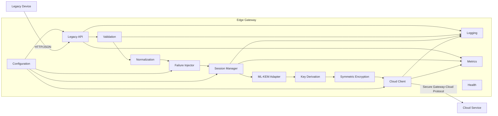

---

# 8. External API: Legacy → Gateway


The gateway receives the contract already designed for the Legacy Device.

```http
POST /api/v1/measurements
Content-Type: application/json
```

Example:

```json
{
  "device_id": "sensor-001",
  "temperature_c": 21.7,
  "humidity_pct": 42.5,
  "timestamp": "2026-09-21T08:20:31Z",
  "sequence_number": 184
}
```

Expected responses are frozen as follows:

| Condition | Response |
|---|---|
| Valid measurement and downstream Cloud delivery succeeds | `202 Accepted` |
| Malformed or unparseable JSON/body syntax | `400 Bad Request` |
| Duplicate or out-of-order sequence rejected by Gateway policy | `409 Conflict` |
| Parsed JSON with missing, wrongly typed, or domain-invalid required fields | `422 Unprocessable Entity` |
| Cloud or secure session temporarily unavailable | `503 Service Unavailable` |
| Internal Gateway error | `500 Internal Server Error` |

The `400` / `422` boundary is frozen project-wide:

```text
malformed or unparseable JSON/body syntax
→ 400 Bad Request

JSON parses, but a required field is missing, has the wrong type,
or violates a domain rule
→ 422 Unprocessable Entity
```

Therefore a Legacy `missing_field` test payload is expected to receive `422`.

The Gateway returns `202` only after the selected downstream transport has accepted the measurement. Therefore, in this initial synchronous design, Legacy success means that the measurement was accepted by the Cloud path as well.

The Legacy Device treats `400`, `409`, and `422` as non-retryable application errors. It treats network failures, timeouts, and selected `5xx` responses as retryable according to its bounded retry policy.

Error bodies should use the common structured form:

```json
{
  "error": {
    "code": "INVALID_MEASUREMENT",
    "message": "measurement validation failed"
  }
}
```

Do not expose stack traces, internal exception names, cryptographic details, or filesystem paths to Legacy clients.

---

# 9. Internal canonical measurement model

The gateway should not use arbitrary dictionaries everywhere.

Create an internal canonical model:

```text
CanonicalMeasurement
```

Fields:

| Field             | Type         |
| ----------------- | ------------ |
| `device_id`       | string       |
| `temperature_c`   | float        |
| `humidity_pct`    | float        |
| `measured_at`     | UTC datetime |
| `sequence_number` | integer      |
| `received_at`     | UTC datetime |
| `gateway_id`      | string       |

The gateway adds:

```text
received_at
gateway_id
```

These are metadata created by the gateway.

Example:

```json
{
  "device_id": "sensor-001",
  "temperature_c": 21.7,
  "humidity_pct": 42.5,
  "measured_at": "2026-09-21T08:20:31Z",
  "sequence_number": 184,
  "received_at": "2026-09-21T08:20:31.218Z",
  "gateway_id": "gateway-001"
}
```

---

# 10. Data model diagram


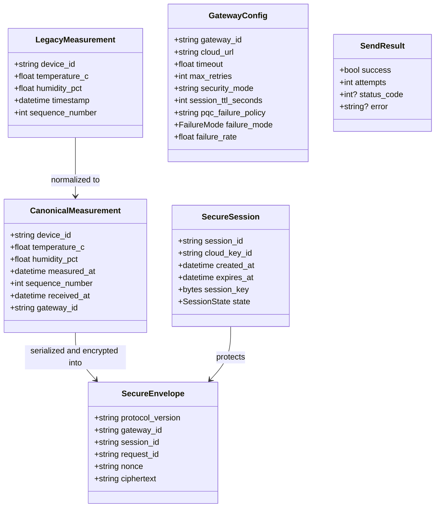

`request_id` is deliberately **not** part of `CanonicalMeasurement`. It is request/transport context created by the Gateway and propagated separately for tracing. In secure mode it is included in the `SecureEnvelope` and authenticated as AAD. In baseline mode it is propagated to the Cloud through the `X-Request-ID` HTTP header.

---

# 11. Validation responsibilities

Legacy request objects contain exactly `device_id`, `temperature_c`,
`humidity_pct`, `timestamp`, and `sequence_number`. Reject additional fields as
schema errors (`422` for parsed JSON), following the shared protocol.

The gateway is the first modern validation boundary.

It should validate at least:

```text
device_id not empty
temperature within accepted protocol range
humidity within 0–100
timestamp parseable
timestamp timezone-aware/UTC
0 <= sequence_number <= 9223372036854775807
```

For example:

```text
temperature valid:
-40 .. 85 °C

humidity:
0 .. 100 %
```

The gateway should reject invalid data before cloud forwarding.

---

# 12. Validation flow

```text
incoming JSON
     ↓
syntax valid?
     │
  no └──> 400
     │
    yes
     ↓
required fields?
     │
  no └──> 422
     │
    yes
     ↓
domain constraints?
     │
  no └──> 422
     │
    yes
     ↓
canonical measurement
```

---

# 13. Duplicate and sequence handling


Since the Legacy Device includes sequence numbers, the Gateway tracks the last valid sequence **observed** for each device.

Use a simple in-memory map:

```text
last_sequence[device_id]
```

The state is keyed by `device_id` so multiple simulated devices remain independent.

Frozen behavior:

| Condition | Action |
|---|---|
| first valid sequence for device | accept |
| new sequence > previous + 1 | accept + log/metric sequence gap |
| new sequence = previous + 1 | accept |
| new sequence = previous | reject as duplicate with `409` |
| new sequence < previous | reject as out-of-order with `409` |

Example:

```text
Received:
40
41
43

→ 43 accepted
→ sequence gap 42 recorded
```

A gap is not automatically invalid because the missing measurement may have been dropped before reaching the Gateway.

## Sequence-state timing

The sequence tracker records the **last valid sequence observed by the Gateway**, not the last sequence successfully stored by the Cloud.

Therefore:

```text
receive seq=10
↓
schema/domain validation succeeds
↓
sequence policy accepts it
↓
last_sequence[device_id] becomes 10
↓
Cloud delivery later fails
```

The Gateway still remembers that sequence `10` was observed.

Cloud-delivery success is a separate concern and must not redefine the meaning of Legacy-side sequence tracking.

This decision is important for retry behavior. If the same Legacy message is resent after the Gateway has already accepted it into sequence state, the Gateway can identify it as a duplicate. The Cloud separately provides idempotency for retransmission on the Gateway→Cloud boundary.

Sequence state is intentionally in memory. Gateway restart therefore loses this history; that limitation is documented as technical debt.

A simple per-device state update must be safe under concurrent requests. A small lock/serialized update is sufficient for this course; no distributed coordination is required.

---

# 14. Gateway → Cloud security model


This is the main modernization path.

The course requires integrating ML-KEM through an existing implementation rather than implementing ML-KEM manually.

The project protocol freezes the secure stack as:

```text
ML-KEM-768
   ↓
shared secret
   ↓
HKDF-SHA-256
   ↓
32-byte session key
   ↓
AES-256-GCM
   ↓
authenticated encrypted cloud messages
```

ML-KEM is used only for key establishment. It is **not** used to encrypt each JSON measurement directly.

The Gateway performs encapsulation using the Cloud's ML-KEM public key. The Cloud performs decapsulation using its ML-KEM private key. Both sides then derive the same temporary symmetric key using the frozen HKDF parameters.

All cryptographic primitives must come from maintained libraries. The team may still choose the concrete libraries during implementation, but the protocol algorithms themselves are no longer open design decisions.

---

# 15. Recommended secure communication layering


The secure communication stack is fixed as follows:

```text
┌─────────────────────────────┐
│ CanonicalMeasurement        │
└──────────────┬──────────────┘
               ▼
┌─────────────────────────────┐
│ Deterministic JSON          │
│ UTF-8 serialization         │
└──────────────┬──────────────┘
               ▼
┌─────────────────────────────┐
│ AES-256-GCM                 │
│ authenticated encryption    │
└──────────────┬──────────────┘
               ▼
┌─────────────────────────────┐
│ 32-byte session key         │
│ derived using HKDF-SHA-256  │
└──────────────┬──────────────┘
               ▼
┌─────────────────────────────┐
│ ML-KEM-768 shared secret    │
└─────────────────────────────┘
```

Frozen KDF contract:

```text
Algorithm:
HKDF-SHA-256

Input key material:
ML-KEM shared secret

Salt:
None

Info/context:
"ml-kem-project:v1:gateway-cloud-session"

Output length:
32 bytes
```

Both Gateway and Cloud must implement these parameters identically.

Frozen AEAD contract:

```text
AES-256-GCM
nonce size = 12 bytes / 96 bits
```

The concrete Python libraries may be selected during implementation, but the protocol must not change because one library exposes a different convenience API.

---

# 16. ML-KEM session establishment


The secure session establishment protocol is frozen.

### 1. Fetch current Cloud public key

```http
GET /api/v1/crypto/public-key
```

Response:

```json
{
  "protocol_version": "1",
  "algorithm": "ML-KEM-768",
  "key_id": "cloud-key-001",
  "public_key": "<base64url>"
}
```

The Gateway validates:

```text
protocol_version == "1"
algorithm == "ML-KEM-768"
key_id is non-empty
public_key is valid Base64URL and valid for the selected ML-KEM library
```

### 2. Gateway encapsulation

The Gateway performs:

```text
ML-KEM-768 encapsulate(public_key)
```

and obtains:

```text
encapsulation_ciphertext
shared_secret
```

The shared secret remains inside Gateway memory.

The Gateway derives the 32-byte session key using the frozen HKDF contract.

### 3. Send encapsulation ciphertext to Cloud

```http
POST /api/v1/crypto/sessions
Content-Type: application/json
```

Request:

```json
{
  "protocol_version": "1",
  "gateway_id": "gateway-001",
  "key_id": "cloud-key-001",
  "encapsulation_ciphertext": "<base64url>"
}
```

The Cloud decapsulates the ciphertext with its private key and derives the same session key.

### 4. Cloud creates session

Response:

```json
{
  "protocol_version": "1",
  "session_id": "sess-...",
  "status": "established",
  "expires_at": "2026-09-21T13:50:31Z"
}
```

The Gateway validates the response before activating the local session.

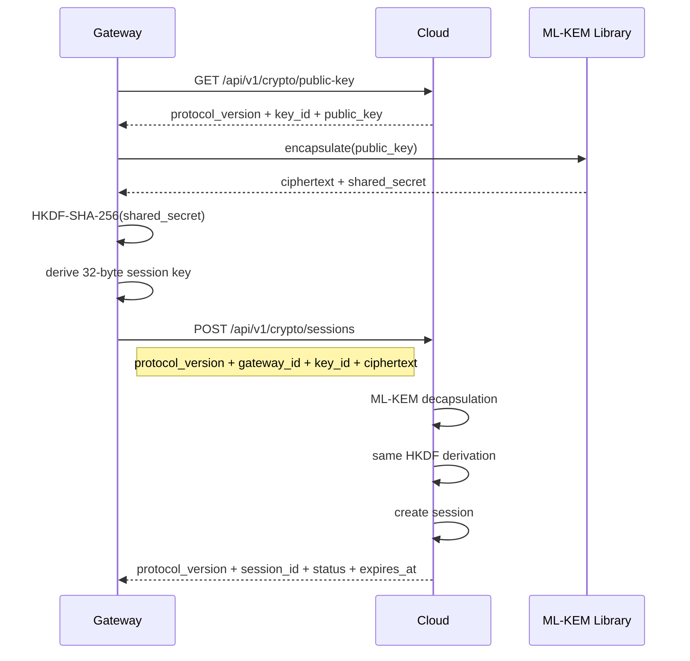

All binary crypto material carried in JSON uses Base64URL encoding.

The exact wrapper calls may differ between maintained libraries, but the network contract above is fixed.

---

# 17. Session model


Do not perform ML-KEM for every measurement.

Maintain a temporary secure session and reuse it for multiple messages.

```text
Gateway starts
     ↓
No secure session
     ↓
ML-KEM handshake
     ↓
Secure session created
     ↓
Measurement 1
Measurement 2
Measurement 3
...
     ↓
Session expires
     ↓
new ML-KEM handshake
```

Gateway session fields:

```text
session_id
cloud_key_id
created_at
expires_at
session_key
state
```

The session belongs to this configured Gateway identity and corresponds to a Cloud-side session with the same `session_id`.

`session_key` remains in process memory only. It is never:

```text
serialized to API output
stored in SQLite
written to disk intentionally
logged
written to AI-history files
```

Python does not guarantee cryptographic memory zeroization. The implementation should clear/dereference old session objects when they are replaced or the Gateway shuts down, while documenting true memory zeroization as outside this project's guarantees.

---

# 18. Session states

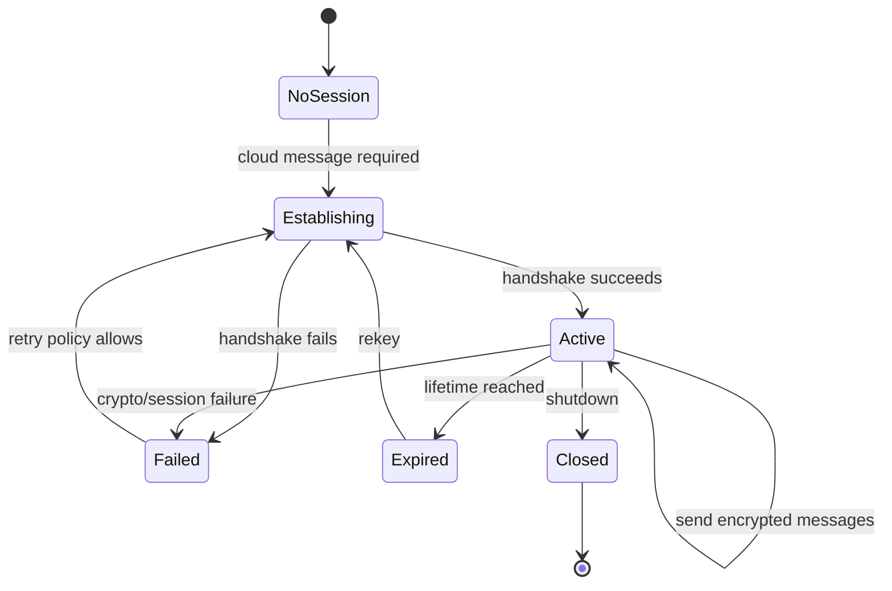

---

# 19. Session lifetime


The project uses **time-based session expiry only**.

Default:

```text
SESSION_TTL_SECONDS=300
```

That means a normal session is valid for approximately five minutes unless the Cloud invalidates it earlier.

```text
session established
↓
multiple secure messages
↓
expires_at reached
↓
Gateway discards local session
↓
new ML-KEM handshake
```

Tests should use a much shorter or mocked TTL so they do not need to wait five real minutes.

Message-count-based rotation is intentionally not part of the initial protocol. It could be added in a future version if needed.

---

# 20. Secure envelope model


Cloud-bound secure measurements use one fixed versioned envelope:

```json
{
  "protocol_version": "1",
  "gateway_id": "gateway-001",
  "session_id": "sess-123",
  "request_id": "req-8fb2...",
  "nonce": "<base64url>",
  "ciphertext": "<base64url>"
}
```

Fields:

| Field | Purpose |
|---|---|
| `protocol_version` | secure protocol compatibility |
| `gateway_id` | identifies sending Gateway |
| `session_id` | identifies active Cloud/Gateway session |
| `request_id` | correlation and authenticated logical-request identity |
| `nonce` | 12-byte AES-GCM nonce encoded as Base64URL |
| `ciphertext` | AES-GCM ciphertext/tag output encoded as Base64URL |

The envelope does **not** contain:

```text
algorithm
authentication_data
shared_secret
session_key
plaintext measurement
```

The crypto suite is fixed by protocol version and configuration; it is not negotiated inside every envelope.

The encrypted plaintext is the serialized `CanonicalMeasurement`.

---

# 21. Associated authenticated data


The following visible metadata is authenticated as AES-GCM associated data:

```text
protocol_version
gateway_id
session_id
request_id
```

The Gateway and Cloud must construct the **same bytes**.

Use one canonical JSON object:

```json
{
  "gateway_id": "gateway-001",
  "protocol_version": "1",
  "request_id": "req-8fb2...",
  "session_id": "sess-123"
}
```

Canonical AAD encoding:

```text
UTF-8
JSON object
sorted keys
fixed compact separators
no irrelevant whitespace differences
```

Conceptually:

```text
AAD = canonical_json({
    "gateway_id": gateway_id,
    "protocol_version": protocol_version,
    "request_id": request_id,
    "session_id": session_id
})
```

Then:

```text
AES-256-GCM(
    key = session_key,
    nonce = 12-byte nonce,
    plaintext = canonical measurement JSON,
    associated_data = AAD
)
```

If an attacker or test modifies any authenticated field, Cloud authentication/decryption must fail.

The AAD encoding contract must have an interoperability test proving that Gateway and Cloud independently produce identical bytes.

---

# 22. Nonce handling


AES-256-GCM uses a **12-byte / 96-bit nonce** for every encryption operation.

Rules:

```text
generate nonce with cryptographically secure system/library randomness
never intentionally reuse the same nonce with the same session key
never derive nonce only from timestamp
never derive nonce only from sequence_number
never use Python's non-cryptographic random module
```

Each new logical secure message receives a newly generated nonce.

For an ordinary transport retry after a timeout, lost response, or otherwise ambiguous response, the Gateway must resend the **same already-built `SecureEnvelope`**:

```text
same request_id
same session_id
same nonce
same ciphertext
same AAD
```

Do not re-encrypt the same plaintext under the same session key for an ordinary transport retry. Re-encryption occurs only after a replacement session is established because of `409 SESSION_INVALID` or `409 SESSION_EXPIRED`.

A new logical request always gets a new `request_id`, nonce, and encryption operation.

---

# 23. Key handling

The gateway must never:

```text
print session key
log shared secret
write session key into AI history
commit keys to Git
return shared secret through API
```

Session keys should ideally remain:

```text
in process memory only
```

for this project.

No HSM or external secret manager is required.

---

# 24. Cloud public-key trust


ML-KEM establishes shared keying material but does not by itself authenticate the identity of the Cloud.

For this course project, the trust assumption is:

> The Gateway trusts the ML-KEM public key returned by the explicitly configured Cloud Service endpoint in the controlled test environment.

The response also contains a `key_id`, which allows both sides to identify which Cloud key is being used.

This is **not production-grade identity authentication**.

Out-of-scope production improvements include:

```text
TLS server authentication
mTLS
public-key pinning
signed key distribution
PKI/certificate lifecycle
HSM/KMS-backed identity keys
```

The project must therefore describe its result precisely as **post-quantum key establishment and authenticated application-payload protection on the Gateway↔Cloud path**, not as a complete production identity/PKI solution.

---

# 25. Security modes


The Gateway supports two explicit modes.

### Baseline Mode

Configuration value:

```text
SECURITY_MODE=classical
```

Meaning:

```text
Gateway sends CanonicalMeasurement
to:
POST /api/v1/baseline/measurements
```

This exists for the initial system, migration comparison, and baseline measurements.

### Modernized Mode

Configuration value:

```text
SECURITY_MODE=mlkem
```

Meaning:

```text
ML-KEM-768 session establishment
+ HKDF-SHA-256
+ AES-256-GCM
+ POST /api/v1/secure/measurements
```

Terminology throughout the project should therefore be:

```text
Baseline Mode     = SECURITY_MODE=classical
Modernized Mode   = SECURITY_MODE=mlkem
```

No third `migration` security mode is required for the initial implementation.

---

# 26. Migration strategy


The migration strategy is deliberately simple:

```text
Stage 1
Legacy Device → Gateway → Cloud
SECURITY_MODE=classical

Stage 2
Gateway and Cloud gain ML-KEM capability

Stage 3
Legacy Device remains unchanged
Gateway/Cloud switch to:
SECURITY_MODE=mlkem

Stage 4
Classical endpoint can later be removed when migration/evaluation is complete
```

The key compatibility property is:

> The Legacy Device protocol does not change when the Gateway→Cloud path is modernized.

The baseline endpoint is retained during the project so the team can demonstrate and measure the before/after system. Its existence must not create an automatic downgrade from modernized mode.

---

# 27. Fallback policy


The initial project implements one security-failure policy:

```text
PQC_FAILURE_POLICY=fail_closed
```

Meaning:

```text
ML-KEM/session/secure-transport failure
        ↓
record safe log + metric
        ↓
return classified failure upstream
        ↓
DO NOT send the measurement to the baseline plaintext endpoint
```

There is no automatic classical fallback in the implementation.

This avoids an ambiguous downgrade path and keeps the migration story small enough for the course.

The baseline endpoint still exists for explicit baseline runs:

```text
SECURITY_MODE=classical
```

but switching from:

```text
SECURITY_MODE=mlkem
```

to baseline behavior requires an explicit configuration change/restart or other explicit operator action. A runtime cryptographic failure must not trigger that transition automatically.

A future production migration design could introduce a carefully controlled fallback policy, but that is outside the initial implementation.

This rule should be enforced by tests:

```text
SECURITY_MODE=mlkem
+ injected ML-KEM failure
→ no call to /api/v1/baseline/measurements
```

---

# 28. Failure injection

Like the Legacy Device, the Edge Gateway should have controlled fault injection.

This is valuable because the gateway has far more interesting failure points:

```text
validation
processing
ML-KEM
session management
encryption
cloud transport
cloud response
```

The failure-injection subsystem should remain clearly separated from normal logic.

---

# 29. Gateway failure-injection architecture

```text
Incoming Measurement
        ↓
Validation
        ↓
Normalization
        ↓
┌──────────────────────┐
│ Failure Injection    │
└──────────┬───────────┘
           ↓
Secure Session
           ↓
Encryption
           ↓
Cloud Client
```

But some failures need injection at different stages.

Better conceptual architecture:

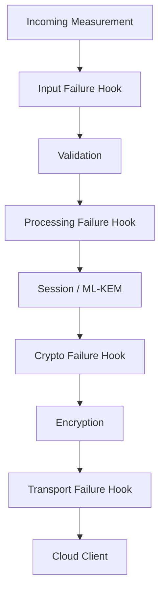

---

# 30. Proposed failure modes

Start with a controlled list.

### Processing failures

```text
force_validation_error
force_internal_error
processing_delay
```

### ML-KEM/session failures

```text
mlkem_handshake_failure
corrupt_encapsulation_ciphertext
session_expired
session_missing
```

### Encryption failures

```text
encryption_failure
invalid_nonce_simulation
```

Be careful with intentionally unsafe crypto behavior: use failures to test rejection paths, not to create insecure production behavior.

### Cloud transport failures

```text
cloud_timeout
cloud_connection_error
cloud_500
cloud_503
```

### Message failures

```text
drop_message
duplicate_forward
delayed_forward
```

---

# 31. Recommended initial gateway failure modes

To avoid overengineering, initial implementation could support:

```text
none
processing_error
mlkem_handshake_failure
corrupt_ciphertext
cloud_timeout
cloud_unavailable
drop_message
random
```

That covers most meaningful system paths.

---

# 32. Failure configuration

Proposed:

```text
FAILURE_MODE=none
FAILURE_RATE=0.0
FAILURE_SEED=
```

Same concept as Legacy Device.

Validation:

```text
0.0 <= FAILURE_RATE <= 1.0
```

Optional future setting:

```text
FAILURE_STAGE=
```

But `FAILURE_MODE` alone may be enough if each scenario already maps to a stage.

---

# 33. Failure-injection principles

The injector must:

- be disabled by default;
    
- not alter normal production-like behavior when disabled;
    
- log when a failure is deliberately injected;
    
- never add hidden testing flags to cloud payloads;
    
- support deterministic seeded tests where needed;
    
- never expose actual secret key material;
    
- remain isolated from core crypto code.
    

---

# 34. ML-KEM failure simulation


Example:

```text
FAILURE_MODE=mlkem_handshake_failure
FAILURE_RATE=1.0
```

Sequence:

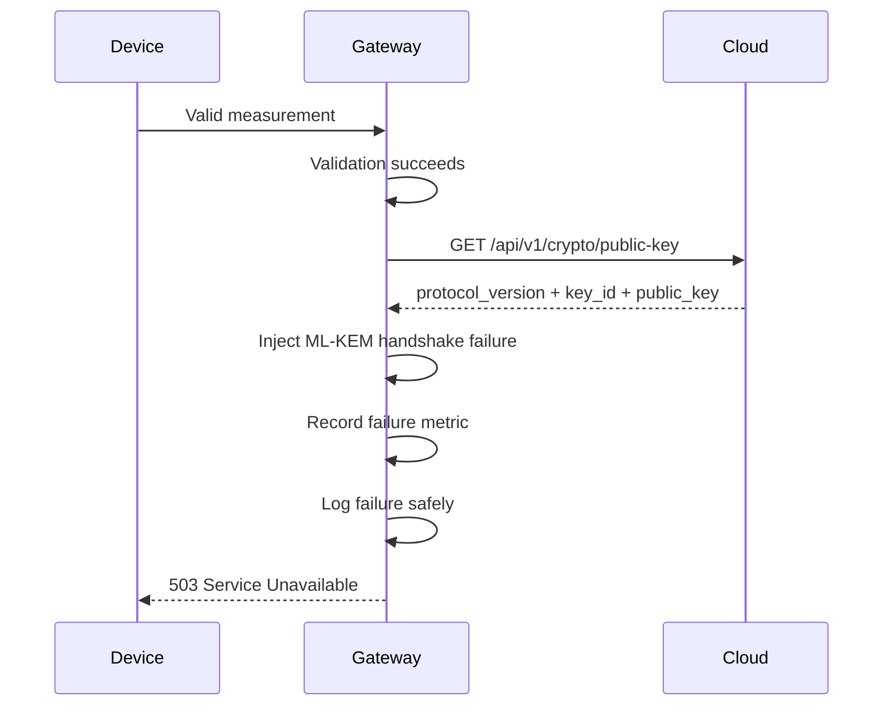

Because the implemented policy is `fail_closed`, the Gateway must **not** call `/api/v1/baseline/measurements` after the simulated ML-KEM failure.

---

# 35. Corrupt-ciphertext simulation

This is particularly useful for demonstrating cloud rejection.

```text
Gateway performs correct encryption
          ↓
Failure injector corrupts ciphertext
          ↓
Cloud receives corrupted payload
          ↓
Authentication/decryption fails
          ↓
Cloud rejects
          ↓
Gateway records failure
```

This provides a meaningful security failure demonstration.

---

# 36. Cloud-timeout simulation

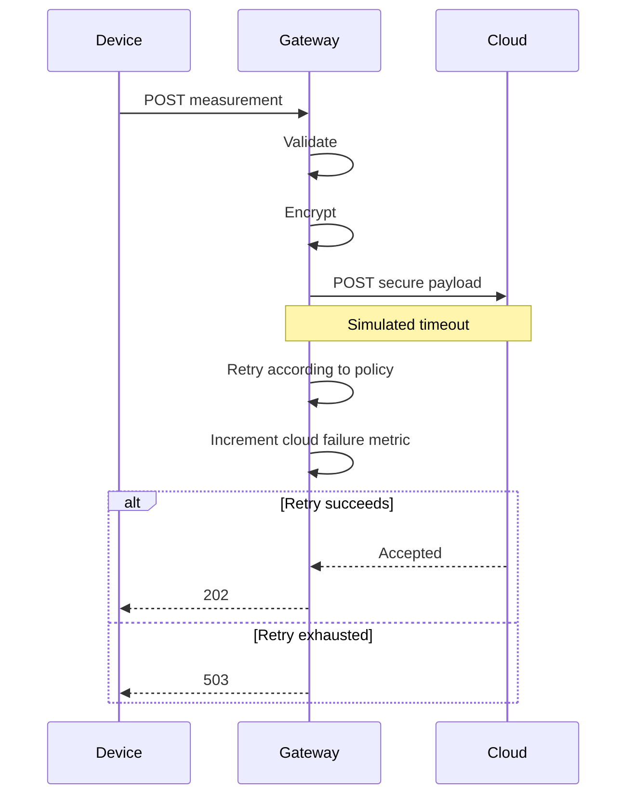

---

# 37. Gateway configuration


Recommended environment variables:

| Variable | Example/default |
|---|---|
| `GATEWAY_ID` | `gateway-001` |
| `HOST` | `0.0.0.0` |
| `PORT` | `8000` |
| `CLOUD_URL` | `http://cloud-service:9000` |
| `CLOUD_TIMEOUT_SECONDS` | `3` |
| `CLOUD_MAX_RETRIES` | `2` |
| `SECURITY_MODE` | `mlkem` |
| `SESSION_TTL_SECONDS` | `300` |
| `PQC_FAILURE_POLICY` | `fail_closed` |
| `FAILURE_MODE` | `none` |
| `FAILURE_RATE` | `0.0` |
| `FAILURE_SEED` | empty |
| `LOG_LEVEL` | `INFO` |

For the initial implementation:

```text
SECURITY_MODE ∈ {classical, mlkem}

PQC_FAILURE_POLICY = fail_closed
```

The policy variable is kept explicit so the security behavior is visible in configuration and documentation, but `fail_closed` is the only supported runtime value in the initial version.

The crypto suite is **not configurable** in the first version:

```text
ML-KEM-768
HKDF-SHA-256
AES-256-GCM
```

This avoids accidental Gateway/Cloud algorithm mismatch and unnecessary configuration complexity.

---

# 38. Configuration validation


The following configuration must fail startup:

```text
empty GATEWAY_ID
invalid PORT
empty/invalid CLOUD_URL
CLOUD_TIMEOUT_SECONDS <= 0
CLOUD_MAX_RETRIES < 0
SESSION_TTL_SECONDS <= 0
FAILURE_RATE < 0
FAILURE_RATE > 1
unknown SECURITY_MODE
unknown FAILURE_MODE
PQC_FAILURE_POLICY != fail_closed
```

Behavior:

```text
startup
 ↓
load config
 ↓
validate
 ↓
invalid?
 ↓
log clear safe configuration error
 ↓
exit non-zero
```

The Gateway must not start in a partially valid or ambiguously secured configuration.

---

# 39. Cloud client retry strategy


Gateway→Cloud communication uses explicit timeout and bounded retry.

### Retryable transport/service failures

```text
timeout
connection failure
HTTP 500
HTTP 502
HTTP 503
HTTP 504
```

### Non-retryable application/security failures

```text
HTTP 400
HTTP 422
unsupported protocol version
cryptographic rejection caused by malformed/tampered secure payload
```

### Session-recovery condition

The secure protocol uses:

```text
HTTP 409 Conflict
```

with structured error codes such as:

```text
SESSION_INVALID
SESSION_EXPIRED
```

A `409` session error is **not** treated like a normal repeated HTTP retry.

Instead:

```text
invalidate local session
↓
fetch current Cloud public key
↓
establish a new ML-KEM session
↓
retry the same logical secure request once
```

That session-recovery attempt is bounded. If recovery fails again, return failure upstream.

Default transport retry count:

```text
CLOUD_MAX_RETRIES=2
```

which means one initial attempt plus at most two transport retries.

---

# 40. Retry behavior

Example:

```text
Attempt 1
   ↓ failure
wait 1 sec
   ↓
Attempt 2
   ↓ failure
wait 2 sec
   ↓
Attempt 3
   ↓ failure
return failure upstream
```

Keep it bounded.

No infinite retries.

---

# 41. Message buffering

Initially:

```text
No persistent queue.
```

If cloud forwarding fails after retry exhaustion:

```text
gateway reports failure to legacy device
```

and does not retain the message permanently.

This is another explicit technical-debt item.

A future production system could use:

```text
persistent local queue / store-and-forward
```

but that is outside the initial course project.

---

# 42. Request handling sequence


The Legacy-facing processing pipeline is identical in both security modes through canonicalization.

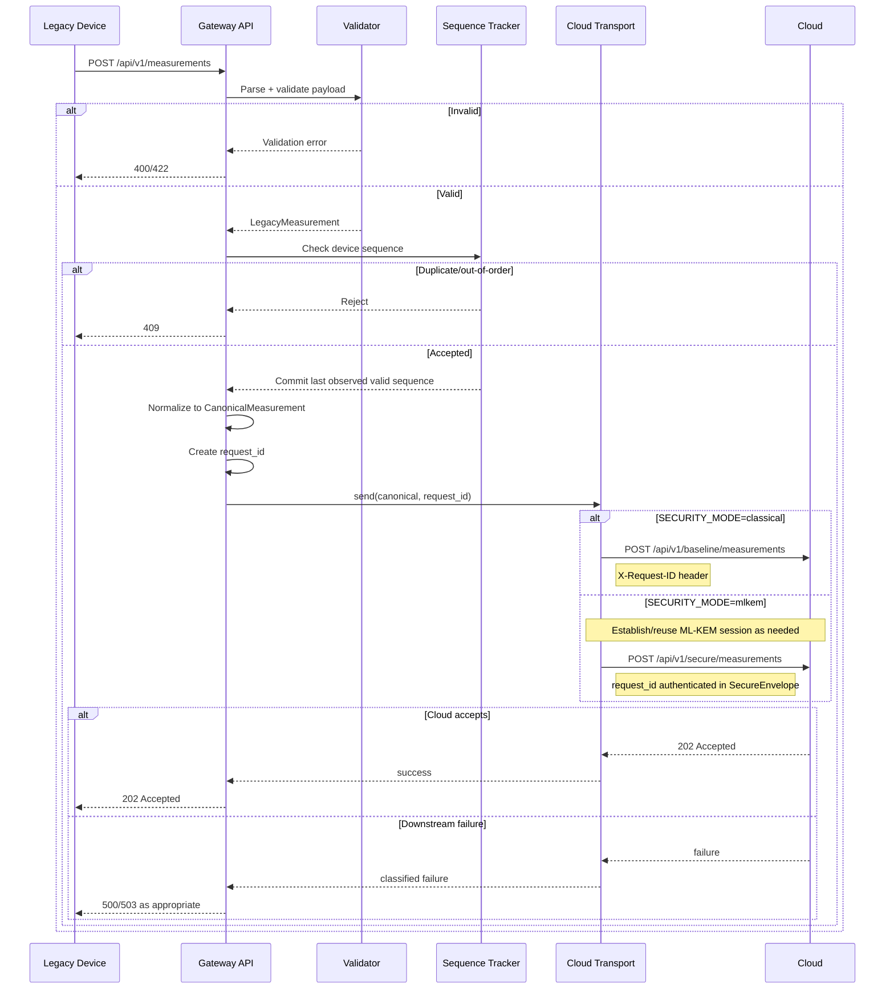

The route remains application-level and must not contain ML-KEM or AES-GCM implementation details. It delegates to a selected Cloud transport abstraction.

---

# 43. API endpoints

Recommended gateway API:

```text
POST /api/v1/measurements
GET  /health
GET  /ready
GET  /metrics
```

Potentially:

```text
GET /version
```

but not necessary.

### `/health`

Process health.

### `/ready`

Can the gateway perform useful work?

For example:

```json
{
  "status": "ready",
  "cloud": "reachable",
  "security_mode": "mlkem"
}
```

Avoid exposing sensitive crypto internals.

---

# 44. Liveness vs readiness

Useful distinction:

### Liveness

```text
Is the gateway process alive?
```

`/health`

### Readiness

```text
Can it currently accept/process traffic?
```

`/ready`

For example:

```text
process alive
but
configuration invalid
or required Cloud dependency unavailable
or secure transport subsystem failed to initialize
```

could mean:

```text
health = OK
ready = NOT READY
```

An **inactive secure session by itself must not make the Gateway unready**. Sessions are established lazily when secure traffic requires them.

This is useful operational design without becoming too complex.

---

# 45. Logging strategy

Gateway logs are more important than Legacy Device logs.

Recommended events:

```text
gateway_starting
gateway_ready
legacy_measurement_received
legacy_validation_failed
duplicate_sequence_detected
out_of_order_sequence_detected
sequence_gap_detected

mlkem_handshake_started
mlkem_handshake_succeeded
mlkem_handshake_failed
session_created
session_expired

cloud_delivery_started
cloud_delivery_succeeded
cloud_delivery_retry
cloud_delivery_failed

failure_injected

gateway_shutting_down
```

---

# 46. What not to log

Never log:

```text
ML-KEM private key
ML-KEM shared secret
derived session key
raw symmetric key
password/token
full secret configuration
```

Potentially avoid logging full ciphertext too unless truly needed.

Logging identifiers is usually enough:

```text
device_id
gateway_id
sequence_number
session_id
request_id
```

---

# 47. Correlation/request IDs


The Gateway creates a unique correlation identifier for every accepted Legacy request.

Example:

```text
request_id=req-8fb2...
```

`request_id` is request/transport context. It is **not** a field of `CanonicalMeasurement`.

Propagation is mode-specific.

### Baseline Mode

For:

```http
POST /api/v1/baseline/measurements
```

send:

```http
X-Request-ID: req-8fb2...
```

The canonical JSON body remains unchanged.

### Modernized Mode

`request_id` is included in:

```text
SecureEnvelope.request_id
```

and is part of authenticated AAD.

The Gateway may additionally send `X-Request-ID` for HTTP-layer diagnostics, but the authenticated envelope value is the protocol-authoritative value.

This gives the trace:

```text
Legacy request
↓
Gateway request_id=req-8fb2
↓
Gateway log
↓
Cloud request
↓
Cloud log with same request_id
```

Never use `request_id` as cryptographic key material or as an unbounded Prometheus label.

---

# 48. Metrics


The Gateway exposes meaningful application, transport, failure, and PQC metrics.

### Legacy input

```text
gateway_measurements_received_total
gateway_measurements_accepted_total
gateway_measurements_rejected_total
gateway_duplicate_measurements_total
gateway_out_of_order_measurements_total
gateway_sequence_gaps_total
```

### Cloud delivery

```text
gateway_cloud_requests_total
gateway_cloud_failures_total
gateway_cloud_retries_total
gateway_cloud_request_duration_seconds
```

### PQC/session

```text
gateway_mlkem_handshakes_total
gateway_mlkem_handshake_failures_total
gateway_mlkem_handshake_duration_seconds
gateway_session_reestablishments_total
gateway_encryption_failures_total
gateway_active_session
gateway_pqc_fallback_total
```

`gateway_pqc_fallback_total` should remain zero in the initial implementation because the only supported policy is `fail_closed`. Keeping the metric makes an unintended downgrade observable.

### Failure injection

```text
gateway_injected_failures_total
```

Metric labels must remain bounded. Do not use:

```text
request_id
session_id
arbitrary device_id
```

as uncontrolled labels.

Prefer labels such as:

```text
result
reason
failure_type
security_mode
status_class
```

---

# 49. Metrics philosophy

Metrics should answer useful questions:

```text
Are devices sending data?

How much is rejected?

Can cloud communication succeed?

Is ML-KEM failing?

How expensive is the handshake?

Is failure injection currently exercising negative paths?
```

Don't create metrics simply because Prometheus supports them.

---

# 50. Baseline versus modernized metrics

This gateway allows useful comparisons.

Baseline:

```text
classical/cloud handshake latency
request latency
payload size
```

Modernized:

```text
ML-KEM handshake duration
secure payload size
overall forwarding latency
```

These measurements can support your final evaluation.

---

# 51. Health model

Conceptual health status:

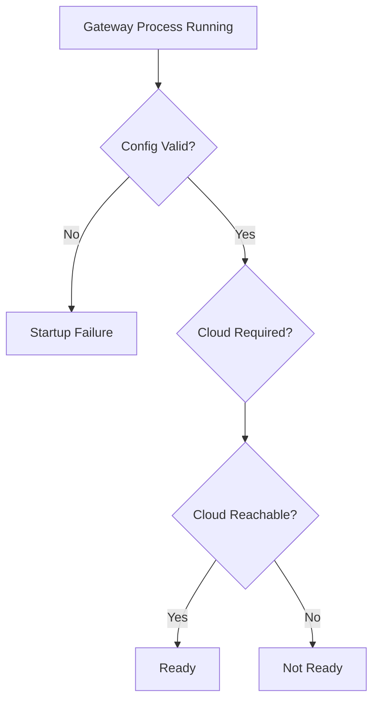

No health endpoint should reveal private crypto material.

---

# 52. Startup sequence

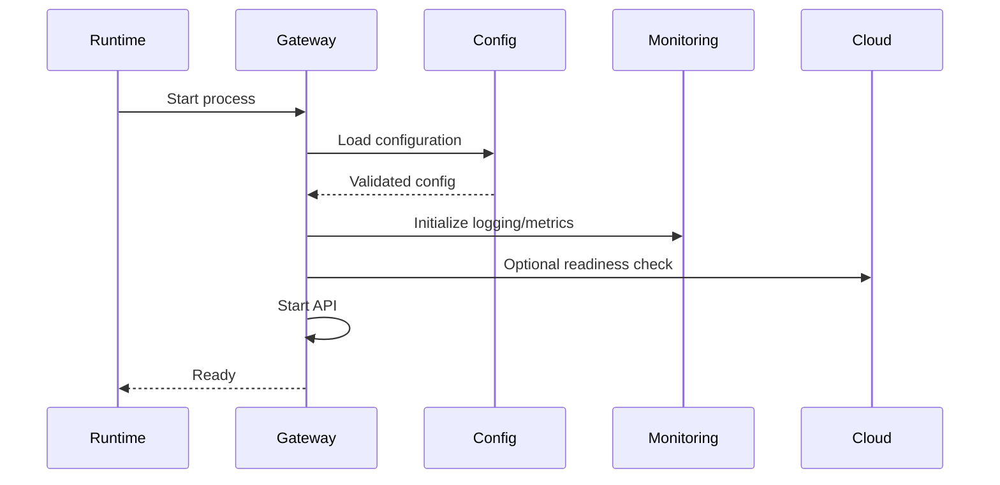

ML-KEM session establishment is **lazy** in the initial design:

```text
Gateway starts
↓
secure transport subsystem is initialized
↓
no active session is required yet
↓
first secure message establishes/reuses a session as needed
```

This allows the Gateway to start independently and establish PQC only when necessary.

---

# 53. Shutdown sequence

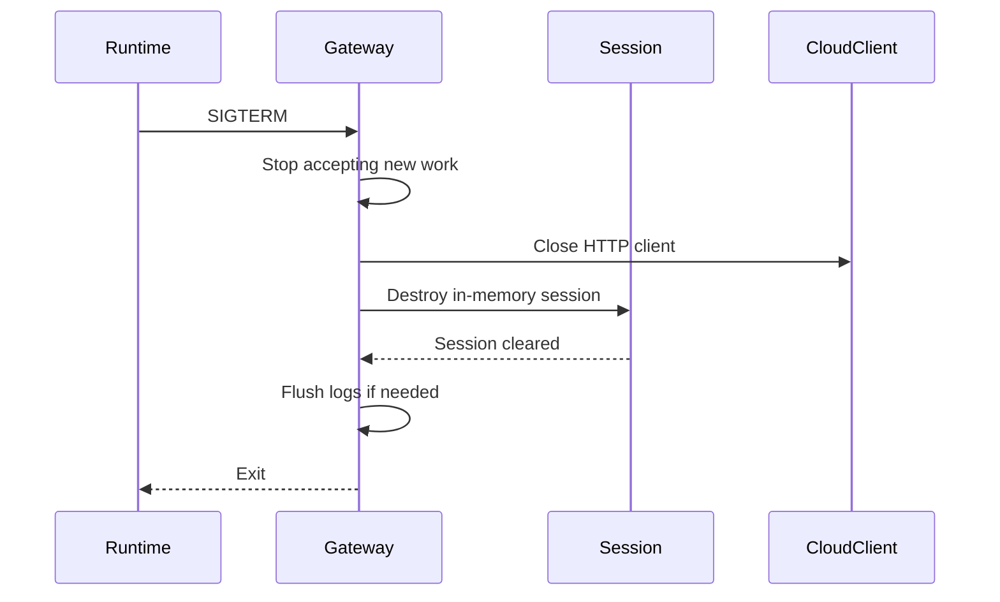

In-memory key material should no longer be referenced after shutdown.

---

# 54. Failure handling matrix


| Failure | Expected Gateway behavior |
|---|---|
| Invalid legacy JSON | `400` |
| Invalid temperature/humidity/timestamp/schema | `422` |
| Duplicate sequence | `409` + log/metric |
| Out-of-order sequence | `409` + log/metric |
| Sequence gap | accept + log/metric |
| Cloud timeout | bounded transport retry |
| Cloud `503` | bounded transport retry |
| Cloud `422` | no retry |
| Unsupported protocol version | no retry / protocol failure |
| ML-KEM establishment failure | safe log + metric + `fail_closed` |
| Encryption failure | fail request; no plaintext fallback |
| `409 SESSION_INVALID` | invalidate session + one bounded session recovery |
| `409 SESSION_EXPIRED` | invalidate session + one bounded session recovery |
| Secure cryptographic rejection | no blind retry of malformed payload |
| Failure injection triggered | execute deterministic configured scenario |
| Invalid config | startup fails |
| SIGTERM | graceful shutdown |

---

# 55. Failure policy for ML-KEM


The Gateway distinguishes transport failures from cryptographic/security failures.

Example:

```text
Cloud timeout while requesting public key
→ retry transport within bounded policy
```

versus:

```text
ML-KEM operation fails
→ security failure
→ metric + safe log
→ fail request
→ never call baseline endpoint automatically
```

The initial implementation's only supported policy is:

```text
PQC_FAILURE_POLICY=fail_closed
```

This must be covered by an integration test that records/inspects Cloud calls and proves that an injected ML-KEM failure in `SECURITY_MODE=mlkem` results in **zero** calls to:

```text
POST /api/v1/baseline/measurements
```

---

# 56. Security properties we want

Our gateway-cloud design should aim to provide:

```text
confidentiality
integrity/authentication of application payload
post-quantum key establishment
explicit failure handling
no silent downgrade
secret-safe logging
```

But we should not claim this makes the entire system "quantum secure" or "fully secure."

The Legacy Device → Gateway path still has legacy limitations.

---

# 57. Threat boundaries

```text
Legacy Device → Gateway
```

Risks:

```text
weak/no authentication
plaintext local network traffic
malformed input
duplicate/out-of-order messages
```

```text
Gateway → Cloud
```

Modernization should address:

```text
key establishment
payload confidentiality
payload integrity
failure visibility
session handling
```

---

# 58. Failure-injection threat simulation

Gateway failure injection allows controlled testing of:

```text
availability failures
crypto failures
corrupted protected messages
cloud failures
processing failures
message drops
```

This is for testing only.

It should never be enabled accidentally in normal execution.

Potential safeguard:

```text
FAILURE_MODE default = none
```

and startup log:

```text
WARNING failure injection enabled
```

whenever not `none`.

---

# 59. Failure mode status exposure

A health/readiness endpoint may expose only a safe indicator:

```json
{
  "failure_injection": "enabled"
}
```

or perhaps:

```json
{
  "simulation_mode": true
}
```

But you may choose not to expose it through the network.

At minimum, log it clearly at startup.

---

# 60. Testing strategy

The gateway should have broad testing because it is the central component.

Testing layers:

```text
Unit tests
    ↓
Component tests
    ↓
Legacy integration tests
    ↓
Cloud integration tests
    ↓
Security/failure tests
    ↓
End-to-end tests
```

---

# 61. Validation tests

Test:

```text
valid measurement accepted
missing device ID rejected
temperature too high rejected
humidity below zero rejected
invalid timestamp rejected
negative sequence rejected
```

---

# 62. Sequence tests


Test:

```text
first message accepted
next sequence accepted
duplicate detected → 409
older sequence detected → 409
sequence gap detected but accepted
two device IDs tracked independently
```

Also test the frozen state-timing rule:

```text
valid seq=10 observed
↓
Cloud forwarding later fails
↓
last_sequence[device] remains 10
```

and verify concurrent same-device updates do not corrupt state.

---

# 63. Session tests

Test:

```text
no session → handshake triggered
active session reused
expired session renewed
failed handshake does not create active session
session cleared during shutdown
```

---

# 64. ML-KEM adapter tests

Once the library is chosen, test at wrapper level:

```text
encapsulation succeeds
gateway/cloud derive the same shared secret through integration
malformed/incorrect-length input is handled safely where detectable
library exceptions are translated safely
no secret is emitted to logs
```

Do **not** assume that every modified, valid-length ML-KEM ciphertext must cause an explicit decapsulation exception. ML-KEM implementations may use implicit-rejection behavior, so a modified ciphertext can lead to different pseudorandom keying material instead of a convenient "invalid ciphertext" error.

End-to-end mismatch/rejection should therefore be verified through the secure protocol, while explicit `mlkem_handshake_failure` / decapsulation-failure injection is used to test operational failure handling.

Do not test ML-KEM's mathematical internals. The maintained library is responsible for that.

---

# 65. Symmetric-crypto tests


Test the frozen AES-256-GCM/AAD contract:

```text
encrypt/decrypt round trip

32-byte session key accepted

12-byte nonce used

modified ciphertext rejected

wrong key rejected

modified nonce rejected

modified protocol_version AAD rejected

modified gateway_id AAD rejected

modified session_id AAD rejected

modified request_id AAD rejected

Gateway and Cloud construct identical AAD bytes
```

Also verify that a secure envelope does not expose plaintext `CanonicalMeasurement` JSON.

Use established cryptographic-library functionality; do not implement AES-GCM manually.

---

# 66. Cloud client tests


Test:

```text
baseline 202 success
secure 202 success

timeout
connection failure
retryable 500/502/503/504
non-retryable 400/422
retry exhaustion
eventual transport success

409 SESSION_INVALID
→ local session invalidated
→ one new handshake
→ logical request retried once

409 SESSION_EXPIRED
→ same bounded recovery behavior
```

Also verify:

```text
SECURITY_MODE=classical
→ POST /api/v1/baseline/measurements
→ X-Request-ID present

SECURITY_MODE=mlkem
→ POST /api/v1/secure/measurements
→ request_id present in SecureEnvelope
→ no baseline POST on crypto failure
```

---

# 67. Failure-injection tests

Test every supported failure mode.

Examples:

```text
none
→ no behavior changed

mlkem_handshake_failure
→ handshake forced to fail

corrupt_ciphertext
→ protected message altered

cloud_timeout
→ transport timeout simulated

drop_message
→ cloud forwarding skipped

random + seed
→ deterministic sequence
```

---

# 68. Logging-security tests

Particularly useful:

```text
Generate known fake secret
      ↓
exercise ML-KEM/session code
      ↓
capture logs
      ↓
assert fake secret is absent
```

This directly demonstrates critical security evaluation.

---

# 69. Health tests

Test:

```text
healthy state
not-ready when cloud unavailable if configured that way
no sensitive data in health response
```

---

# 70. Integration tests: Legacy → Gateway

Examples:

```text
valid device payload
→ 202 if full downstream succeeds

invalid humidity
→ 422

duplicate sequence
→ expected duplicate behavior

failure-injected legacy payload
→ gateway validates/rejects correctly
```

---

# 71. Integration tests: Gateway → Cloud


Test both Gateway→Cloud modes.

### Baseline Mode

```text
SECURITY_MODE=classical
↓
POST /api/v1/baseline/measurements
↓
Cloud accepts CanonicalMeasurement
↓
X-Request-ID propagated
```

### Modernized Mode

```text
GET /api/v1/crypto/public-key
↓
ML-KEM-768 encapsulation
↓
POST /api/v1/crypto/sessions
↓
HKDF-SHA-256 key agreement
↓
AES-256-GCM SecureEnvelope
↓
POST /api/v1/secure/measurements
↓
Cloud decrypts same CanonicalMeasurement
```

Required secure scenarios:

```text
session reuse
session expiry/re-establishment
same KDF output on both sides
same AAD bytes on both sides
corrupted ciphertext rejected
AAD tampering rejected
unknown session recovered once
expired session recovered once
fail-closed behavior: zero baseline-endpoint calls after secure/ML-KEM failure
```

---

# 72. End-to-end tests

Eventually:

```text
Legacy Device
      ↓
Gateway
      ↓
ML-KEM session
      ↓
Encrypted cloud message
      ↓
Cloud decrypts
      ↓
stored measurement matches original
```

Also:

```text
Legacy invalid data
      ↓
Gateway rejects
      ↓
Cloud receives nothing
```

And:

```text
Gateway corrupt_ciphertext failure
      ↓
Cloud rejects
      ↓
appropriate gateway failure recorded
```

---

# 73. Baseline design


The Gateway must first support a working baseline before PQC modernization.

Terminology:

```text
Baseline Mode = SECURITY_MODE=classical
```

Architecture:

```text
Legacy Device
      ↓
Gateway
      ↓
POST /api/v1/baseline/measurements
      ↓
Cloud
```

Payload is the plain `CanonicalMeasurement`.

The Gateway propagates request correlation using:

```http
X-Request-ID: req-...
```

The baseline is intentionally simpler and does not provide the application-layer ML-KEM/AES-GCM protection of the modernized mode.

Before modernization, record:

```text
baseline Gateway→Cloud latency
baseline end-to-end latency
baseline payload size
baseline test results
baseline failure/retry behavior
baseline logs/metrics
```

The baseline implementation should be frozen/tagged before the secure transport is introduced so the comparison is genuine.

---

# 74. Modernized design


Terminology:

```text
Modernized Mode = SECURITY_MODE=mlkem
```

Architecture:

```text
Legacy Device
      ↓
Gateway validates + canonicalizes
      ↓
GET /api/v1/crypto/public-key
      ↓
ML-KEM-768 session establishment
      ↓
HKDF-SHA-256 → 32-byte session key
      ↓
AES-256-GCM
      ↓
SecureEnvelope
      ↓
POST /api/v1/secure/measurements
      ↓
Cloud
```

The same Legacy Device interface remains unchanged.

Compare baseline and modernized modes using the same workload:

```text
functional behavior
first-message latency
steady-state latency
payload size
session-establishment overhead
failure behavior
operational visibility
```

The first secure message should be measured separately because it includes session establishment. Subsequent messages normally reuse the session.

---

# 75. Deployment

Gateway runs in its own Docker container.

Conceptually:

```yaml
edge-gateway:
  build: ./edge_gateway
  ports:
    - "8000:8000"
  environment:
    GATEWAY_ID: gateway-001
    CLOUD_URL: http://cloud-service:9000
    SECURITY_MODE: mlkem
    PQC_FAILURE_POLICY: fail_closed
    FAILURE_MODE: none
```

In the final Compose network:

```text
legacy-device
     ↓
edge-gateway
     ↓
cloud-service
```

---

# 76. Container health check

Unlike Legacy Device, the gateway should have a container-level health check.

For example:

```text
GET /health
```

Potential Compose health check:

```text
curl /health
```

Exact syntax can be implemented later.

---

# 77. Dependency philosophy

The gateway will naturally have more dependencies than Legacy Device.

Potential categories:

```text
API framework
HTTP client
configuration/model validation
maintained ML-KEM library
maintained symmetric cryptography library
metrics library if needed
```

Do not add dependencies without clear use.

Especially:

```text
do not implement ML-KEM manually
```

which matches the course requirement.

---

# 78. Observability architecture

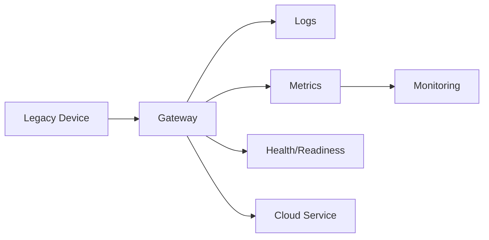

This satisfies the operational side of the course more directly than the Legacy Device.

---

# 79. Request tracing

Useful request lifecycle:

```text
device_id=sensor-001
sequence=184
request_id=abc123
session_id=sess42
```

These identifiers let you correlate:

```text
Legacy message
Gateway logs
Cloud logs
```

without storing sensitive contents.

---

# 80. Concurrency

FastAPI or equivalent may receive multiple device requests concurrently.

Avoid global mutable state where possible.

Particular concern:

```text
session creation
```

If two requests arrive with no session:

```text
Request A → establish session
Request B → establish session simultaneously
```

The session manager should avoid creating conflicting sessions.

For this course, a simple async lock may be enough.

Do not build a distributed locking system.

---

# 81. Multiple legacy devices

The gateway should support:

```text
sensor-001
sensor-002
sensor-003
```

without separate endpoints.

All use:

```text
POST /api/v1/measurements
```

`device_id` distinguishes them.

Sequence tracking should therefore be keyed by:

```text
device_id
```

---

# 82. Gateway identity

Configure:

```text
GATEWAY_ID=gateway-001
```

Cloud-bound canonical messages can include this.

This helps when multiple gateways are simulated later.

But multi-gateway orchestration is out of scope initially.

---

# 83. Graceful degradation

We should not confuse graceful degradation with insecure downgrade.

Acceptable:

```text
metrics temporarily unavailable
→ core message flow continues
```

Potentially unacceptable:

```text
ML-KEM fails
→ silently disable encryption
```

Security-critical failures follow the frozen protocol-v1 policy:

```text
PQC_FAILURE_POLICY=fail_closed
```

They must not trigger an automatic switch to the baseline plaintext endpoint.

---

# 84. Technical debt

Potential acknowledged limitations:

### In-memory session storage

Gateway restart loses active session.

Future:

```text
durable session/secure key infrastructure
```

### Simplified cloud public-key trust

No full PKI.

### No persistent message buffer

Cloud downtime may result in failed measurements.

### Simple retry policy

Not production-grade adaptive retry.

### Single gateway process

No clustering/high availability.

### Simplified sequence tracking

In-memory only.

### No dedicated cryptographic anti-replay counter/window

Protocol version `1` relies on authenticated encryption plus Cloud business idempotency on `(device_id, sequence_number)`, but it does **not** implement a dedicated per-session replay counter/window.

Future:

```text
per-session authenticated counter
or
replay window
```

This limitation must be described as technical debt; business idempotency is not cryptographic replay protection.

### Test/simulation failure injection

Designed for course testing, not production software.

### Simplified key lifecycle

No enterprise-grade rotation infrastructure.

All of these are useful items for the final technical-debt evaluation the assignment expects.

---

# 85. Out-of-scope list

Explicitly exclude:

```text
Kubernetes
distributed gateway cluster
production PKI
hardware security module
persistent message broker
device provisioning service
OAuth/user login
admin dashboard
firmware OTA
real industrial protocols
full certificate lifecycle
service mesh
cloud autoscaling
```

---

# 86. AI-assisted implementation strategy

The gateway is large enough that it should not be one giant AI task.

Possible tasks:

```text
Task 1 — Gateway application skeleton and configuration

Task 2 — Legacy measurement endpoint and validation

Task 3 — Normalization and sequence tracking

Task 4 — Cloud client

Task 5 — ML-KEM adapter

Task 6 — Session manager

Task 7 — Symmetric crypto wrapper

Task 8 — Secure cloud protocol

Task 9 — Failure injection

Task 10 — Health and readiness

Task 11 — Logging and metrics

Task 12 — Gateway unit tests

Task 13 — Gateway-cloud integration tests

Task 14 — Docker/deployment
```

Each should follow your AI-history process.

That gives you excellent evidence for the course's requirement to critically evaluate AI-generated artifacts.

---

# 87. Human-review focus areas

For gateway-related AI code, reviewers should pay special attention to:

```text
incorrect crypto library usage
logging secrets
incorrect nonce handling
silent fallback
bad session state
overly broad exception handling
timeouts missing
retry loops infinite
validation bypass
unbounded metric labels
race conditions during session creation
unnecessary dependencies
```

This is arguably the most security-sensitive component.

---

# 88. Complete gateway state model

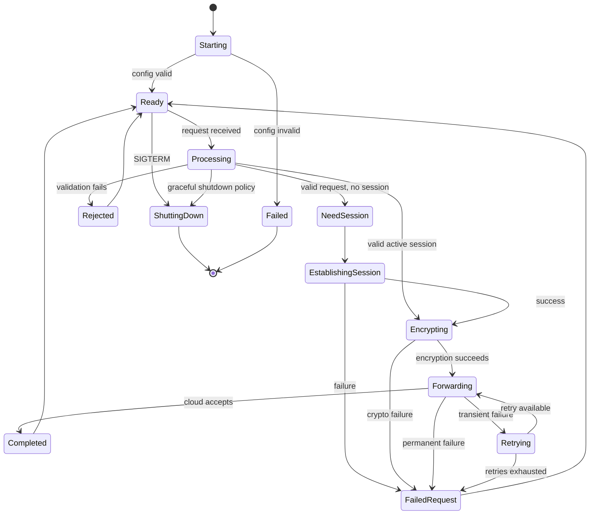

---

# 89. Normal end-to-end sequence


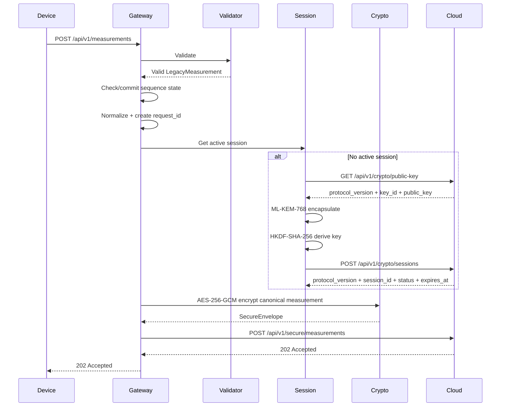

---

# 90. Legacy validation failure sequence

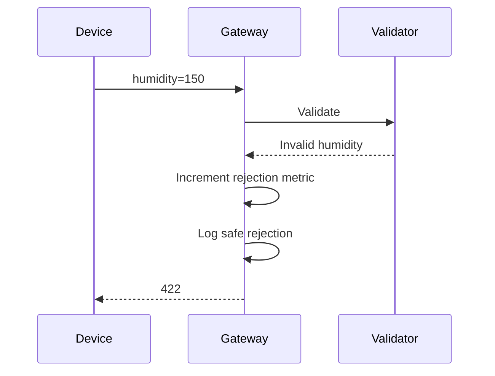

No cloud communication occurs.

---

# 91. ML-KEM failure sequence


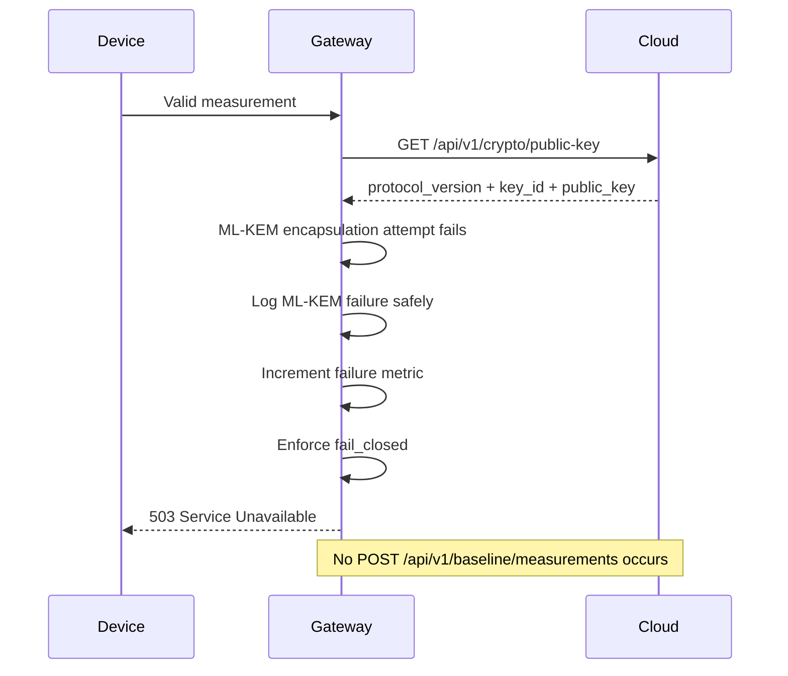

---

# 92. Corrupted secure message sequence

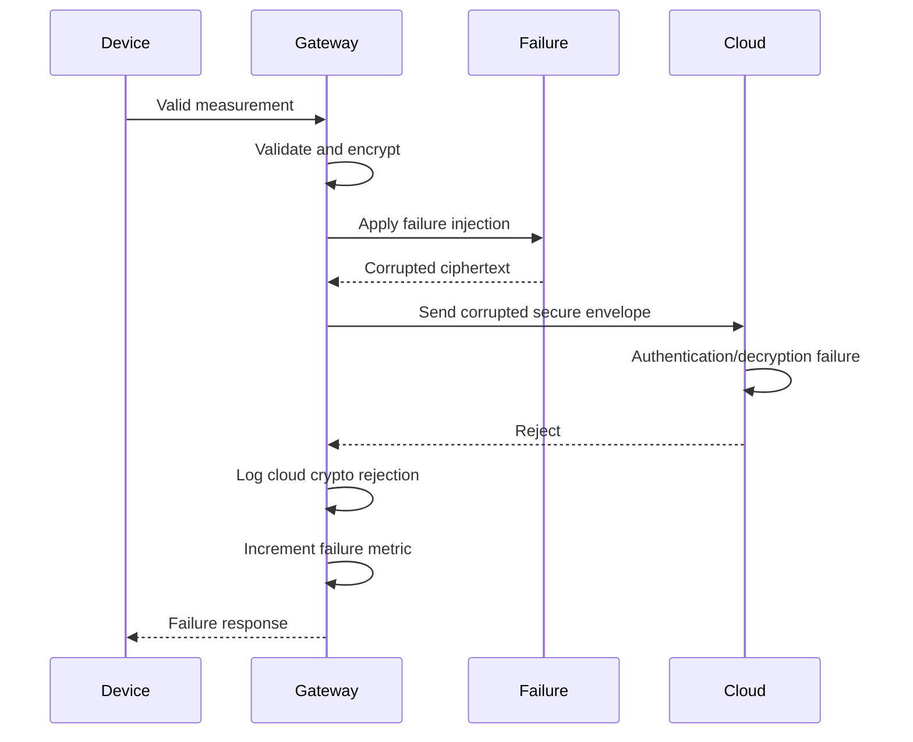

---

# 93. Complete architecture diagram

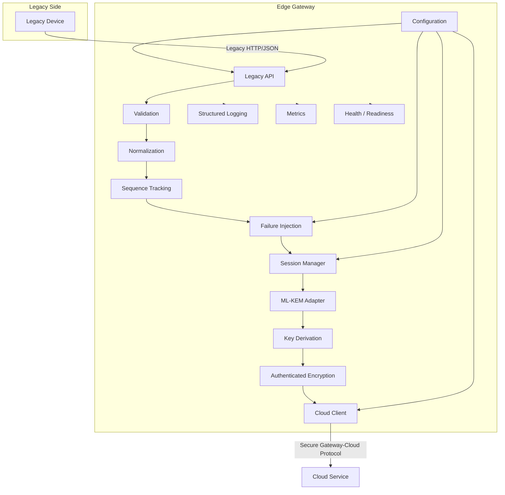

---

# 94. Requirements traceability

|Course requirement|Gateway contribution|
|---|---|
|Legacy edge-cloud system|Bridges Legacy Device and Cloud|
|Baseline analysis|Supports explicit Baseline Mode (`SECURITY_MODE=classical`)|
|ML-KEM integration|Main ML-KEM endpoint/component|
|Existing crypto implementation|Wrapper around maintained library|
|Legacy compatibility|Legacy Device protocol remains stable|
|Migration strategy|Explicit Baseline/Modernized mode selection; protocol v1 is fail-closed with no runtime plaintext fallback|
|AI-assisted development|Gateway artifacts developed via recorded AI tasks|
|Critical evaluation|Crypto/security code receives manual review|
|Automated testing|Unit/integration/security tests|
|Deployment|Gateway Docker service|
|Health checks|`/health` and `/ready`|
|Logging|Structured gateway/security logs|
|Metrics|Gateway, cloud, ML-KEM metrics|
|Technical debt|Explicitly documented|
|Failure/security testing|Gateway failure-injection subsystem|

This directly covers a large portion of what the project description expects.

---

# 95. Edge Gateway design acceptance checklist

Before implementation begins, the team should approve the following.

### Architecture

-  Gateway is the modernization boundary.
    
-  Legacy and cloud interfaces are separated.
    
-  Gateway does not become a general-purpose platform.
    
-  Internal responsibilities are clearly separated.
    

### Legacy interface

-  `POST /api/v1/measurements` approved.
    
-  JSON schema matches Legacy Device proposal.
    
-  Validation ranges agreed.
    
-  Response codes agreed, including `409` for duplicate/out-of-order sequence rejection.
    
-  Sequence behavior and state-commit timing agreed.
    

### Canonical model

-  Internal measurement representation defined.
    
-  `received_at` defined.
    
-  `gateway_id` defined.
    
-  Legacy payload and cloud payload are separated conceptually.
    

### ML-KEM

-  Gateway-cloud is the selected PQC path.
    
-  Existing maintained ML-KEM implementation will be used.
    
-  No manual ML-KEM implementation.
    
-  ML-KEM is for key establishment, not bulk data encryption.
    
-  `ML-KEM-768` is the selected parameter set.
    
-  Shared-secret handling is defined.
    
-  HKDF-SHA-256 derivation contract is frozen.
    
-  No shared secret is logged.
    

### Session management

-  Session lifecycle defined.
    
-  Time-based session expiry (`SESSION_TTL_SECONDS`, default 300) defined.
    
-  Re-key/session-recovery behavior defined and bounded.
    
-  Session failure behavior defined.
    
-  Session data stays in memory initially.
    

### Symmetric encryption

-  AES-256-GCM selected for authenticated encryption.
    
-  HKDF-SHA-256 selected with `salt=None`, fixed protocol `info`, and 32-byte output.
    
-  12-byte cryptographically secure nonce strategy defined.
    
-  AAD fields and deterministic encoding defined.
    
-  Tampered ciphertext or AAD must fail.
    

### Migration / mode selection

-  Baseline Mode (`SECURITY_MODE=classical`) defined.
    
-  Modernized Mode (`SECURITY_MODE=mlkem`) defined.
    
-  `PQC_FAILURE_POLICY=fail_closed` is the only supported initial policy.
    
-  No silent or automatic downgrade.
    
-  Baseline mode requires explicit configuration rather than runtime cryptographic fallback.
    

### Cloud communication

-  Cloud URL configurable.
    
-  Timeout defined.
    
-  Retry count defined.
    
-  Retryable errors defined.
    
-  Non-retryable errors defined.
    
-  Retry exhaustion defined.
    

### Failure injection

-  `FAILURE_MODE` defined.
    
-  `FAILURE_RATE` defined.
    
-  Optional seed defined.
    
-  Initial gateway failure scenarios selected.
    
-  Crypto failures can be simulated.
    
-  Cloud failures can be simulated.
    
-  Failure mode disabled by default.
    
-  Injected failures logged.
    
-  Failure simulation never exposes secret material.
    

### Validation

-  Invalid JSON handled.
    
-  Invalid temperature handled.
    
-  Invalid humidity handled.
    
-  Invalid timestamp handled.
    
-  Invalid sequence handled.
    
-  Duplicate/out-of-order behavior agreed.
    

### Logging

-  Request lifecycle logging defined.
    
-  Validation failures logged.
    
-  ML-KEM events logged safely.
    
-  Cloud failures logged.
    
-  Failure-injection events logged.
    
-  Secrets never logged.
    

### Metrics

-  Input count metric defined.
    
-  Rejection metric defined.
    
-  Cloud failure metric defined.
    
-  Retry metric defined.
    
-  ML-KEM handshake metric defined.
    
-  ML-KEM failure metric defined.
    
-  Handshake duration metric defined.
    
-  Failure injection metric defined.
    

### Health

-  `/health` defined.
    
-  `/ready` defined.
    
-  Readiness does not require an already active secure session.

-  Health/readiness responses leak no sensitive information.
    
-  Container health strategy defined.
    

### Failure handling

-  Cloud timeout behavior defined.
    
-  Cloud unavailable behavior defined.
    
-  ML-KEM failure behavior defined.
    
-  Crypto failure behavior defined.
    
-  Session-expiry behavior defined.
    
-  Invalid configuration fails startup.
    

### Testing

-  Validation tests planned.
    
-  Sequence tests planned.
    
-  Cloud client tests planned.
    
-  ML-KEM wrapper tests planned.
    
-  Session tests planned.
    
-  Symmetric-crypto tests planned.
    
-  Failure-injection tests planned.
    
-  Logging-secret tests planned.
    
-  Health tests planned.
    
-  Device-gateway integration tests planned.
    
-  Gateway-cloud integration tests planned.
    
-  End-to-end tests planned.
    

### Operations

-  Docker behavior defined.
    
-  Gateway port defined.
    
-  Configuration through environment.
    
-  Graceful shutdown defined.
    
-  Health check usable by deployment.
    
-  Observability strategy defined.
    

### Technical debt

-  No persistent queue acknowledged.
    
-  In-memory session acknowledged.
    
-  Simplified public-key trust acknowledged.
    
-  Single-process gateway acknowledged.
    
-  Simplified retry acknowledged.
    
-  Simplified sequence tracking acknowledged.
    

### Course alignment

-  Baseline can be demonstrated.
    
-  Modernized PQC version can be demonstrated.
    
-  Before/after measurements possible.
    
-  AI-generated implementation can be manually evaluated.
    
-  Failure/security behavior can be demonstrated.
    
-  Remaining risks can be discussed.
    
-  System remains small enough for course scope.
    

---

# 96. Final proposed Edge Gateway specification

The Edge Gateway can be summarized as:

> The Edge Gateway is the modernization boundary between the simulated legacy device environment and the cloud service. It receives legacy HTTP/JSON measurements, validates and normalizes them into a canonical internal representation, tracks basic sequence behavior, and forwards accepted data to the cloud through a modernized secure communication path. In the modernized mode, the gateway uses an existing ML-KEM-768 implementation to establish shared keying material with the cloud, derives a temporary 32-byte session key using HKDF-SHA-256 (`salt=None` and the frozen protocol context), and protects cloud-bound measurements using AES-256-GCM with a 12-byte nonce and authenticated protocol metadata. Secure sessions are reused for multiple messages and periodically re-established rather than performing ML-KEM for every measurement.
> 
> The gateway includes explicit timeout and bounded retry behavior, explicit Baseline/Modernized security modes, fail-closed PQC behavior with no runtime plaintext fallback, structured logging, operational and post-quantum-related metrics, health/readiness endpoints whose readiness does not require an already active secure session, graceful shutdown, and a dedicated configurable failure-injection subsystem. Failure injection can simulate processing, ML-KEM, ciphertext, message-drop, and cloud-connectivity failures, enabling repeatable testing of negative and security-sensitive paths. Cryptographic private keys, shared secrets, and derived session keys are never logged or stored in project history. The gateway intentionally avoids production-scale infrastructure such as distributed queues, PKI, HSMs, clustering, or Kubernetes in order to remain appropriate for the course scope.
