# Cloud Service Design Proposal

## 1. Purpose

The **Cloud Service** is the modern destination of the edge–cloud architecture.

Its responsibilities are to:

- provide the cloud side of the ML-KEM key-establishment protocol;
    
- manage secure sessions established with Edge Gateways;
    
- receive encrypted gateway payloads;
    
- authenticate and decrypt those payloads;
    
- validate the resulting canonical measurements;
    
- store accepted measurements;
    
- expose selected read/query functionality for demonstration;
    
- provide logging, metrics, health, and readiness information;
    
- support controlled failure injection for testing;
    
- reject malformed, unauthenticated, corrupted, expired, or otherwise invalid secure messages;
    
- remain simple enough for the course scope.
    

The Cloud Service does **not** communicate directly with Legacy Devices.

The architectural rule remains:

```text
Legacy Device
      │
      │ legacy HTTP/JSON
      ▼
Edge Gateway
      │
      │ ML-KEM + secure application transport
      ▼
Cloud Service
```

The Cloud Service trusts the Edge Gateway as the modernization boundary, but it still validates everything it receives.

---

# 2. Architectural role

The system now has two different communication domains:

```text
┌───────────────────────────────────────────────────┐
│                LEGACY DOMAIN                      │
│                                                   │
│ Legacy Device ─────── HTTP/JSON ───────> Gateway  │
└───────────────────────────────────────────────────┘
                                      │
                                      │
                                      ▼
                         MODERNIZATION BOUNDARY
                                      │
                                      ▼
┌───────────────────────────────────────────────────┐
│                 MODERN DOMAIN                     │
│                                                   │
│ Gateway ─── ML-KEM + authenticated encryption ──> │
│                                      Cloud        │
└───────────────────────────────────────────────────┘
```

The Cloud Service is therefore responsible for the **receiving half of the modernized secure path**.

---

# 3. Primary responsibilities

|Area|Cloud responsibility|
|---|---|
|Gateway protocol|Receive gateway requests|
|ML-KEM|Own cloud key pair / perform decapsulation|
|Session management|Create, validate, expire, and destroy secure sessions|
|Key derivation|Derive same symmetric key as gateway|
|Secure transport|Authenticate/decrypt secure envelopes|
|Validation|Validate decrypted canonical measurement|
|Storage|Persist accepted measurements|
|Query API|Expose simple measurement retrieval if useful|
|Failure handling|Reject invalid or failed secure messages|
|Failure injection|Simulate controlled cloud-side failures|
|Logging|Record operational/security events|
|Metrics|Expose cloud and PQC-related measurements|
|Health|Provide liveness/readiness endpoints|
|Configuration|Load/validate runtime settings|
|Shutdown|Cleanly close storage/network resources|

---

# 4. Explicit non-responsibilities

The Cloud Service should initially **not** provide:

```text
user authentication system
admin dashboard
frontend
analytics platform
machine learning
event streaming
Kafka
Redis
multi-region deployment
Kubernetes
autoscaling
complex IAM
production-grade PKI
HSM integration
billing
notification system
device fleet management
firmware management
```

The course explicitly recommends keeping the project small rather than adding unnecessary complexity.

---

# 5. High-level cloud architecture


The Cloud supports two clearly separated Gateway-facing application paths:

```text
Baseline Mode
Gateway → POST /api/v1/baseline/measurements → validate → store

Modernized Mode
Gateway → ML-KEM session establishment
        → POST /api/v1/secure/measurements
        → authenticate/decrypt → validate → store
```

The secure and baseline paths must never be ambiguous.

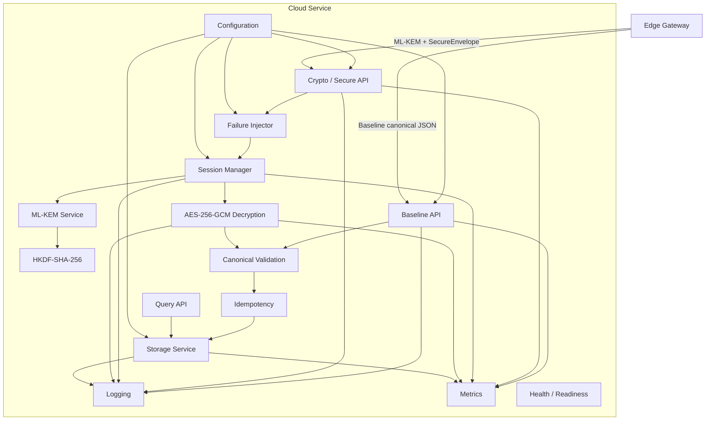

The Cloud remains unaware of the Legacy Device wire protocol. It only accepts the canonical Gateway representation on the baseline path or the decrypted canonical representation on the secure path.

---

# 6. Recommended internal module structure

A clean target structure would be:

```text
cloud_service/
├── pyproject.toml
│
├── src/
│   └── cloud_service/
│       ├── __init__.py
│       ├── app.py
│       ├── config.py
│       ├── models.py
│       │
│       ├── gateway/
│       │   ├── __init__.py
│       │   ├── routes.py
│       │   └── protocol.py
│       │
│       ├── crypto/
│       │   ├── __init__.py
│       │   ├── mlkem.py
│       │   ├── kdf.py
│       │   ├── symmetric.py
│       │   └── session.py
│       │
│       ├── storage/
│       │   ├── __init__.py
│       │   ├── repository.py
│       │   ├── database.py
│       │   └── models.py
│       │
│       ├── failure/
│       │   ├── __init__.py
│       │   └── injector.py
│       │
│       ├── monitoring/
│       │   ├── __init__.py
│       │   ├── logging.py
│       │   ├── metrics.py
│       │   └── health.py
│       │
│       └── lifecycle.py
│
├── tests/
│   ├── test_config.py
│   ├── test_gateway_routes.py
│   ├── test_mlkem.py
│   ├── test_session.py
│   ├── test_symmetric.py
│   ├── test_storage.py
│   ├── test_failure_injector.py
│   ├── test_health.py
│   └── test_metrics.py
│
└── Dockerfile
```

This mirrors the Edge Gateway structure closely, which is good because both sides participate in the same secure protocol.

---

# 7. Cloud data model

The Cloud Service receives the gateway's canonical measurement after decrypting the secure envelope.

The canonical measurement remains:

|Field|Type|Meaning|
|---|---|---|
|`device_id`|string|original legacy device|
|`temperature_c`|float|measured temperature|
|`humidity_pct`|float|measured humidity|
|`measured_at`|UTC datetime|device measurement time|
|`sequence_number`|integer|device sequence|
|`received_at`|UTC datetime|time gateway received it|
|`gateway_id`|string|forwarding gateway|

The cloud should add:

|Field|Type|Meaning|
|---|---|---|
|`cloud_received_at`|UTC datetime|time cloud accepted it|
|`record_id`|UUID/string|cloud storage identifier|

---

# 8. Stored measurement model


The canonical Gateway field:

```text
received_at
```

means "time the Gateway received the Legacy measurement."

When persisted by the Cloud, rename it explicitly to:

```text
gateway_received_at
```

so it is not confused with the Cloud's own receive time.

Example stored record:

```json
{
  "record_id": "rec-4a20...",
  "device_id": "sensor-001",
  "temperature_c": 21.7,
  "humidity_pct": 42.5,
  "measured_at": "2026-09-21T08:20:31Z",
  "sequence_number": 184,
  "gateway_received_at": "2026-09-21T08:20:31.218Z",
  "gateway_id": "gateway-001",
  "cloud_received_at": "2026-09-21T08:20:31.290Z"
}
```

Mapping:

```text
CanonicalMeasurement.received_at
→ StoredMeasurement.gateway_received_at
```

The Cloud stores the decrypted logical measurement plus Cloud/Gateway receive metadata. It must never persist:

```text
ML-KEM private key
ML-KEM shared secret
derived session key
raw secure envelope as a replacement for validated application data
```

---

# 9. Data model diagram


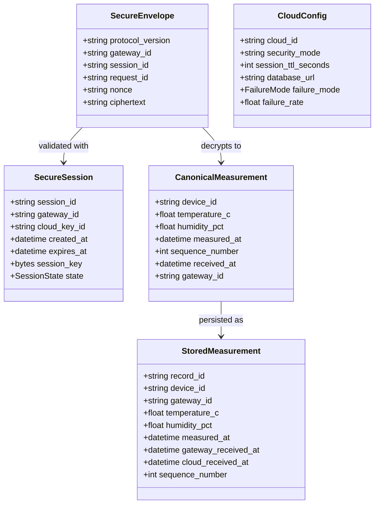

`request_id` belongs to the secure transport envelope, not to `CanonicalMeasurement`.

For the baseline endpoint the same request correlation value is transported using the `X-Request-ID` HTTP header.

---

# 10. Cloud API overview


The Cloud Service exposes a small, explicit set of endpoints.

```text
GET  /health
GET  /ready
GET  /metrics

POST /api/v1/baseline/measurements

GET  /api/v1/crypto/public-key
POST /api/v1/crypto/sessions
POST /api/v1/secure/measurements

GET  /api/v1/measurements
GET  /api/v1/measurements/{record_id}
```

Mode terminology:

```text
Baseline Mode     = SECURITY_MODE=classical
Modernized Mode   = SECURITY_MODE=mlkem
```

The endpoint contracts are fixed independently of the concrete Python libraries selected during implementation.

The baseline and secure measurement endpoints remain separate so the Cloud never has to guess whether a body is plaintext or encrypted.

---

# 11. ML-KEM public-key endpoint


```http
GET /api/v1/crypto/public-key
```

Response:

```json
{
  "protocol_version": "1",
  "algorithm": "ML-KEM-768",
  "key_id": "cloud-key-001",
  "public_key": "<base64url>"
}
```

Rules:

```text
protocol_version = "1"
algorithm = "ML-KEM-768"
key_id must be non-empty
public_key uses Base64URL encoding
```

The public key is not secret.

The private key must never leave the Cloud Service.

The Gateway validates all response metadata before attempting encapsulation. The concrete ML-KEM library may have its own binary key representation internally; the network representation is always Base64URL.

---

# 12. Cloud ML-KEM key ownership

The cloud owns the ML-KEM key pair:

```text
Cloud
 ├── public key
 └── private key
```

Gateway obtains:

```text
public key only
```

Then:

```text
Gateway:
encapsulate(public_key)
       ↓
shared_secret_gateway
ciphertext
```

Cloud receives ciphertext:

```text
Cloud:
decapsulate(ciphertext, private_key)
       ↓
shared_secret_cloud
```

Both shared secrets match.

---

# 13. ML-KEM session establishment


Session establishment uses a fixed versioned protocol.

```http
POST /api/v1/crypto/sessions
Content-Type: application/json
```

Request:

```json
{
  "protocol_version": "1",
  "gateway_id": "gateway-001",
  "key_id": "cloud-key-001",
  "encapsulation_ciphertext": "<base64url>"
}
```

Cloud processing:

```text
validate protocol_version
↓
validate gateway_id
↓
validate key_id
↓
Base64URL-decode ML-KEM ciphertext
↓
load matching private key
↓
ML-KEM-768 decapsulate
↓
HKDF-SHA-256 derive 32-byte session key
↓
create in-memory session
↓
return versioned session metadata
```

Response:

```json
{
  "protocol_version": "1",
  "session_id": "sess-123",
  "status": "established",
  "expires_at": "2026-09-21T08:25:31Z"
}
```

No shared secret or session key is returned.

If request validation, Base64URL/length checks, the ML-KEM wrapper, KDF, or session creation fails, **no session is created**.

Do not assume that every modified, correctly sized ML-KEM ciphertext will produce an explicit decapsulation exception. ML-KEM implementations may use implicit-rejection behavior, so some altered valid-length ciphertexts can yield different pseudorandom keying material instead. The application must therefore not treat "no exception" as proof that both sides derived the same secret.

---

# 14. ML-KEM sequence diagram


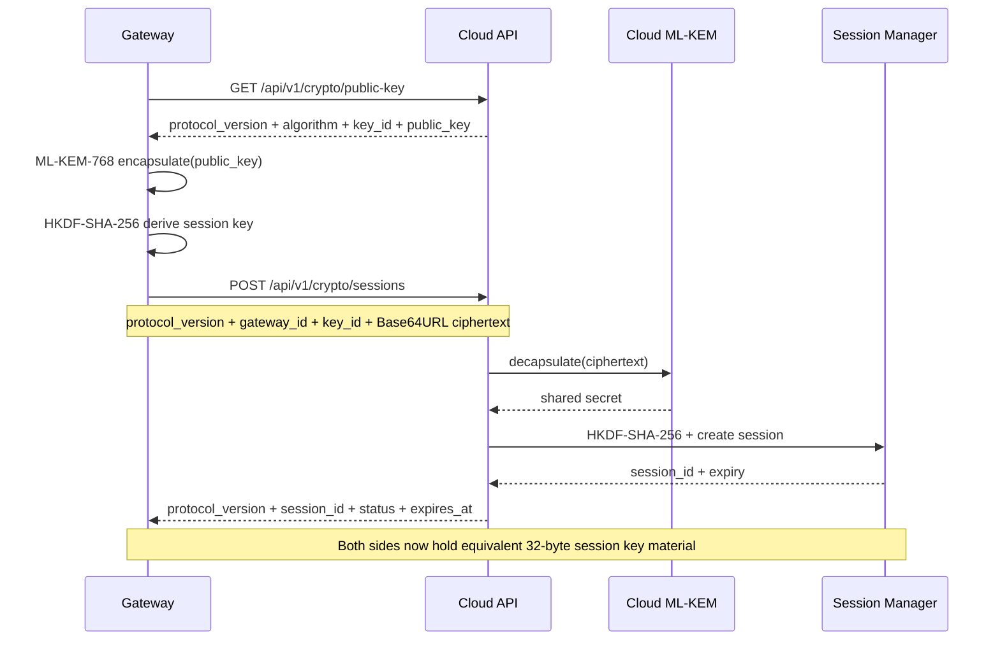

---

# 15. Session manager responsibilities

The cloud session manager should:

- create new sessions;
    
- associate sessions with a gateway;
    
- track expiry;
    
- reject unknown session IDs;
    
- reject expired sessions;
    
- provide session key material to the decryption layer;
    
- destroy expired/closed sessions;
    
- clear in-memory sessions during shutdown.
    

Initial storage:

```text
in-memory
```

This is sufficient for the course project.

---

# 16. Session state model

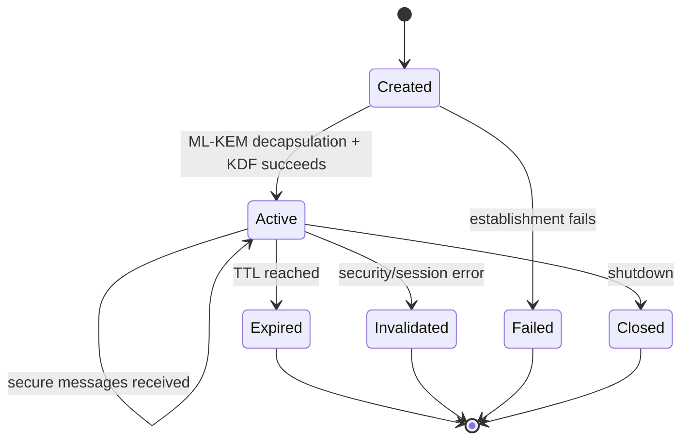

The cloud does not automatically restore an expired session.

The gateway initiates a new handshake.

---

# 17. Session lifetime


The Cloud uses the same time-based session lifetime as the Gateway.

Default:

```text
SESSION_TTL_SECONDS=300
```

That means approximately five minutes in normal operation.

Rules:

```text
session expiry is time-based only in the initial version
Cloud does not silently extend an expired session
Gateway initiates a new ML-KEM handshake
```

Tests should use a mocked/controlled clock or a very small test TTL rather than waiting five real minutes.

---

# 18. Session binding

Each session should be associated with:

```text
session_id
gateway_id
cloud_key_id
created_at
expires_at
```

The cloud should reject a secure envelope if:

```text
session_id exists
but
gateway_id does not match session owner
```

This prevents accidental cross-gateway session use.

---

# 19. Key derivation


The project freezes the KDF contract as:

```text
Algorithm:
HKDF-SHA-256

Input key material:
ML-KEM shared secret

Salt:
None

Info/context:
"ml-kem-project:v1:gateway-cloud-session"

Output:
32 bytes
```

Conceptually:

```text
ML-KEM shared secret
        ↓
HKDF-SHA-256
        ↓
32-byte AES session key
```

Gateway and Cloud must use these parameters identically.

Do not replace this with:

```text
SHA256(shared_secret)
custom concatenation
home-made stretching logic
```

Use a maintained cryptographic library's standard HKDF implementation.

The concrete library remains an implementation choice; the network/derivation contract is no longer open.

---

# 20. Symmetric authenticated encryption


The Cloud mirrors the Gateway's frozen authenticated-encryption scheme:

```text
AES-256-GCM
```

Session key:

```text
32 bytes
```

Nonce:

```text
12 bytes / 96 bits
```

Conceptual flow:

```text
SecureEnvelope
     ↓
validate envelope
     ↓
lookup active session
     ↓
reconstruct deterministic AAD
     ↓
Base64URL-decode 12-byte nonce + ciphertext
     ↓
AES-256-GCM authenticate/decrypt
     ↓
CanonicalMeasurement JSON
```

If authentication fails:

```text
reject immediately
do not expose plaintext
do not parse/store any unauthenticated bytes
```

The Cloud must never continue processing corrupted or unauthenticated plaintext.

---

# 21. Secure envelope


The Cloud expects the exact same secure envelope produced by the Gateway:

```json
{
  "protocol_version": "1",
  "gateway_id": "gateway-001",
  "session_id": "sess-123",
  "request_id": "req-8fb2...",
  "nonce": "<base64url>",
  "ciphertext": "<base64url>"
}
```

Fields:

| Field | Meaning |
|---|---|
| `protocol_version` | protocol compatibility |
| `gateway_id` | sending Gateway identity |
| `session_id` | active secure session |
| `request_id` | authenticated logical request/correlation ID |
| `nonce` | 12-byte AES-GCM nonce encoded as Base64URL |
| `ciphertext` | AES-GCM ciphertext/tag output encoded as Base64URL |

The following fields are authenticated as AAD:

```text
protocol_version
gateway_id
session_id
request_id
```

The Gateway and Cloud independently construct identical AAD bytes using canonical JSON:

```json
{
  "gateway_id": "gateway-001",
  "protocol_version": "1",
  "request_id": "req-8fb2...",
  "session_id": "sess-123"
}
```

Canonical AAD encoding:

```text
UTF-8
JSON
sorted keys
fixed compact separators
```

Binary JSON fields use Base64URL.

The envelope must not contain:

```text
session_key
shared_secret
private_key
plaintext measurement
algorithm negotiation fields
```

The algorithm suite is fixed by protocol version:

```text
ML-KEM-768
HKDF-SHA-256
AES-256-GCM
```

---

# 22. Secure measurement endpoint


```http
POST /api/v1/secure/measurements
Content-Type: application/json
```

Request:

```json
{
  "protocol_version": "1",
  "gateway_id": "gateway-001",
  "session_id": "sess-123",
  "request_id": "req-8fb2...",
  "nonce": "<base64url>",
  "ciphertext": "<base64url>"
}
```

Processing order is fixed:

```text
validate envelope structure
        ↓
validate protocol version and Base64URL encoding
        ↓
lookup session
        ↓
check session expiry
        ↓
verify session belongs to gateway_id
        ↓
construct canonical AAD
        ↓
AES-256-GCM authenticate/decrypt
        ↓
parse canonical measurement JSON
        ↓
validate canonical model
        ↓
verify decrypted gateway_id matches envelope/session gateway
        ↓
idempotency check
        ↓
store or return already_accepted
        ↓
202 Accepted
```

No storage occurs before all security and application validation succeeds.

The secure endpoint accepts **SecureEnvelope only**. It never falls back to interpreting an invalid secure body as plaintext.

---

# 23. Normal secure-message sequence


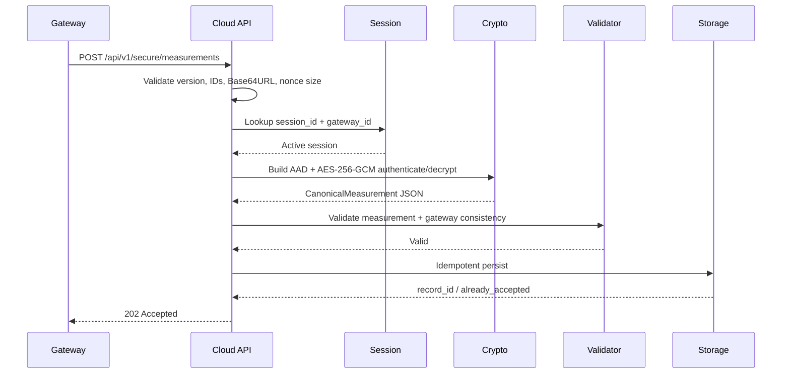

---

# 24. Cloud validation

The Cloud Service should validate decrypted data again even though the gateway already validated it.

This is **defense in depth**.

At minimum:

```text
device_id non-empty
gateway_id non-empty
temperature within allowed range
humidity within allowed range
measured_at valid UTC datetime
received_at valid UTC datetime
sequence_number >= 0
```

Also ensure:

```text
decrypted gateway_id
matches
envelope/session gateway identity
```

if gateway ID exists in both places.

---

# 25. Why validate twice?

Because:

```text
Gateway validation
≠
Cloud trust
```

A bug or compromise in the gateway should not automatically allow arbitrary malformed data into storage.

This also gives useful test cases for AI-generated validation code.

---

# 26. Storage design

For the course project, I recommend:

```text
SQLite
```

initially.

Reasons:

- simple;
    
- no external service needed;
    
- easy local testing;
    
- easy Docker deployment;
    
- enough for a small simulated workload;
    
- keeps focus on ML-KEM and software operations.
    

PostgreSQL is also valid, but it adds more setup.

Unless your group has a specific reason, SQLite is probably enough.

---

# 27. Storage schema

Recommended table:

```text
measurements
```

Fields:

```text
record_id
device_id
gateway_id
temperature_c
humidity_pct
measured_at
gateway_received_at
cloud_received_at
sequence_number
```

Potentially:

```text
created_at
```

but this would duplicate `cloud_received_at`, so avoid unnecessary fields.

---

# 28. Storage model diagram

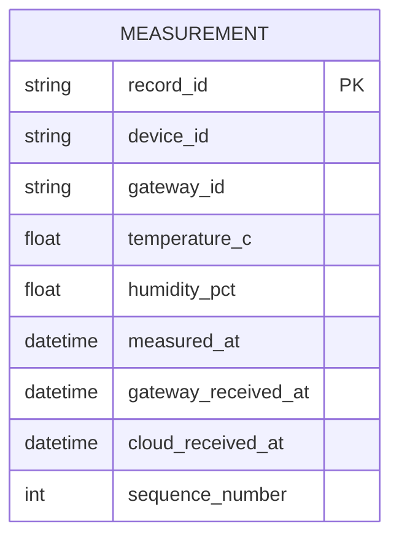

A separate session table is **not required initially** if sessions remain in memory.

---

# 29. Storage repository abstraction

The application should not scatter SQL throughout route handlers.

Use a small repository layer:

```text
Cloud API
   ↓
Measurement Service
   ↓
Measurement Repository
   ↓
SQLite
```

Conceptually:

```python
repository.save(measurement)
repository.get(record_id)
repository.list(...)
```

No need for a large ORM architecture if simple SQL is sufficient.

---

# 30. Query API


For demonstration and testing, provide:

```http
GET /api/v1/measurements
```

and:

```http
GET /api/v1/measurements/{record_id}
```

This helps prove end-to-end functionality.

Example response:

```json
[
  {
    "record_id": "rec-001",
    "device_id": "sensor-001",
    "temperature_c": 21.7,
    "humidity_pct": 42.5,
    "measured_at": "...",
    "sequence_number": 184,
    "gateway_id": "gateway-001",
    "gateway_received_at": "...",
    "cloud_received_at": "..."
  }
]
```

No complex search API is needed.

Optional minimal filters such as:

```text
device_id
limit
```

are enough for the course project.

---

# 31. Pagination

If listing measurements, avoid unbounded responses.

Even a simple:

```text
limit
```

is enough.

Example:

```http
GET /api/v1/measurements?limit=100
```

Default:

```text
100
```

You do not need sophisticated cursor pagination for the course project.

---

# 32. Failure injection

The Cloud Service should also contain controlled fault injection.

This is consistent with the Legacy Device and Edge Gateway designs.

Cloud failures are especially useful for testing:

```text
ML-KEM wrapper/application failures
malformed ML-KEM input
session failures
decryption failures
storage errors
processing delays
HTTP failures
corrupted responses
```

---

# 33. Cloud failure-injection architecture

Failure hooks should exist at meaningful boundaries:

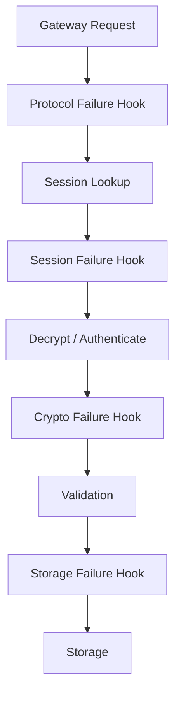

---

# 34. Proposed cloud failure modes

Initial useful modes:

```text
none

public_key_unavailable

mlkem_decapsulation_failure

session_not_found

session_expired

decryption_failure

storage_failure

processing_delay

service_unavailable

drop_response

random
```

You should not implement every imaginable failure.

This list already provides strong negative-testing coverage.

---

# 35. Failure configuration

Use the same project-wide pattern:

```text
FAILURE_MODE=none
FAILURE_RATE=0.0
FAILURE_SEED=
```

Optional:

```text
FAILURE_DELAY_SECONDS=2
```

only if `processing_delay` is implemented.

Consistency across all components is valuable.

---

# 36. Cloud failure-injection rules

The failure injector must:

- be disabled by default;
    
- clearly log injected failures;
    
- support deterministic testing when seeded;
    
- never leak secret material;
    
- never permanently alter cryptographic keys;
    
- not insert "this is simulated" markers into normal protocol responses unless explicitly part of a test endpoint;
    
- not bypass normal security validation accidentally.
    

---

# 37. Simulated ML-KEM wrapper/decapsulation failure

Example:

```text
FAILURE_MODE=mlkem_decapsulation_failure
FAILURE_RATE=1.0
```

Sequence:

```mermaid
sequenceDiagram
    participant Gateway
    participant Cloud
    participant Failure
    participant MLKEM

    Gateway->>Cloud: Create secure session
    Cloud->>Failure: Apply failure policy
    Failure-->>Cloud: Force decapsulation failure

    Cloud->>Cloud: Increment ML-KEM failure metric
    Cloud->>Cloud: Log safe failure

    Cloud-->>Gateway: Session establishment failure
```

No session should be created.

This injected failure is an operational test hook. It must not be presented as evidence that arbitrary bit-flips in a valid-length ML-KEM ciphertext naturally cause an explicit decapsulation exception.

---

# 38. Storage failure simulation

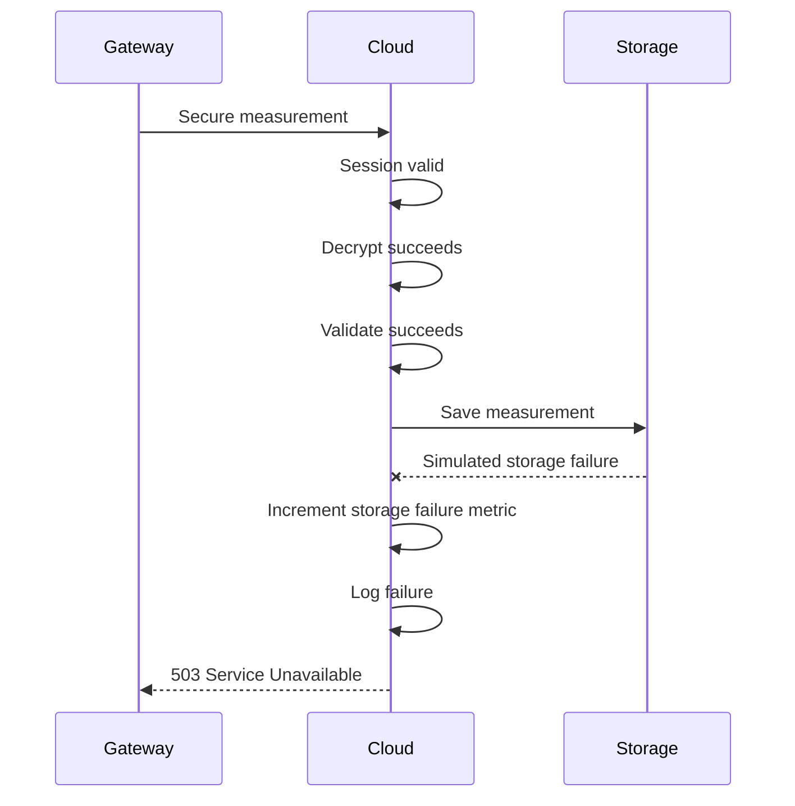

This lets the gateway retry logic be tested realistically.

---

# 39. Decryption failure simulation

Useful for testing gateway behavior and cloud rejection paths.

```text
Gateway sends valid envelope
        ↓
Cloud failure injector forces auth/decryption failure
        ↓
Cloud rejects
        ↓
No storage occurs
```

This differs from gateway-side ciphertext corruption.

Both are useful:

```text
Gateway corruption
→ malformed data enters Cloud

Cloud forced decryption failure
→ test Cloud failure branch directly
```

---

# 40. Service-unavailable simulation

```text
FAILURE_MODE=service_unavailable
```

The cloud responds:

```http
503 Service Unavailable
```

This lets the gateway exercise:

```text
retry
retry delay
retry exhaustion
metric updates
legacy failure propagation
```

---

# 41. Public-key unavailability


Failure mode:

```text
public_key_unavailable
```

The endpoint:

```http
GET /api/v1/crypto/public-key
```

returns:

```http
503 Service Unavailable
```

This tests:

```text
Gateway
   ↓
cannot retrieve current ML-KEM public key
   ↓
bounded transport retry
   ↓
fail_closed if establishment cannot proceed
```

The Cloud must not provide a plaintext fallback from this endpoint.

---

# 42. Cloud configuration


Recommended environment variables:

| Variable | Example/default |
|---|---|
| `CLOUD_ID` | `cloud-001` |
| `HOST` | `0.0.0.0` |
| `PORT` | `9000` |
| `DATABASE_URL` | `sqlite:///...` |
| `SECURITY_MODE` | `mlkem` |
| `SESSION_TTL_SECONDS` | `300` |
| `FAILURE_MODE` | `none` |
| `FAILURE_RATE` | `0.0` |
| `FAILURE_SEED` | empty |
| `FAILURE_DELAY_SECONDS` | optional |
| `LOG_LEVEL` | `INFO` |

Mode terminology:

```text
SECURITY_MODE=classical
→ Baseline Mode

SECURITY_MODE=mlkem
→ Modernized Mode
```

The initial cryptographic suite is fixed and not configurable:

```text
ML-KEM-768
HKDF-SHA-256
AES-256-GCM
```

Do not add `MLKEM_PARAMETER_SET` or algorithm-negotiation settings unless a later protocol version genuinely requires them. Keeping one frozen suite prevents Gateway/Cloud mismatch and keeps the course implementation small.

---

# 43. Configuration validation


Startup should fail for:

```text
empty CLOUD_ID
invalid PORT
invalid DATABASE_URL
SESSION_TTL_SECONDS <= 0
FAILURE_RATE < 0
FAILURE_RATE > 1
unknown SECURITY_MODE
unknown FAILURE_MODE
FAILURE_DELAY_SECONDS < 0 when configured
```

Supported security modes:

```text
classical
mlkem
```

Behavior:

```text
start
 ↓
load config
 ↓
validate
 ↓
invalid?
 ↓
safe configuration error log
 ↓
exit non-zero
```

The service must not start partially initialized or with an ambiguous security mode.

---

# 44. Key lifecycle


Cloud ML-KEM keys use a simple in-memory lifecycle:

```text
startup
 ↓
generate ML-KEM-768 key pair
 ↓
assign key_id
 ↓
serve public key
 ↓
use private key for session establishment
 ↓
shutdown/restart
 ↓
key pair disappears
```

The private key remains in process memory only.

It is never:

```text
returned through an API
logged
stored in SQLite
committed to Git
written to AI history
```

A Cloud restart therefore creates a new key pair and invalidates the practical usefulness of old sessions. Gateway recovery is expected to obtain the new public key and establish a new session.

---

# 45. Key persistence decision


The initial implementation decision is:

> Generate the ML-KEM-768 key pair at Cloud Service startup and keep it in memory only.

Reasons:

- simple;
- no private-key file handling;
- aligns with in-memory sessions;
- restart behavior is easy to test;
- appropriate for a simulated course environment.

Known limitation:

> Cloud ML-KEM identity is ephemeral and changes after restart.

A production system would require authenticated persistent key management, rotation, and protected private-key storage such as a KMS/HSM or equivalent mechanism.

---

# 46. Public key identifier

Every public key should have:

```text
key_id
```

Example:

```text
cloud-key-20260921-001
```

The gateway sends this back during session establishment.

This avoids ambiguity if rotation is added later.

---

# 47. Key rotation

Full automated rotation is out of scope.

But design should permit:

```text
new key_id
new public/private key pair
old sessions remain until expiry
```

or:

```text
service restart invalidates sessions
```

For this course, documenting future rotation is enough.

---

# 48. Gateway identity trust

The cloud receives:

```text
gateway_id
```

but initially may not strongly authenticate it.

That is a known limitation.

A production system might use:

```text
client certificates
pre-provisioned credentials
gateway identity certificates
```

but this project does not need full PKI.

Document the limitation explicitly.

---

# 49. Protocol versioning


Use:

```text
protocol_version = "1"
```

in every versioned secure-protocol message:

```text
GET /api/v1/crypto/public-key response

POST /api/v1/crypto/sessions request

POST /api/v1/crypto/sessions response

SecureEnvelope
```

Purpose:

```text
future format evolution
explicit compatibility checks
safe rejection of unsupported versions
no implicit downgrade
```

The Cloud must reject unsupported protocol versions before cryptographic processing where practical.

---

# 50. Secure envelope validation


Before touching session key material, validate the envelope structure:

```text
protocol_version exists and == "1"
gateway_id exists and is non-empty
session_id exists and is non-empty
request_id exists and is non-empty
nonce exists
ciphertext exists
nonce is valid Base64URL
ciphertext is valid Base64URL
decoded nonce length == 12 bytes
payload sizes are reasonable
```

Then:

```text
session lookup
↓
expiry check
↓
gateway ownership check
↓
AAD construction
↓
AES-256-GCM authentication/decryption
```

This ordering avoids unnecessary cryptographic processing on obviously malformed input.

---

# 51. Authentication/decryption failure behavior


If AES-256-GCM authentication/decryption fails:

```text
do not reveal detailed cryptographic cause externally
do not return plaintext
do not parse unauthenticated bytes
do not store anything
log safe security event
increment decryption-failure metric
return permanent secure-message rejection
```

Use the project-wide structured error format:

```json
{
  "error": {
    "code": "SECURE_MESSAGE_REJECTED",
    "message": "secure message could not be processed"
  }
}
```

A `400 Bad Request` is appropriate for malformed/tampered secure messages in this project.

Detailed library exceptions belong only in safe internal handling and should not be exposed to the Gateway.

---

# 52. Session-not-found behavior


If:

```text
session_id = unknown
```

return:

```http
409 Conflict
```

with:

```json
{
  "error": {
    "code": "SESSION_INVALID",
    "message": "secure session is invalid"
  }
}
```

The Gateway interprets this as a bounded session-recovery condition:

```text
invalidate local session
↓
obtain current Cloud public key
↓
establish a new ML-KEM session
↓
retry the same logical request once
```

This is **not** a generic repeated HTTP retry.

---

# 53. Expired session behavior


For an expired session:

```text
secure envelope
   ↓
lookup session
   ↓
expired
   ↓
invalidate/remove session
   ↓
409 Conflict
```

Response:

```json
{
  "error": {
    "code": "SESSION_EXPIRED",
    "message": "secure session has expired"
  }
}
```

The Gateway then performs one bounded session re-establishment and retries the same logical request once.

The Cloud must never automatically extend an expired session.

---

# 54. Duplicate secure requests


Gateway transport retries can resend the same logical secure request.

The Cloud's storage-level idempotency key is:

```text
(device_id, sequence_number)
```

Policy:

```text
first accepted logical measurement
→ create one record

same logical measurement received again
→ do not create another record
→ return idempotent success
```

Recommended duplicate response:

```http
202 Accepted
```

with:

```json
{
  "status": "already_accepted",
  "record_id": "rec-existing"
}
```

`request_id` supports tracing and secure-request identity, but the persistence uniqueness rule remains `(device_id, sequence_number)` for the current simulated device model.

A pure Gateway transport retry should resend the same already-built secure envelope/request ID rather than create a second logical measurement.

---

# 55. Idempotency

I recommend a unique logical constraint on:

```text
(device_id, sequence_number)
```

Then:

```text
same measurement received twice
→ one stored record
```

This helps with gateway retry behavior.

Potential caveat:

If a device restarts and resets sequence numbering, duplicates could appear.

For the simulation, either:

- sequence persists for process lifetime only and restarts are accepted as a limitation, or
    
- include boot/session identifier later.
    

Keep it simple initially and document the limitation.

---

# 56. Storage idempotency sequence

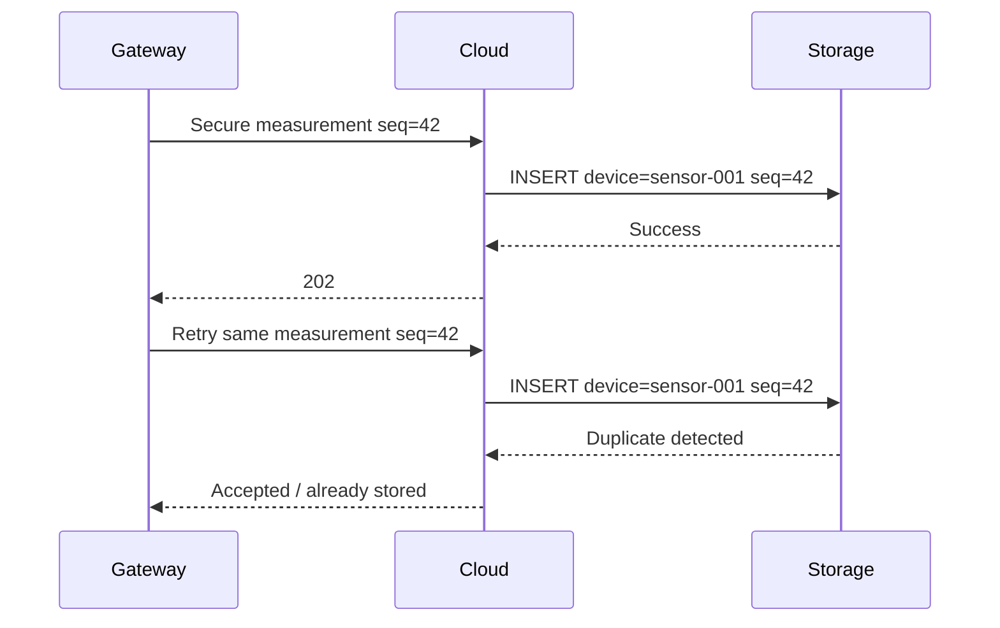

This prevents duplicate persistence from transport retries.

---

# 57. Read/query behavior

Cloud query endpoint should expose data needed for demonstration and testing.

Examples:

```text
GET /api/v1/measurements

GET /api/v1/measurements/{record_id}
```

Optional filtering:

```text
?device_id=sensor-001
```

But keep query functionality minimal.

---

# 58. Health endpoint

```http
GET /health
```

Purpose:

```text
Is the service process alive?
```

Example:

```json
{
  "status": "ok"
}
```

This should be cheap and not depend heavily on external systems.

---

# 59. Readiness endpoint

```http
GET /ready
```

Purpose:

```text
Can the Cloud Service currently do useful work?
```

Frozen readiness checks:

```text
configuration valid
database reachable
required subsystem for configured mode initialized
```

In Modernized Mode:

```text
ML-KEM subsystem initialized
KDF/AEAD dependencies usable
Cloud ML-KEM key pair available
```

In Baseline Mode, an active ML-KEM session is not required.

An **active Gateway session is never a readiness prerequisite** because sessions are created lazily.

Example:

```json
{
  "status": "ready",
  "storage": "ok",
  "mlkem": "available"
}
```

Do not expose key values.

---

# 60. Health versus readiness

```text
/health
→ process exists

/ready
→ process can serve normal traffic
```

For example:

```text
Database failure:

/health = 200
/ready  = 503
```

because the application is alive but cannot reliably persist measurements.

---

# 61. Logging strategy

Recommended cloud events:

```text
cloud_starting
cloud_ready

public_key_requested
session_establishment_started
session_established
session_establishment_failed
session_expired
session_unknown

secure_measurement_received
secure_envelope_rejected
decryption_succeeded
decryption_failed

measurement_validation_failed
measurement_stored
measurement_duplicate
storage_failed

failure_injected

cloud_shutting_down
```

---

# 62. Safe log fields

Good fields:

```text
gateway_id
device_id
sequence_number
session_id
key_id
request_id
record_id
status_code
attempt/result
```

Never log:

```text
ML-KEM private key
ML-KEM shared secret
derived session key
raw encryption key
password
token
database credentials
full .env contents
```

---

# 63. Correlation ID


The Gateway creates the request/correlation ID.

Example:

```text
request_id=req-8fb2...
```

The Cloud receives it differently by transport mode.

### Baseline Mode

The Gateway sends:

```http
X-Request-ID: req-8fb2...
```

with:

```http
POST /api/v1/baseline/measurements
```

The Cloud reads the header and uses the value in logs/tracing.

### Modernized Mode

The Gateway includes:

```text
SecureEnvelope.request_id
```

and authenticates it as AES-GCM AAD.

The Gateway may also send an HTTP `X-Request-ID` header for diagnostics, but the authenticated envelope value is authoritative.

Trace example:

```text
Legacy Device sequence=184
     ↓
Gateway request_id=req-8fb2
     ↓
Cloud request_id=req-8fb2
     ↓
Storage record=rec-789
```

`request_id` must not be used as a Prometheus label with unbounded cardinality.

---

# 64. Cloud metrics


The Cloud exposes meaningful baseline, secure, session, crypto, storage, and failure metrics.

### Request metrics

```text
cloud_baseline_requests_total
cloud_secure_requests_total
cloud_secure_requests_rejected_total
cloud_request_duration_seconds
```

### ML-KEM/session metrics

```text
cloud_mlkem_sessions_created_total
cloud_mlkem_session_failures_total
cloud_mlkem_decapsulation_duration_seconds
cloud_active_sessions
cloud_expired_sessions_total
```

### Crypto metrics

```text
cloud_decryption_failures_total
cloud_authenticated_messages_total
```

### Storage metrics

```text
cloud_measurements_stored_total
cloud_storage_failures_total
cloud_duplicate_measurements_total
```

### Failure injection

```text
cloud_injected_failures_total
```

Metric labels must stay bounded and must never expose secrets.

---

# 65. Metric-label restrictions

Avoid labels with unbounded cardinality like:

```text
record_id
session_id
request_id
```

because every value is unique.

Safer labels:

```text
failure_type
result
security_mode
status_class
```

Do not expose secrets in labels.

---

# 66. Failure injection metric

Useful:

```text
cloud_injected_failures_total{type="storage_failure"}
```

or equivalent.

This helps during demonstrations:

```text
turn on failure injection
 ↓
observe metric increase
 ↓
observe gateway retry behavior
```

---

# 67. Baseline Mode


Terminology:

```text
Baseline Mode = SECURITY_MODE=classical
```

The baseline endpoint is:

```http
POST /api/v1/baseline/measurements
Content-Type: application/json
X-Request-ID: req-...
```

Body:

```json
{
  "device_id": "sensor-001",
  "temperature_c": 21.7,
  "humidity_pct": 42.5,
  "measured_at": "2026-09-21T08:20:31Z",
  "sequence_number": 184,
  "received_at": "2026-09-21T08:20:31.218Z",
  "gateway_id": "gateway-001"
}
```

Baseline processing:

```text
parse canonical JSON
↓
validate canonical model
↓
idempotency check
↓
store
↓
202 Accepted
```

This is the pre-PQC comparison path.

It is deliberately separate from:

```text
POST /api/v1/secure/measurements
```

and must never be reached implicitly because secure processing failed.

---

# 68. Modernized Mode


Terminology:

```text
Modernized Mode = SECURITY_MODE=mlkem
```

The modernized path is:

```text
Gateway
 ↓
GET /api/v1/crypto/public-key
 ↓
ML-KEM-768
 ↓
POST /api/v1/crypto/sessions
 ↓
HKDF-SHA-256 session key
 ↓
AES-256-GCM SecureEnvelope
 ↓
POST /api/v1/secure/measurements
 ↓
Cloud authentication/decryption
 ↓
validation + idempotent storage
```

No silent or automatic fallback occurs inside the Cloud Service.

The Cloud's secure endpoint never accepts plaintext canonical JSON.

---

# 69. Fallback consistency


The initial project implements no runtime plaintext fallback.

Gateway behavior in modernized mode is:

```text
PQC_FAILURE_POLICY=fail_closed
```

Therefore the Cloud does not need to negotiate fallback.

The baseline endpoint remains available for explicit baseline runs:

```text
SECURITY_MODE=classical
```

while modernized runs use:

```text
SECURITY_MODE=mlkem
```

A cryptographic failure must not cause either service to silently switch to the baseline endpoint.

If the team later designs an explicit migration fallback in a future protocol version, it would require a separate, clearly authenticated/observable policy on both sides. It is out of scope for the initial implementation.

---

# 70. Protocol-mode separation


The Cloud uses distinct endpoints:

```text
Baseline:
POST /api/v1/baseline/measurements

Modernized:
POST /api/v1/secure/measurements
```

The secure endpoint accepts only `SecureEnvelope`.

The baseline endpoint accepts only `CanonicalMeasurement`.

The Cloud never uses "try decrypt, then try plaintext" behavior.

This separation prevents accidental downgrade ambiguity and makes baseline/modernized measurements straightforward to compare.

---

# 71. Failure-handling matrix


| Failure | Cloud behavior |
|---|---|
| Unsupported protocol version | reject, permanent protocol error |
| Missing/invalid request ID in secure envelope | reject |
| Missing session ID | reject |
| Unknown session | `409 SESSION_INVALID` |
| Expired session | `409 SESSION_EXPIRED` |
| Gateway/session ownership mismatch | reject |
| Malformed/incorrect-length ML-KEM input detectable before/at wrapper boundary | reject session request; no session |
| Simulated ML-KEM wrapper/decapsulation failure | reject; no session |
| Modified valid-length ML-KEM ciphertext | do not assume explicit decapsulation error; end-to-end key mismatch may surface later during authenticated secure communication |
| AEAD authentication failure | reject, no storage |
| Invalid decrypted JSON | reject, no storage |
| Invalid canonical measurement | reject, no storage |
| Duplicate measurement | idempotent `202 already_accepted` |
| Storage unavailable | `503 Service Unavailable` |
| Service failure | appropriate `5xx` |
| Invalid config | startup failure |
| SIGTERM | graceful shutdown |

---

# 72. Failure propagation to gateway


The Cloud distinguishes permanent request/security failures, session-recovery conditions, and temporary service failures.

### Permanent

```text
unsupported protocol
malformed secure envelope
failed AES-GCM authentication
invalid decrypted canonical measurement
gateway/session ownership mismatch
```

Gateway should not blindly retry the same invalid secure payload.

### Session recovery

```text
409 SESSION_INVALID
409 SESSION_EXPIRED
```

Gateway should:

```text
invalidate local session
→ establish one new session
→ retry the same logical request once
```

### Temporary

```text
storage temporarily unavailable
service unavailable
Cloud overloaded
transport timeout
```

Gateway may use its normal bounded transport retry policy.

These categories must be visible in tests, logs, and error handling.

---

# 73. Error response philosophy


All application errors use the same structured external shape:

```json
{
  "error": {
    "code": "SECURE_MESSAGE_REJECTED",
    "message": "secure message could not be processed"
  }
}
```

Do not expose:

```text
AES-GCM tag details
ML-KEM library internals
stack traces
private filesystem paths
secret values
```

Examples:

```text
INVALID_MEASUREMENT
UNSUPPORTED_PROTOCOL_VERSION
SECURE_MESSAGE_REJECTED
SESSION_INVALID
SESSION_EXPIRED
SERVICE_UNAVAILABLE
```

Detailed causes belong in safe internal logs where appropriate.

This gives the Gateway machine-readable error classification without creating a cryptographic error oracle.

---

# 74. Startup lifecycle

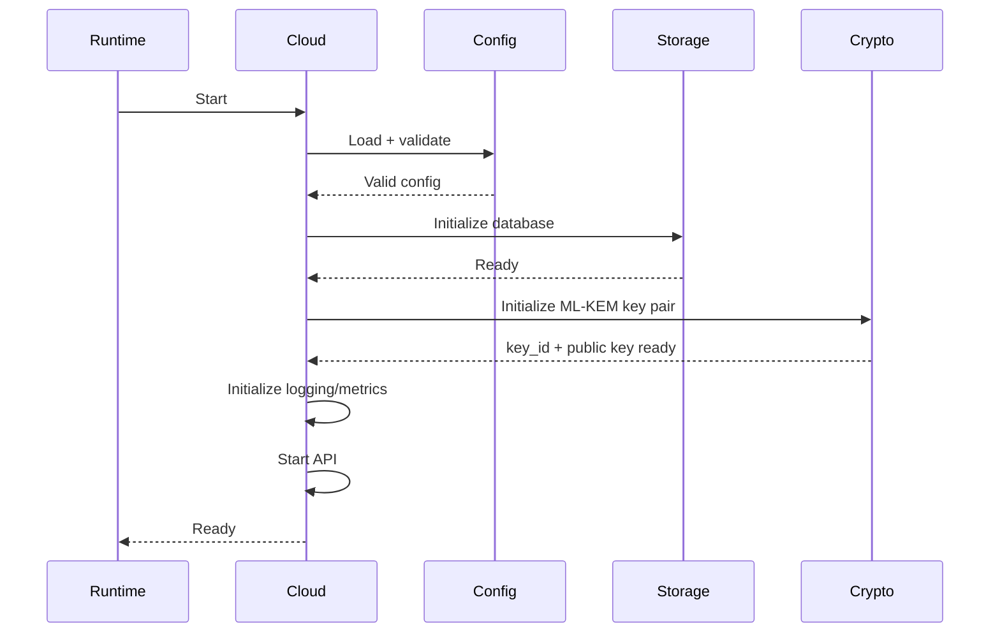

If any critical initialization fails:

```text
do not start partially ready
```

unless explicitly supported.

---

# 75. Shutdown lifecycle

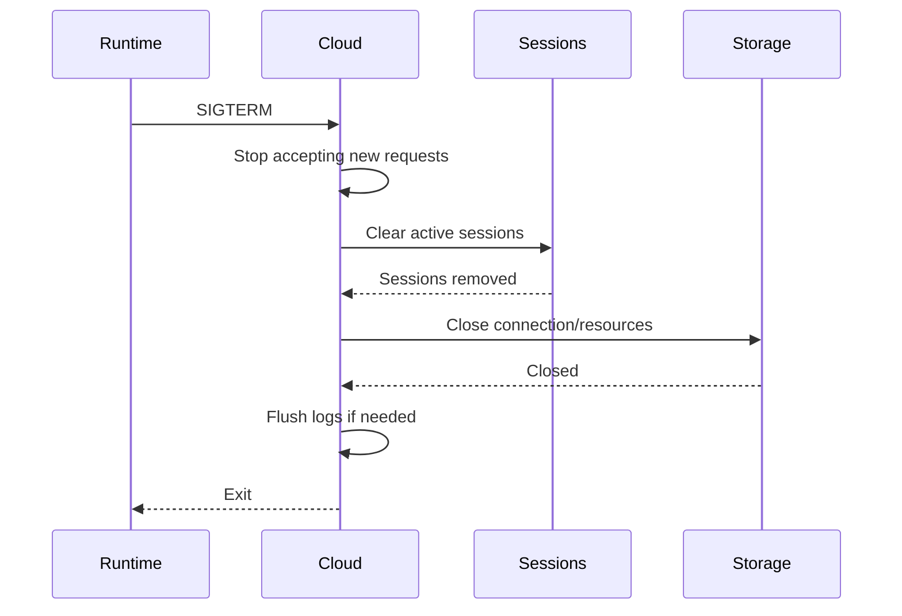

---

# 76. Storage backup

Not required for the course project.

If SQLite is used, the database file is test/demo data.

No complex backup system is needed.

Mention production backup as out of scope.

---

# 77. Docker design

The Cloud Service runs in its own container.

Conceptually:

```yaml
cloud-service:
  build: ./cloud_service
  ports:
    - "9000:9000"
  environment:
    CLOUD_ID: cloud-001
    SECURITY_MODE: mlkem
    SESSION_TTL_SECONDS: 300
    FAILURE_MODE: none
    FAILURE_RATE: 0.0
```

If SQLite file persistence is desired:

```text
mounted volume
```

could be used.

But this is optional.

---

# 78. Docker health check

Use:

```text
GET /health
```

for container liveness.

Use:

```text
GET /ready
```

for dependency readiness.

The Compose startup order may use readiness/health if needed, but avoid overly complex orchestration.

---

# 79. Complete Docker topology

```text
┌───────────────────────────────────────────────┐
│                Docker Compose                 │
│                                               │
│  ┌──────────────┐                             │
│  │Legacy Device │                             │
│  └──────┬───────┘                             │
│         │                                     │
│         ▼                                     │
│  ┌──────────────┐                             │
│  │ Edge Gateway │                             │
│  └──────┬───────┘                             │
│         │                                     │
│         │ ML-KEM + encrypted messages         │
│         ▼                                     │
│  ┌──────────────┐       ┌────────────────┐    │
│  │Cloud Service │──────>│ SQLite Storage │    │
│  └──────────────┘       └────────────────┘    │
│                                               │
└───────────────────────────────────────────────┘
```

---

# 80. Testing strategy

The Cloud Service needs strong testing because it is the final security and storage boundary.

Testing categories:

```text
unit tests
crypto wrapper tests
session tests
API tests
storage tests
failure injection tests
security tests
gateway-cloud integration tests
end-to-end tests
```

---

# 81. Configuration tests

Test:

```text
valid config loads

invalid session TTL rejected

invalid failure rate rejected

unknown failure mode rejected

invalid security mode rejected

bad database URL rejected
```

---

# 82. ML-KEM tests

Test the application wrapper, not the lattice mathematics.

Examples:

```text
key pair initialization works

public key endpoint returns expected metadata

valid encapsulation ciphertext decapsulates

gateway/cloud derive equivalent shared secret in integration test

malformed/incorrect-length encapsulation input handled safely where detectable

no secret appears in logs
```

---

# 83. Session tests

Test:

```text
session created successfully

session associated with gateway

active session found

unknown session rejected

expired session rejected

session expiry cleanup

session removed on shutdown

wrong gateway cannot use another gateway's session
```

---

# 84. Symmetric crypto tests


Test the frozen AES-256-GCM contract:

```text
valid envelope decrypts

32-byte key used

12-byte nonce accepted

modified ciphertext rejected

modified nonce rejected

wrong session key rejected

modified protocol_version AAD rejected

modified gateway_id AAD rejected

modified session_id AAD rejected

modified request_id AAD rejected

Gateway/Cloud independently build identical AAD bytes

plaintext never accepted on secure endpoint
```

No storage may occur after authentication failure.

---

# 85. Secure API tests


Test:

```text
valid SecureEnvelope -> 202

missing protocol_version -> rejected

unknown protocol_version -> rejected

missing gateway_id -> rejected

missing session_id -> rejected

missing request_id -> rejected

invalid Base64URL -> rejected

nonce not 12 bytes -> rejected

unknown session -> 409 SESSION_INVALID

expired session -> 409 SESSION_EXPIRED

gateway/session ownership mismatch -> rejected

malformed decrypted JSON -> rejected

invalid canonical data -> rejected

tampered ciphertext -> rejected

tampered AAD metadata -> rejected

plaintext body on secure endpoint -> rejected
```

---

# 86. Storage tests

Test:

```text
valid measurement persisted

record can be retrieved

multiple measurements stored

duplicate device_id + sequence handled idempotently

storage failure propagated safely

cloud_received_at populated
```

---

# 87. Failure injection tests

Test every supported mode.

Examples:

```text
none
→ no modification

public_key_unavailable
→ public key endpoint fails

mlkem_decapsulation_failure
→ no session created

session_expired
→ request rejected

decryption_failure
→ no storage

storage_failure
→ gateway receives retryable error

service_unavailable
→ 503

random + seed
→ deterministic scenario sequence
```

---

# 88. Secret-logging tests

This is particularly important.

Conceptually:

```text
known fake private/shared/session key
        ↓
exercise crypto/session workflow
        ↓
capture logs
        ↓
assert secret values absent
```

This is a strong course demonstration of critical security testing.

---

# 89. Health/readiness tests

Test:

```text
/health returns healthy when process running

Baseline Mode + DB initialized
→ /ready succeeds

Modernized Mode + DB + ML-KEM/KDF/AEAD initialized
→ /ready succeeds

no active Gateway session yet
→ /ready can still succeed

DB unavailable
→ /health may remain OK
→ /ready fails

Modernized Mode crypto initialization failure
→ /ready fails

health/readiness response contains no secrets
```

---

# 90. Gateway-cloud integration tests


Test both Gateway→Cloud paths.

### Baseline

```text
POST /api/v1/baseline/measurements
↓
CanonicalMeasurement accepted
↓
X-Request-ID propagated
↓
idempotent storage
```

### Modernized

```text
GET /api/v1/crypto/public-key
↓
Gateway ML-KEM-768 encapsulation
↓
POST /api/v1/crypto/sessions
↓
Cloud ML-KEM-768 decapsulation
↓
same shared secret
↓
same HKDF-SHA-256 32-byte session key
↓
Gateway AES-256-GCM encryption
↓
POST /api/v1/secure/measurements
↓
Cloud reconstructs same AAD
↓
Cloud authenticates/decrypts
↓
measurement stored
```

Also test:

```text
session reuse

session expiry
→ 409 SESSION_EXPIRED
→ Gateway establishes new session
→ bounded retry succeeds

unknown session
→ 409 SESSION_INVALID
→ bounded recovery

corrupted ciphertext
→ reject
→ no storage

modified AAD
→ reject
→ no storage

ML-KEM failure in modernized mode
→ no call to baseline endpoint
```

---

# 91. End-to-end tests

Full system:

```text
Legacy Device
    ↓
Edge Gateway
    ↓
ML-KEM session
    ↓
Encrypted envelope
    ↓
Cloud
    ↓
Storage
```

Verify:

```text
original temperature
=
stored temperature

original humidity
=
stored humidity

device ID preserved

sequence preserved
```

---

# 92. End-to-end failure test: invalid legacy data

```text
Legacy Device failure injection
    ↓
humidity=145
    ↓
Gateway validation rejects
    ↓
Cloud receives nothing
```

Cloud test assertion:

```text
no storage record created
```

---

# 93. End-to-end failure test: corrupted gateway ciphertext

```text
Legacy Device valid
    ↓
Gateway valid
    ↓
Gateway failure injection corrupts ciphertext
    ↓
Cloud authentication fails
    ↓
no storage
```

---

# 94. End-to-end failure test: cloud storage unavailable

```text
Legacy Device valid
    ↓
Gateway valid
    ↓
Cloud decrypts valid payload
    ↓
Cloud storage failure injected
    ↓
Cloud returns temporary failure
    ↓
Gateway retries
    ↓
legacy device eventually receives failure/success
```

This demonstrates the interaction between multiple components' failure handling.

---

# 95. Baseline measurements


Before PQC modernization, record Cloud-side baseline measurements such as:

```text
baseline request-processing latency
baseline canonical payload size
storage latency
successful request count/rate
duplicate handling
storage-failure behavior
```

Use:

```text
SECURITY_MODE=classical
FAILURE_MODE=none
```

for normal baseline runs.

After modernization, record:

```text
ML-KEM session-establishment duration
ML-KEM decapsulation duration
first secure-message latency
steady-state secure-message latency
SecureEnvelope size
AES-GCM decryption/authentication time
storage latency
```

The first secure request should be measured separately from later requests because it includes session establishment.

Use equivalent workloads when comparing baseline and modernized modes.

---

# 96. PQC-related observability

The cloud is a good place to expose post-quantum metrics.

For example:

```text
ML-KEM session count
ML-KEM failure count
ML-KEM decapsulation duration
active sessions
expired sessions
```

This directly contributes to the assignment's requirement for post-quantum-related observability.

---

# 97. Performance considerations

The Cloud Service does not need high-performance optimization.

But useful observations include:

```text
ML-KEM handshake is less frequent than data messages

symmetric crypto handles repeated payloads

session reuse reduces handshake overhead

storage may dominate some request latency
```

These can later be measured rather than assumed.

---

# 98. Concurrency

Cloud API may receive concurrent gateway requests.

Potential shared state:

```text
session dictionary
key state
SQLite connection
```

Use safe access patterns.

For a simple FastAPI-style implementation:

- avoid unsafe mutable globals where possible;
    
- protect session mutation if necessary;
    
- use storage access appropriate to concurrency.
    

No distributed locks are needed.

---

# 99. Multiple gateways

The design should conceptually support:

```text
gateway-001 ─┐
gateway-002 ─┼──> Cloud
gateway-003 ─┘
```

Each gateway gets its own sessions.

The Cloud Service keys session lookup by:

```text
session_id
```

and verifies the associated:

```text
gateway_id
```

You do not need to run multiple gateways initially.

---

# 100. Cloud identity

Configure:

```text
CLOUD_ID=cloud-001
```

This can appear in logs/health metadata.

It does not need to be included in every application payload unless useful.

---

# 101. Security properties targeted

The modernized Gateway → Cloud design aims for:

- post-quantum key establishment;
    
- confidentiality of measurement contents;
    
- integrity/authentication of encrypted payload;
    
- explicit session lifecycle;
    
- no silent downgrade;
    
- rejection of corrupted messages;
    
- secret-safe logging;
    
- failure visibility.
    

But it should **not** be described as making the full end-to-end system completely secure, because:

```text
Legacy Device → Gateway
```

still has legacy limitations.

---

# 102. Threat model

Relevant threats:

### Network tampering

Attacker modifies secure envelope.

Expected result:

```text
AEAD authentication fails
```

### Replay

Attacker resends an old valid authenticated envelope.

Protocol version `1` does **not** implement a dedicated cryptographic anti-replay counter/window.

Cloud business idempotency on:

```text
(device_id, sequence_number)
```

prevents duplicate logical database rows, but an authenticated envelope can still be replayed at the cryptographic layer.

This is accepted and documented technical debt for the course-sized system.

### Wrong/expired session

Reject.

### Modified or malformed ML-KEM ciphertext

For malformed encoding, incorrect length, or an explicit wrapper/application failure:

```text
reject session request
→ create no session
```

For a modified but correctly sized ML-KEM ciphertext, do **not** assume the library must raise a decapsulation exception. ML-KEM may use implicit-rejection behavior and return different pseudorandom keying material instead.

Therefore:

```text
successful decapsulation call
≠
proof that Gateway and Cloud derived the same key
```

Any mismatch is expected to surface when later authenticated secure communication fails. The project uses explicit failure injection to test operational decapsulation-failure handling without making an incorrect claim about every malformed ciphertext.

### Secret leakage through logs

Prevent via logging policy/tests.

### Malicious malformed input

Validate before use.

### Storage failure

Fail safely and expose operational state.

---

# 103. Replay considerations

Because the measurement already has:

```text
device_id
sequence_number
```

and storage enforces logical uniqueness, retransmission of the same logical measurement does not create a second database row.

This is **business idempotency, not cryptographic replay protection**.

Protocol version `1` intentionally has no dedicated cryptographic anti-replay counter/window.

Future improvement:

```text
per-session authenticated message counter
or
replay window
```

---

# 104. Authentication limitation

The design secures payloads based on the derived session key, but strong long-term identity authentication of gateways/cloud is simplified.

Known limitation:

```text
public-key trust and gateway identity are simplified
```

This should appear explicitly in final risk analysis.

---

# 105. Technical debt

Important cloud technical debt includes:

### Ephemeral ML-KEM private key

Generated at startup rather than using persistent secure key storage.

### In-memory sessions

Restart invalidates sessions.

### Simplified gateway identity

No production PKI/client certificates.

### SQLite

Suitable for simulation, not large-scale cloud deployment.

### No dedicated cryptographic anti-replay counter/window

Business idempotency is based on `(device_id, sequence_number)`, but authenticated envelopes may still be replayed at the cryptographic layer.

Future improvement:

```text
per-session authenticated counter
or
replay window
```

### No high availability

Single cloud instance.

### No persistent session store

No multi-instance shared state.

### Simple key rotation

No automated enterprise key lifecycle.

### Failure injection in application

Useful for testing but would not belong in production code unchanged.

All of these are good candidates for the final technical-debt discussion required by the project.

---

# 106. Out of scope

Explicitly out of scope:

```text
real cloud provider deployment architecture
Kubernetes
multi-region replication
HSM
production PKI
enterprise IAM
distributed database
Kafka
Redis
service mesh
frontend
analytics dashboard
production backup/disaster recovery
real user authentication
automatic ML-KEM key rotation infrastructure
```

---

# 107. AI-assisted implementation plan

Like the gateway, Cloud Service should be split into multiple meaningful AI tasks.

Possible breakdown:

```text
Task 1 — Cloud application skeleton and configuration

Task 2 — Storage model and repository

Task 3 — Health/readiness endpoints

Task 4 — ML-KEM key management

Task 5 — Session establishment endpoint

Task 6 — Session manager

Task 7 — KDF wrapper

Task 8 — Symmetric decryption wrapper

Task 9 — Secure measurement endpoint

Task 10 — Measurement persistence

Task 11 — Query API

Task 12 — Failure injection

Task 13 — Logging and metrics

Task 14 — Crypto/security tests

Task 15 — Gateway-cloud integration tests

Task 16 — Docker packaging
```

Each should follow the AI-history workflow and human-review process.

---

# 108. Human review focus

For AI-generated Cloud code, reviewers should especially inspect:

```text
private key exposure

shared/session key logging

wrong ML-KEM API usage

unsafe key persistence

incorrect KDF usage

nonce misuse

failure to authenticate before decrypt/use

plaintext fallback

incorrect session validation

error messages leaking crypto details

storage occurring before validation

duplicate handling bugs

retry/error classification mistakes

unnecessary dependencies
```

---

# 109. Cloud runtime state model

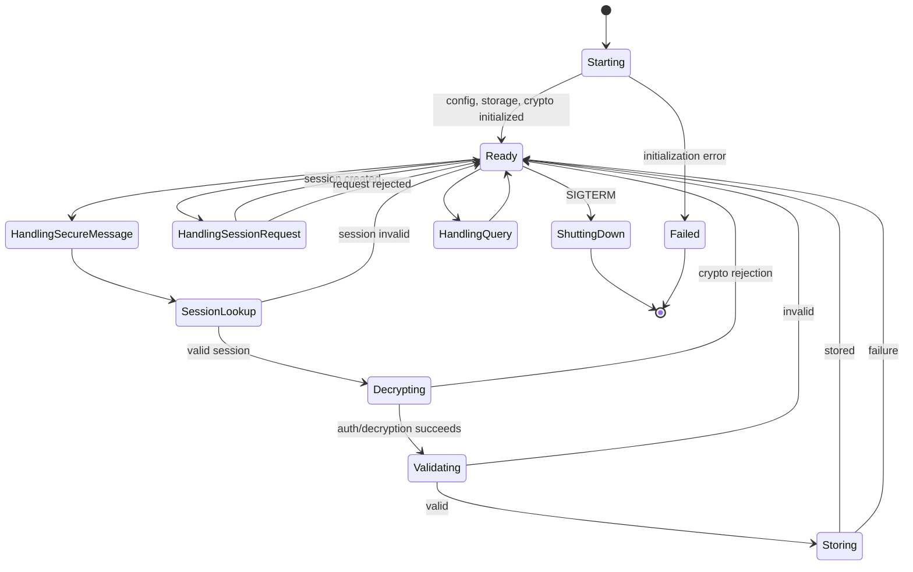

---

# 110. Complete secure-flow sequence


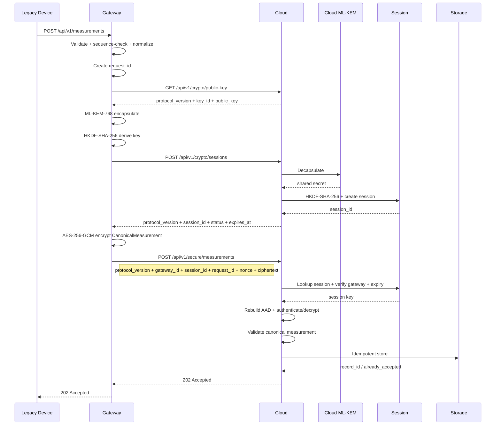

---

# 111. Failure flow: corrupted ciphertext

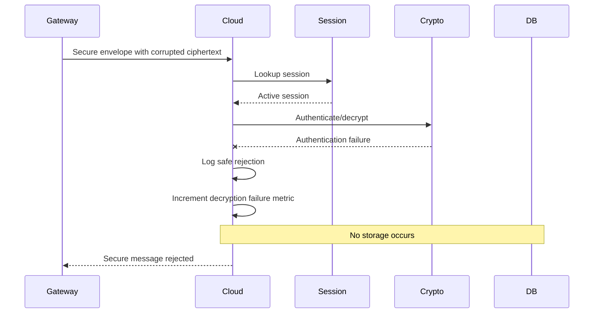

---

# 112. Failure flow: expired session


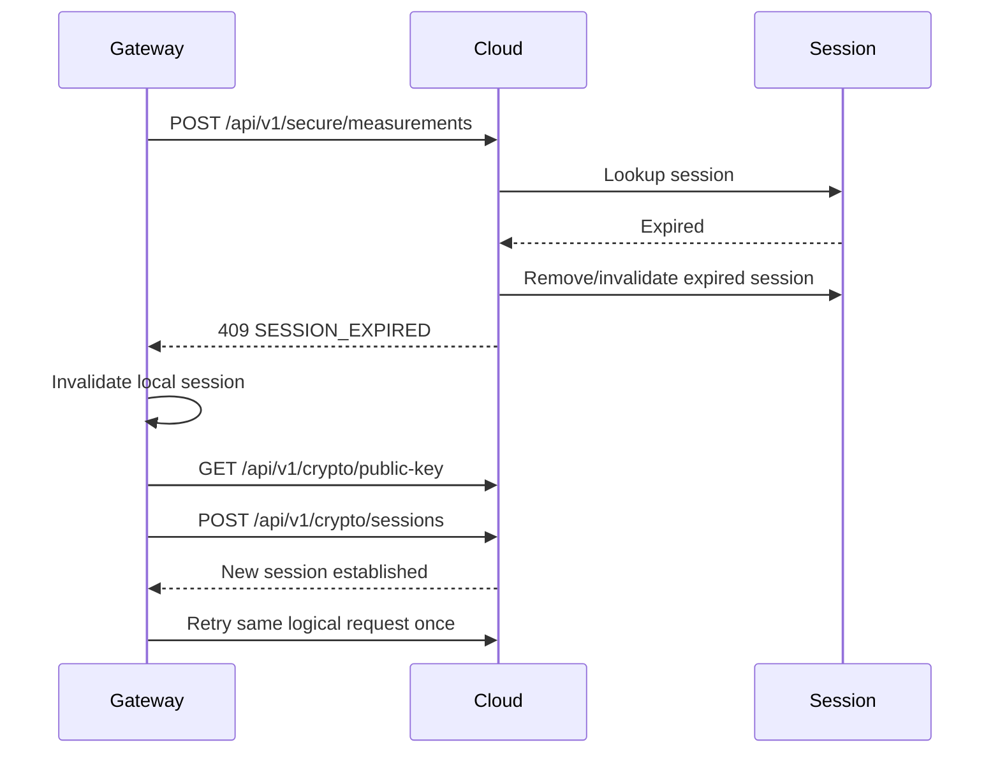

---

# 113. Failure flow: storage failure

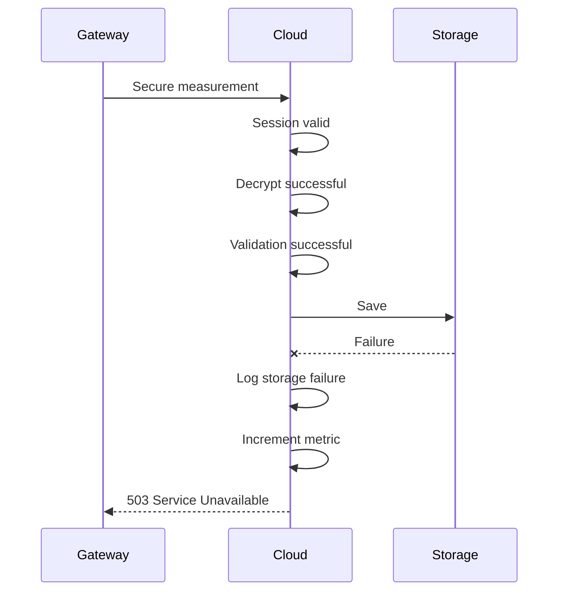

---

# 114. Failure injection flow

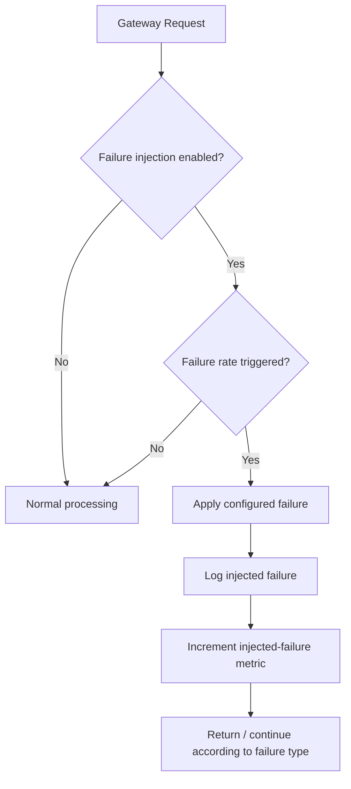

---

# 115. Complete system architecture


With all three proposals combined:

```mermaid
flowchart LR

    subgraph LEGACY["Legacy System"]
        SENSOR[Sensor Generator]
        SERIAL[Serialize Valid Measurement]
        LFAIL[Legacy Payload Failure Injector]
        LCLIENT[Gateway Client]

        SENSOR --> SERIAL
        SERIAL --> LFAIL
        LFAIL --> LCLIENT
    end

    subgraph GATEWAY["Edge Gateway"]
        API[Legacy API]
        VAL[Validation]
        NORM[Normalization]
        SEQ[Sequence Tracking]
        RID[Request ID]

        GFAIL[Gateway Failure Injector]

        SESSION[Session Manager]
        MLKEMG[ML-KEM-768 Encapsulation]
        KDFG[HKDF-SHA-256]
        ENCRYPT[AES-256-GCM]

        BASECLIENT[Baseline Cloud Transport]
        SECURECLIENT[Secure Cloud Transport]

        API --> VAL
        VAL --> SEQ
        SEQ --> NORM
        NORM --> RID
        RID --> GFAIL

        GFAIL --> BASECLIENT
        GFAIL --> SESSION
        SESSION --> MLKEMG
        MLKEMG --> KDFG
        SESSION --> ENCRYPT
        ENCRYPT --> SECURECLIENT
    end

    subgraph CLOUD["Cloud Service"]
        BAPI[Baseline API]
        CAPI[Crypto / Secure API]
        CFAIL[Cloud Failure Injector]
        CSESSION[Session Manager]
        MLKEMC[ML-KEM-768 Decapsulation]
        KDFC[HKDF-SHA-256]
        DECRYPT[AES-256-GCM Decryption]
        CVAL[Canonical Validation]
        IDEMP[Idempotency]
        STORAGE[SQLite Storage]

        BAPI --> CVAL
        CAPI --> CFAIL
        CFAIL --> CSESSION
        CSESSION --> MLKEMC
        MLKEMC --> KDFC
        CSESSION --> DECRYPT
        DECRYPT --> CVAL
        CVAL --> IDEMP
        IDEMP --> STORAGE
    end

    LCLIENT -->|Legacy HTTP/JSON| API
    BASECLIENT -->|POST /api/v1/baseline/measurements| BAPI
    SECURECLIENT -->|ML-KEM session + SecureEnvelope| CAPI
```

---

# 116. Cross-component consistency matrix


| Concern | Legacy Device | Edge Gateway | Cloud Service |
|---|---|---|---|
| Device data | generates valid domain measurement, may mutate serialized test payload | validates/normalizes | validates/stores canonical data |
| Legacy protocol | sends | receives | unaware |
| Canonical model | unaware | creates | consumes |
| Baseline Cloud path | unaware | sends canonical JSON + `X-Request-ID` | receives/validates/stores |
| ML-KEM | none | ML-KEM-768 encapsulation | ML-KEM-768 decapsulation |
| KDF | none | HKDF-SHA-256 | HKDF-SHA-256 |
| Session | none | creates/uses client-side session state | creates/validates Cloud-side session state |
| Symmetric crypto | none | AES-256-GCM encrypts | AES-256-GCM authenticates/decrypts |
| Secure request ID | none | creates/authenticates | validates/logs |
| Failure injection | bad wire payload | processing/crypto/cloud faults | crypto/storage/service faults |
| Logging | basic | detailed | detailed |
| Metrics | minimal/no endpoint | yes | yes |
| Health endpoint | no | yes | yes |
| Storage | none | none | SQLite |
| Cloud protocol | unaware | sends | receives |

This matrix is the canonical high-level consistency check across the three component designs.

---

# 117. Cloud design acceptance checklist

Before implementation, the team should approve the following.

### Architecture

-  Cloud only communicates with Gateway for secure application traffic.
    
-  Cloud has no direct Legacy Device dependency.
    
-  Cloud responsibilities are clearly separated.
    
-  Storage does not leak into route handlers unnecessarily.
    
-  Crypto/session logic is isolated.
    

### ML-KEM

-  Existing maintained ML-KEM implementation will be used.
    
-  Cloud owns ML-KEM private key.
    
-  Gateway receives public key only.
    
-  `protocol_version`, `algorithm`, and `key_id` are defined on the public-key response.
    
-  Public key and ML-KEM ciphertext use Base64URL.
    
-  `ML-KEM-768` is the frozen parameter set.
    
-  Decapsulation flow defined.
    
-  Shared secret never leaves crypto/session layer unnecessarily.
    
-  Shared secret is never logged.
    
-  No manual implementation of ML-KEM.
    

### Session management

-  Session creation flow defined.
    
-  `session_id` defined.
    
-  Session associated with gateway.
    
-  Session TTL agreed.
    
-  Expired session behavior defined.
    
-  Unknown session behavior defined as `409 SESSION_INVALID`.
    
-  Expired session behavior defined as `409 SESSION_EXPIRED`.
    
-  Session recovery is Gateway-initiated and bounded.
    
-  Session cleared at shutdown.
    
-  In-memory session limitation documented.
    

### KDF

-  Gateway/cloud use identical KDF.
    
-  No custom homemade KDF.
    
-  HKDF-SHA-256 parameters documented: `salt=None`, fixed `info`, 32-byte output.
    
-  Derived session key never logged.
    

### Authenticated encryption

-  AES-256-GCM is used by both Gateway and Cloud.
    
-  12-byte nonce handling defined.
    
-  AAD fields and deterministic encoding agreed.
    
-  Tampering is rejected.
    
-  Wrong key is rejected.
    
-  Plaintext never accepted on secure endpoint.
    

### Secure envelope

-  `protocol_version` defined.
    
-  `gateway_id` defined.
    
-  `session_id` defined.
    
-  `request_id` defined and authenticated.
    
-  `nonce` defined as 12-byte Base64URL value.
    
-  `ciphertext` defined.
    
-  Base64URL encoding defined for binary JSON fields.
    
-  Unknown protocol versions rejected.
    

### Validation

-  Envelope validated before crypto.
    
-  Session validated before decryption.
    
-  Decrypted measurement validated.
    
-  Gateway identity consistency checked.
    
-  Invalid measurement never stored.
    

### Storage

-  Storage technology agreed.
    
-  SQLite chosen unless stronger reason exists.
    
-  Measurement table defined.
    
-  `record_id` defined.
    
-  `gateway_received_at` and `cloud_received_at` defined.
    
-  Duplicate behavior defined.
    
-  Repository abstraction defined.
    
-  Storage errors handled.
    

### Idempotency

-  Duplicate `(device_id, sequence_number)` policy agreed.
    
-  Gateway retries do not create duplicate records.
    
-  Device-restart sequence limitation documented.
    

### Failure injection

-  `FAILURE_MODE` defined.
    
-  `FAILURE_RATE` defined.
    
-  `FAILURE_SEED` defined.
    
-  Cloud-specific scenarios selected.
    
-  ML-KEM failures can be simulated.
    
-  Decryption failures can be simulated.
    
-  Storage failures can be simulated.
    
-  Service-unavailable mode exists if useful.
    
-  Failure injection disabled by default.
    
-  Failure injection never leaks secrets.
    

### Logging

-  Startup logged.
    
-  Session creation logged safely.
    
-  Session failures logged.
    
-  Decryption failures logged safely.
    
-  Storage failures logged.
    
-  Injected failures logged.
    
-  Correlation IDs used.
    
-  Secrets never logged.
    

### Metrics

-  Secure request count defined.
    
-  Secure request rejection metric defined.
    
-  ML-KEM session count defined.
    
-  ML-KEM failure metric defined.
    
-  Decapsulation duration defined.
    
-  Decryption failure metric defined.
    
-  Storage failure metric defined.
    
-  Stored measurement count defined.
    
-  Duplicate metric defined.
    
-  Failure-injection metric defined.
    

### Health/readiness

-  `/health` defined.
    
-  `/ready` defined.
    
-  DB readiness considered.
    
-  ML-KEM initialization readiness considered.
    
-  Health output contains no sensitive data.
    
-  Docker health strategy defined.
    

### Failure handling

-  Invalid envelope behavior defined.
    
-  Unsupported protocol behavior defined.
    
-  Unknown session behavior defined.
    
-  Expired session behavior defined.
    
-  Malformed ML-KEM input and simulated wrapper/decapsulation failure behavior defined.

-  Modified valid-length ML-KEM ciphertext implicit-rejection caveat documented.
    
-  Decryption/authentication failure behavior defined.
    
-  Validation failure behavior defined.
    
-  Storage failure behavior defined.
    
-  Invalid config behavior defined.
    

### Testing

-  Config tests planned.
    
-  ML-KEM wrapper tests planned.
    
-  Session tests planned.
    
-  KDF tests planned.
    
-  Symmetric crypto tests planned.
    
-  Secure API tests planned.
    
-  Storage tests planned.
    
-  Idempotency tests planned.
    
-  Failure-injection tests planned.
    
-  Secret-log tests planned.
    
-  Health tests planned.
    
-  Gateway-cloud integration tests planned.
    
-  Full end-to-end tests planned.
    

### Operations

-  Docker behavior defined.
    
-  Cloud port defined.
    
-  Environment configuration defined.
    
-  SQLite persistence choice defined.
    
-  Graceful shutdown defined.
    
-  Health usable by deployment.
    
-  Metrics exposed.
    
-  Logging strategy consistent with Gateway.
    

### Migration

-  Baseline mode defined.
    
-  ML-KEM mode defined.
    
-  Cloud never silently accepts plaintext when ML-KEM mode expected.
    
-  Initial modernized policy is fail-closed; no runtime plaintext fallback.
    
-  Baseline and secure endpoints are separate.
    
-  Gateway/cloud mode compatibility agreed.
    

### Security

-  Private key never exposed.
    
-  Shared secret never logged.
    
-  Session key never logged.
    
-  Authenticated encryption required.
    
-  Malformed input rejected.
    
-  Cryptographic error messages are generic externally.
    
-  Simplified trust model documented.
    

### Technical debt

-  Ephemeral ML-KEM key documented.
    
-  In-memory sessions documented.
    
-  SQLite limitation documented.
    
-  Simplified gateway authentication documented.
    
-  Absence of dedicated cryptographic anti-replay counter/window documented.
    
-  No high availability documented.
    
-  Key rotation limitation documented.
    

### Course alignment

-  Cloud participates in baseline system.
    
-  Cloud participates in modernized ML-KEM system.
    
-  ML-KEM is integrated through existing implementation.
    
-  PQC-related observability exists.
    
-  Failure/security testing can be demonstrated.
    
-  Deployment/test environment supported.
    
-  AI-generated code can be reviewed and evaluated.
    
-  Remaining risks and technical debt are explicit.
    
-  Scope remains appropriate for the course.
    

---

# 118. Final Cloud Service specification

The final Cloud Service can be summarized as:

> The Cloud Service is the modern receiving endpoint of the project's edge–cloud architecture. It provides the cloud side of the post-quantum-secured Gateway–Cloud communication path. The service owns an ML-KEM key pair, publishes the public key together with a key identifier, decapsulates gateway-provided ML-KEM ciphertext, derives 32-byte session keys using HKDF-SHA-256 with `salt=None` and the frozen protocol context, and manages short-lived gateway sessions in memory. Gateway measurements are transmitted through a versioned secure envelope containing `protocol_version`, `gateway_id`, `session_id`, `request_id`, `nonce`, and `ciphertext`, and are protected using AES-256-GCM with a 12-byte nonce and authenticated metadata. The Cloud Service validates the envelope, session identity, decrypted canonical measurement, and gateway metadata before persistence.
> 
> Accepted measurements are stored in a deliberately simple database, preferably SQLite for the project scope, using an idempotent model that prevents transport retries from creating duplicate logical records. The Cloud Service exposes minimal measurement-query functionality for demonstration and testing, together with health, readiness, metrics, structured logging, and graceful shutdown.
> 
> A dedicated configurable failure-injection subsystem allows controlled simulation of ML-KEM wrapper/decapsulation failures, invalid or expired sessions, decryption failures, storage failures, service unavailability, processing delay, and related negative scenarios. These injected failures are operational test hooks and are not used to claim that every modified valid-length ML-KEM ciphertext naturally causes an explicit decapsulation exception. Failure injection is disabled by default, never leaks secret material, and is intended only to make failure/security behavior repeatable and observable during testing.
> 
> The Cloud Service never logs ML-KEM private keys, shared secrets, derived session keys, credentials, or other secret material. Cryptographic rejection occurs before storage, runtime fallback to weaker communication is not implemented; modernized mode fails closed, and externally returned errors avoid exposing detailed cryptographic internals. Known limitations—including ephemeral ML-KEM keys, in-memory session management, simplified gateway authentication, SQLite storage, absence of dedicated cryptographic anti-replay counter/window, and lack of high availability—are explicitly documented as technical debt rather than hidden.

