# Shared Cross-Component Protocol Specification

## 1. System contract

The complete architecture is:

```text
┌─────────────────────┐
│    Legacy Device    │
│                     │
│ temperature         │
│ humidity            │
│ timestamp           │
│ sequence number     │
└──────────┬──────────┘
           │
           │ Legacy Protocol
           │ HTTP + JSON
           ▼
┌─────────────────────┐
│    Edge Gateway     │
│                     │
│ validation          │
│ normalization       │
│ sequence tracking   │
│ ML-KEM              │
│ session management  │
│ encryption          │
└──────────┬──────────┘
           │
           │ Modern Protocol
           │ ML-KEM + AEAD
           ▼
┌─────────────────────┐
│    Cloud Service    │
│                     │
│ ML-KEM              │
│ sessions            │
│ decryption          │
│ validation          │
│ storage             │
└─────────────────────┘
```

There are therefore **two separate protocol boundaries**:

```text
Protocol A
Legacy Device → Edge Gateway

Protocol B
Edge Gateway ↔ Cloud Service
```

They must not be mixed.

---

# 2. Protocol design principles

All three components should follow these rules:

- use explicit versioned APIs;
    
- use UTC timestamps;
    
- use JSON for application-level messages;
    
- validate all incoming data;
    
- do not silently downgrade security;
    
- do not expose cryptographic secrets;
    
- distinguish retryable and non-retryable failures;
    
- support reproducible failure injection;
    
- use correlation IDs for cross-component tracing;
    
- keep the protocols intentionally small.
    

---

# 3. Protocol A — Legacy Device → Edge Gateway

The Legacy Device sends measurements using simple HTTP + JSON.

This intentionally represents the legacy side.

```text
Legacy Device
      │
      │ HTTP/JSON
      ▼
Edge Gateway
```

No ML-KEM is used here.

---

# 4. Legacy endpoint

```http
POST /api/v1/measurements
Content-Type: application/json
```

Gateway listens on this endpoint.

Example URL:

```text
http://edge-gateway:8000/api/v1/measurements
```

---

# 5. Legacy measurement schema

```json
{
  "device_id": "sensor-001",
  "temperature_c": 21.7,
  "humidity_pct": 42.5,
  "timestamp": "2026-09-21T13:45:31Z",
  "sequence_number": 184
}
```

Formal rules:

|Field|Type|Required|Rule|
|---|---|--:|---|
|`device_id`|string|Yes|non-empty|
|`temperature_c`|number|Yes|`-40 <= value <= 85`|
|`humidity_pct`|number|Yes|`0 <= value <= 100`|
|`timestamp`|string|Yes|ISO-8601 UTC|
|`sequence_number`|integer|Yes|`0 <= value <= 9223372036854775807`|

The Legacy request object must contain exactly these five fields. Additional
fields are rejected, not ignored. A parsed JSON object with extra fields is a
schema error and returns `422 Unprocessable Entity` when the Legacy API is implemented.

The sequence-number domain is the non-negative signed 64-bit integer range,
matching Cloud SQLite `INTEGER` storage. This bound also applies to canonical
measurements in both modes. Larger parsed integers are domain errors: Gateway
returns `422 INVALID_MEASUREMENT` before updating sequence state or forwarding;
Cloud returns `422 INVALID_MEASUREMENT` before persistence. JSON uses an integer,
without float conversion, truncation, wrapping, or string encoding. The maximum
value must survive persistence, query, and idempotent retransmission exactly.

---

# 6. Legacy data model

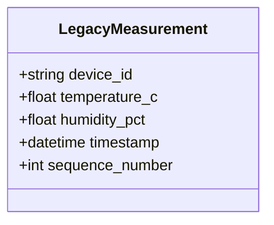

---

# 7. Legacy success response

When the entire request has successfully reached the cloud:

```http
HTTP/1.1 202 Accepted
Content-Type: application/json
```

```json
{
  "status": "accepted"
}
```

The gateway should return `202` only after successful downstream forwarding in the initial design.

---

# 8. Legacy error responses


Recommended contract:

| Situation | Gateway response |
|---|--:|
| Malformed or unparseable JSON/body syntax | `400 Bad Request` |
| Parsed JSON with missing, wrongly typed, or domain-invalid required field | `422 Unprocessable Entity` |
| Duplicate/out-of-order sequence rejected | `409 Conflict` |
| Gateway internal error | `500 Internal Server Error` |
| Cloud temporarily unavailable | `503 Service Unavailable` |
| PQC/session temporarily unavailable | `503 Service Unavailable` |

The `400` / `422` boundary is frozen project-wide:

```text
malformed or unparseable JSON/body syntax
→ 400 Bad Request

JSON parses, but a required field is missing, has the wrong type,
or violates a domain rule
→ 422 Unprocessable Entity
```

Therefore the Legacy `missing_field` failure scenario expects `422`.

All application errors use the common structured body:

```json
{
  "error": {
    "code": "INVALID_MEASUREMENT",
    "message": "measurement validation failed"
  }
}
```

Examples of Legacy-facing error codes:

```text
INVALID_JSON
INVALID_MEASUREMENT
DUPLICATE_SEQUENCE
OUT_OF_ORDER_SEQUENCE
CLOUD_UNAVAILABLE
INTERNAL_ERROR
```

Do not return:

```text
stack traces
internal exception names
filesystem paths
cryptographic details
```

to Legacy clients.

---

# 9. Retry contract for the Legacy Device

Legacy Device retries:

```text
network error
timeout
500
502
503
504
```

It does **not** retry:

```text
400
409
422
```

Conceptually:

```text
send
 ↓
response?
 ├── 2xx → success
 ├── 4xx → stop
 └── retryable failure
        ↓
      retry
```

---

# 10. Legacy request sequence

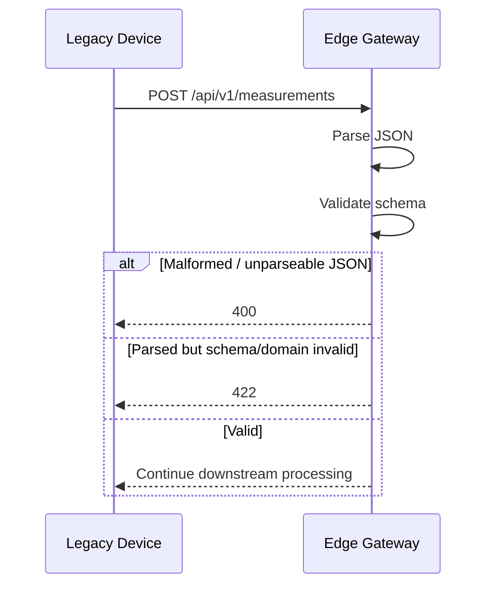

---

# 11. Gateway canonical model

Once the gateway accepts the legacy payload, it converts it into a canonical representation.

```json
{
  "device_id": "sensor-001",
  "temperature_c": 21.7,
  "humidity_pct": 42.5,
  "measured_at": "2026-09-21T13:45:31Z",
  "sequence_number": 184,
  "received_at": "2026-09-21T13:45:31.218Z",
  "gateway_id": "gateway-001"
}
```

Notice:

```text
Legacy timestamp
      ↓
measured_at
```

and the gateway adds:

```text
received_at
gateway_id
```

---

# 12. Canonical data model

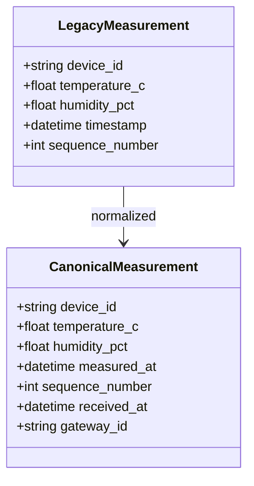

---

# 13. Sequence-number semantics


For each `device_id`, the Gateway tracks:

```text
last_sequence_number
```

The sequence tracker records the **last valid sequence observed by the Gateway**, not the last sequence successfully stored by the Cloud.

Rules:

```text
first valid sequence
→ accept

new == last + 1
→ accept

new > last + 1
→ accept + record gap

new == last
→ reject as duplicate with 409

new < last
→ reject as out-of-order with 409
```

Example:

```text
100
101
103
```

means:

```text
sequence 102 may have been lost
```

The Gateway accepts `103` and records:

```text
sequence_gap_detected
```

A gap is **not automatically rejected**.

## State-update timing

The sequence state is committed after:

```text
schema/domain validation
+
sequence-policy acceptance
```

and **before** downstream Cloud delivery.

Therefore:

```text
receive seq=10
↓
validate successfully
↓
sequence policy accepts
↓
last_sequence_number becomes 10
↓
Cloud delivery later fails
```

The Gateway still remembers that sequence `10` was observed.

This makes sequence tracking a property of the Legacy→Gateway stream, while Cloud-delivery success remains a separate concern.

Sequence state is in memory only. Gateway restart loses it; this is accepted technical debt for the course system.

---

# 14. Protocol B — Gateway ↔ Cloud


The Gateway–Cloud protocol has two explicit modes:

```text
Baseline Mode
configuration value:
SECURITY_MODE=classical
```

and:

```text
Modernized Mode
configuration value:
SECURITY_MODE=mlkem
```

This terminology should be used consistently throughout the project.

Both modes use separate Cloud endpoints. The Cloud never guesses whether a request is plaintext or encrypted.

---

# 15. Baseline Mode


Configuration:

```text
SECURITY_MODE=classical
```

This is called **Baseline Mode**.

Architecture:

```text
Gateway
   │
   │ CanonicalMeasurement JSON
   │ X-Request-ID header
   ▼
Cloud
```

Endpoint:

```http
POST /api/v1/baseline/measurements
Content-Type: application/json
X-Request-ID: req-...
```

The body is the plain `CanonicalMeasurement`.

The baseline endpoint is separate from the secure endpoint. This prevents ambiguity between plaintext and encrypted payloads and gives the project a clean before/after modernization comparison.

Baseline Mode is entered only through explicit configuration. It is not an automatic fallback from Modernized Mode.

---

# 16. Baseline cloud payload

```json
{
  "device_id": "sensor-001",
  "temperature_c": 21.7,
  "humidity_pct": 42.5,
  "measured_at": "2026-09-21T13:45:31Z",
  "sequence_number": 184,
  "received_at": "2026-09-21T13:45:31.218Z",
  "gateway_id": "gateway-001"
}
```

The cloud validates and stores this directly.

This is primarily for:

- baseline functionality;
    
- baseline latency;
    
- baseline message-size comparison;
    
- demonstrating modernization.
    

---

# 17. Modernized Mode


Configuration:

```text
SECURITY_MODE=mlkem
```

This is called **Modernized Mode**.

Path:

```text
Gateway
  ↓
GET /api/v1/crypto/public-key
  ↓
ML-KEM-768 encapsulation
  ↓
POST /api/v1/crypto/sessions
  ↓
HKDF-SHA-256 → 32-byte session key
  ↓
AES-256-GCM encrypt CanonicalMeasurement
  ↓
POST /api/v1/secure/measurements
  ↓
Cloud authenticates/decrypts
  ↓
validate + idempotent storage
```

The Legacy Device contract remains unchanged.

Modernized Mode uses `PQC_FAILURE_POLICY=fail_closed`. A cryptographic or session-establishment failure never causes an automatic plaintext downgrade.

---

# 18. Cryptographic suite


The cryptographic suite is now **frozen for protocol version `1`**.

This is a project design decision, not a course-mandated algorithm combination.

```text
Key establishment:
ML-KEM-768

Key derivation:
HKDF-SHA-256

Payload protection:
AES-256-GCM

AEAD nonce:
12 bytes / 96 bits
```

Rationale:

```text
ML-KEM-768
→ post-quantum key establishment

HKDF-SHA-256
→ standard derivation of application/session key material

AES-256-GCM
→ confidentiality + integrity/authentication
```

All primitives must come from maintained libraries.

No cryptographic primitive is implemented manually.

The **concrete libraries** may still be selected during implementation, but the algorithm suite must not change because one library exposes a different convenience API.

---

# 19. Crypto-suite identifier


Protocol version `1` corresponds to one fixed suite:

```text
MLKEM768-HKDFSHA256-AES256GCM
```

This identifier may appear in documentation/tests as:

```text
CRYPTO_SUITE
```

but it is not negotiated per message and does not need to be configurable in the initial implementation.

The secure envelope therefore does not include an `algorithm` field.

Keeping one fixed suite avoids downgrade/negotiation complexity and prevents Gateway/Cloud configuration drift.

---

# 20. Protocol version


All versioned Gateway–Cloud security messages use:

```text
protocol_version = "1"
```

It appears in:

```text
GET /api/v1/crypto/public-key response

POST /api/v1/crypto/sessions request

POST /api/v1/crypto/sessions response

SecureEnvelope
```

Purpose:

```text
future protocol evolution
clear compatibility checks
safe rejection of unknown formats
no implicit downgrade
```

The Cloud rejects unsupported versions before cryptographic processing where practical.

---

# 21. Cloud public-key endpoint

```http
GET /api/v1/crypto/public-key
```

Response:

```json
{
  "protocol_version": "1",
  "algorithm": "ML-KEM-768",
  "key_id": "cloud-key-001",
  "public_key": "<base64url-encoded-public-key>"
}
```

---

# 22. Binary encoding

All binary crypto material transported through JSON should use:

```text
Base64URL without whitespace
```

This includes:

```text
public_key
ML-KEM ciphertext
nonce
encrypted ciphertext
```

Do not use hexadecimal unless a strong implementation reason emerges.

Base64 is smaller and standard for binary-in-JSON transport.

---

# 23. Public key response model

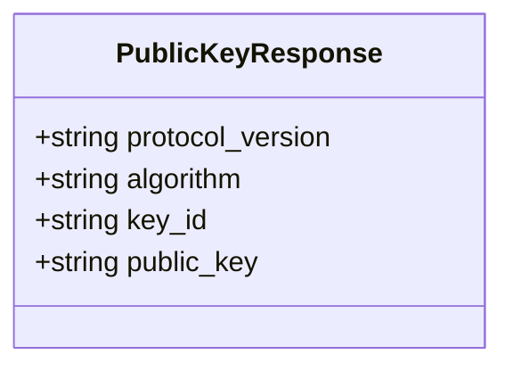

---

# 24. Public-key trust assumption


For this course project:

> The Gateway trusts the ML-KEM public key returned by the explicitly configured Cloud Service endpoint in the controlled test environment.

The response includes:

```text
protocol_version
algorithm
key_id
public_key
```

This is **not production-grade identity authentication**.

ML-KEM establishes shared keying material, but it does not by itself authenticate the identity of the Cloud.

Known limitation:

```text
No full PKI
No certificate-based Cloud authentication
No public-key pinning
No mTLS
```

Potential production improvements include:

```text
TLS server authentication
mTLS
signed key distribution
public-key pinning
PKI/HSM/KMS-backed identity management
```

The project must therefore claim:

```text
post-quantum key establishment
+
authenticated application-payload protection
on Gateway ↔ Cloud
```

not a complete production identity-authentication solution.

---

# 25. Session establishment request

Gateway performs:

```text
ML-KEM.encapsulate(public_key)
```

and obtains:

```text
shared_secret
encapsulation_ciphertext
```

Gateway then derives:

```text
session_key = HKDF(shared_secret)
```

and sends:

```http
POST /api/v1/crypto/sessions
```

Payload:

```json
{
  "protocol_version": "1",
  "gateway_id": "gateway-001",
  "key_id": "cloud-key-001",
  "encapsulation_ciphertext": "<base64url>"
}
```

---

# 26. Session establishment response

Cloud:

```text
decode ciphertext
      ↓
ML-KEM decapsulation
      ↓
shared secret / keying material
      ↓
HKDF
      ↓
session key
      ↓
create session
```

For a normal valid encapsulation produced by the Gateway, both sides derive equivalent shared keying material and therefore the same session key.

Do **not** assume that every modified, correctly sized ML-KEM ciphertext must cause an explicit decapsulation exception. ML-KEM implementations may use implicit-rejection behavior and return different pseudorandom keying material instead. Therefore an apparently successful decapsulation call is not, by itself, proof that both sides derived the same key.

Response:

```json
{
  "protocol_version": "1",
  "session_id": "sess-550e8400...",
  "status": "established",
  "expires_at": "2026-09-21T13:50:31Z"
}
```

---

# 27. Session establishment sequence

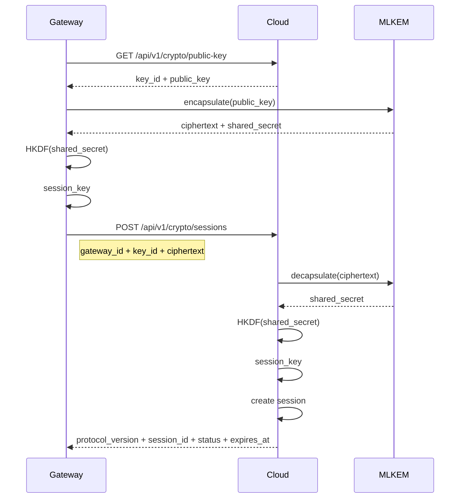

---

# 28. KDF context


Gateway and Cloud use one frozen HKDF contract.

```text
Algorithm:
HKDF-SHA-256

Input key material:
ML-KEM shared secret

Salt:
None

Output:
32 bytes

Info/context:
"ml-kem-project:v1:gateway-cloud-session"
```

Conceptually:

```text
session_key =
HKDF-SHA256(
    input_key_material = mlkem_shared_secret,
    salt = None,
    length = 32,
    info = b"ml-kem-project:v1:gateway-cloud-session"
)
```

The values must be identical on both sides.

Do not replace this with:

```text
SHA256(shared_secret)
custom concatenation
home-made stretching logic
```

The maintained library's standard HKDF API must be used.

---

# 29. Session model

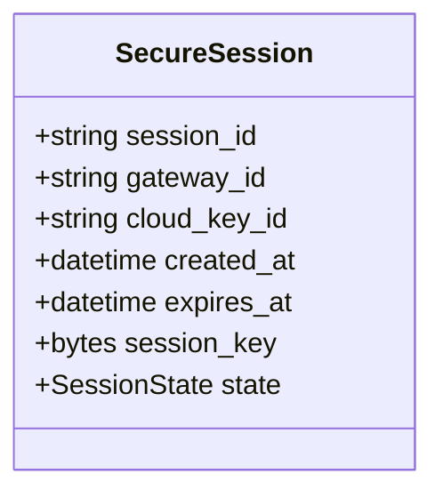

The actual key bytes must never be serialized into:

```text
logs
API responses
database
AI history
```

---

# 30. Session lifetime


The initial session lifetime is fixed as:

```text
SESSION_TTL_SECONDS=300
```

A session carries multiple secure messages:

```text
ML-KEM handshake
   ↓
message 1
message 2
message 3
...
message N
   ↓
time-based expiry
   ↓
new handshake
```

The initial protocol uses **time-based expiry only**.

The Cloud does not silently extend session lifetime.

Tests should use a mocked clock or a much shorter test TTL instead of waiting five real minutes.

---

# 31. Session ownership

Every session belongs to:

```text
one gateway_id
```

Cloud stores:

```text
session_id
gateway_id
key_id
created_at
expires_at
session_key
```

A gateway cannot use another gateway's session.

---

# 32. Session expiration


The Gateway should check local expiry before sending.

The Cloud independently checks expiry on every secure request.

If expired:

```text
Cloud invalidates/removes session
↓
Cloud returns 409 SESSION_EXPIRED
↓
Gateway discards local session
↓
Gateway fetches current public key
↓
Gateway establishes new ML-KEM session
↓
Gateway retries the same logical request once
```

The one recovery attempt is bounded.

Expired sessions are never silently extended.

---

# 33. Secure envelope

Once a session exists, the Gateway sends an encrypted `CanonicalMeasurement`.

Request:

```http
POST /api/v1/secure/measurements
```

Payload:

```json
{
  "protocol_version": "1",
  "gateway_id": "gateway-001",
  "session_id": "sess-550e8400...",
  "request_id": "req-660e8400...",
  "nonce": "<base64url>",
  "ciphertext": "<base64url>"
}
```

---

# 34. SecureEnvelope data model

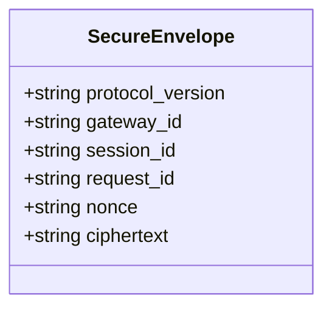

---

# 35. Plaintext inside encryption

Before encryption, Gateway serializes:

```json
{
  "device_id": "sensor-001",
  "temperature_c": 21.7,
  "humidity_pct": 42.5,
  "measured_at": "2026-09-21T13:45:31Z",
  "sequence_number": 184,
  "received_at": "2026-09-21T13:45:31.218Z",
  "gateway_id": "gateway-001"
}
```

That entire canonical measurement becomes the AEAD plaintext.

---

# 36. Authenticated associated data


The following visible metadata is authenticated as AES-256-GCM AAD:

```text
protocol_version
gateway_id
session_id
request_id
```

Conceptually, AAD is the canonical serialized form of those four fields.

If any one of them is modified, authentication/decryption must fail.

Do not authenticate one set of fields on the Gateway and reconstruct a different set on the Cloud.

---

# 37. Canonical AAD encoding


Do **not** concatenate arbitrary strings.

Use one stable JSON object:

```json
{
  "gateway_id": "gateway-001",
  "protocol_version": "1",
  "request_id": "req-...",
  "session_id": "sess-..."
}
```

Canonical encoding rules:

```text
UTF-8
JSON object
sorted keys
compact separators:
"," and ":"
no irrelevant whitespace
```

Conceptually, both sides should produce bytes equivalent to:

```python
json.dumps(
    aad_object,
    sort_keys=True,
    separators=(",", ":"),
).encode("utf-8")
```

The exact implementation language/library may differ, but the resulting bytes must match.

Contract tests must independently construct the AAD on both sides and assert byte equality.

---

# 38. JSON serialization

For encrypted plaintext, define:

```text
UTF-8 JSON
```

with:

```text
consistent field names
ISO-8601 UTC timestamps
no NaN/Infinity values
```

Exact whitespace does not matter after encryption, but tests should use deterministic serialization where useful.

---

# 39. Nonce design


AES-256-GCM uses:

```text
12-byte / 96-bit nonce
```

For every **new logical secure message**, generate a new nonce using cryptographically secure randomness from the selected crypto/system library.

Invariant:

> A nonce must never intentionally repeat with the same session key.

Do not use:

```text
sequence_number alone
timestamp alone
Python's non-cryptographic random module
fixed values
```

For a pure transport retry of the **same already-built secure envelope**, resend the same envelope rather than creating a second logical message with different retry-specific crypto state.

Therefore:

```text
new logical request
→ new request_id
→ new nonce
→ new encryption

transport retry of same logical request
→ same request_id
→ same already-built SecureEnvelope
```

Cloud idempotency prevents duplicate persistence if the first attempt was processed but its response was lost.

---

# 40. Secure-message sequence

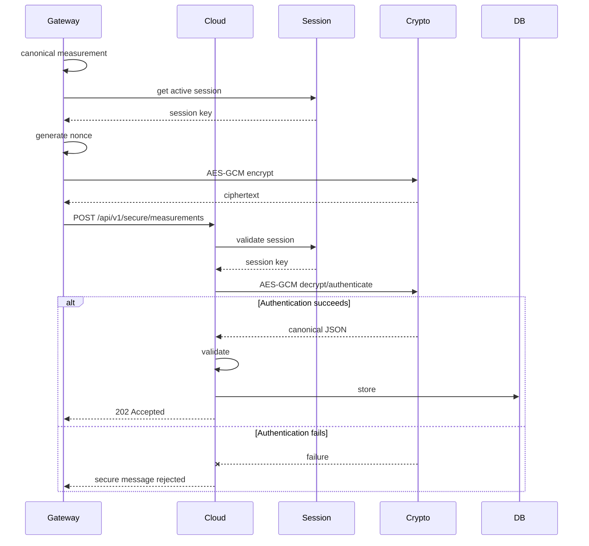

---

# 41. Secure-message success response

```http
202 Accepted
```

```json
{
  "status": "accepted",
  "record_id": "rec-550e8400..."
}
```

The Gateway does not necessarily need the `record_id`, but it can be useful for tests/tracing.

---

# 42. Secure endpoint error responses


Frozen error contract:

| Condition | HTTP | Error code |
|---|---:|---|
| Invalid envelope JSON/encoding | `400` | `SECURE_MESSAGE_REJECTED` |
| Unsupported protocol version | `400` | `UNSUPPORTED_PROTOCOL_VERSION` |
| Unknown session | `409` | `SESSION_INVALID` |
| Expired session | `409` | `SESSION_EXPIRED` |
| Gateway/session ownership mismatch | `400` | `SECURE_MESSAGE_REJECTED` |
| Authentication/decryption failure | `400` | `SECURE_MESSAGE_REJECTED` |
| Invalid decrypted measurement | `422` | `INVALID_MEASUREMENT` |
| Duplicate measurement | `202` | idempotent success |
| Temporary storage failure | `503` | `STORAGE_UNAVAILABLE` |
| Internal error | `500` | `INTERNAL_ERROR` |

Session errors deliberately use:

```text
409 Conflict
```

rather than `401`, because this protocol is not using HTTP user-authentication semantics.

Gateway behavior:

```text
409 SESSION_INVALID / SESSION_EXPIRED
→ invalidate local session
→ obtain current public key
→ establish new ML-KEM session
→ retry same logical request once
```

This is a bounded recovery operation, not an unbounded ordinary retry.

---

# 43. Session recovery flow


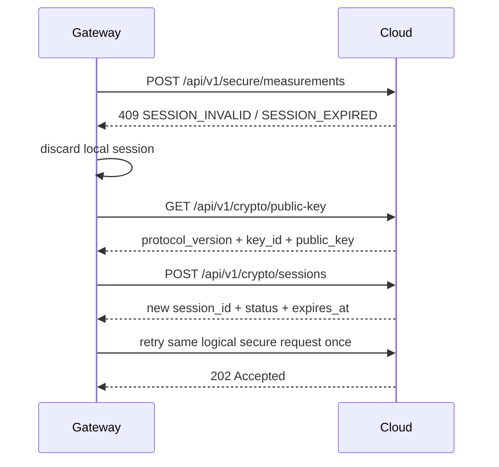

Session re-establishment is bounded to one recovery attempt per send operation.

If recovery fails again, the Gateway returns a classified failure upstream.

---

# 44. Request/correlation ID


The Gateway generates a unique:

```text
request_id
```

for every accepted Legacy request.

Example:

```text
req-9a0c...
```

`request_id` is **not** part of `CanonicalMeasurement`.

Propagation depends on Gateway→Cloud mode.

### Baseline Mode

Send:

```http
X-Request-ID: req-9a0c...
```

with:

```http
POST /api/v1/baseline/measurements
```

### Modernized Mode

Include:

```text
SecureEnvelope.request_id
```

and authenticate it as AAD.

The Gateway may also send `X-Request-ID` for HTTP-layer diagnostics in Modernized Mode, but the authenticated envelope field is authoritative.

Trace:

```text
Legacy sequence=184
      ↓
Gateway request_id=req-9a0c
      ↓
Cloud request_id=req-9a0c
      ↓
Cloud record_id=rec-xyz
```

---

# 45. Request ID rules

`request_id` should:

- be unique enough for tracing;
    
- not contain secrets;
    
- preferably be UUID-based;
    
- not be used as cryptographic key material.
    

---

# 46. Cloud storage model

After decryption and validation:

```json
{
  "record_id": "rec-...",
  "device_id": "sensor-001",
  "gateway_id": "gateway-001",
  "temperature_c": 21.7,
  "humidity_pct": 42.5,
  "measured_at": "2026-09-21T13:45:31Z",
  "gateway_received_at": "2026-09-21T13:45:31.218Z",
  "cloud_received_at": "2026-09-21T13:45:31.290Z",
  "sequence_number": 184
}
```

---

# 47. End-to-end data transformation

```text
LEGACY DEVICE
─────────────
timestamp

        ↓

EDGE GATEWAY
────────────
timestamp
→ measured_at

adds:
received_at
gateway_id

        ↓

CLOUD SERVICE
─────────────
stores:

measured_at
gateway_received_at
cloud_received_at
gateway_id
device_id
sequence_number
sensor values
```

---

# 48. Idempotency contract

A logical measurement identity is:

```text
(device_id, sequence_number)
```

Cloud should prevent duplicate storage.

If same measurement arrives again:

```text
already exists
    ↓
do not insert duplicate
    ↓
return success
```

Recommended response:

```http
202 Accepted
```

```json
{
  "status": "already_accepted",
  "record_id": "rec-existing"
}
```

This makes Gateway retries safe.

---

# 49. Replay considerations

Protocol version `1` does **not** implement a dedicated cryptographic anti-replay counter/window.

Cloud business idempotency uses:

```text
(device_id, sequence_number)
```

so retransmitting the same logical measurement does not create another database row.

However:

```text
business idempotency
≠
cryptographic replay protection
```

An authenticated secure envelope can still be replayed at the cryptographic layer.

This limitation is frozen and must be documented as technical debt.

---

# 50. Cloud query contract

For tests/demonstration:

```http
GET /api/v1/measurements
```

Optional:

```text
?device_id=sensor-001
&limit=100
```

Response:

```json
{
  "items": [
    {
      "record_id": "rec-001",
      "device_id": "sensor-001",
      "gateway_id": "gateway-001",
      "temperature_c": 21.7,
      "humidity_pct": 42.5,
      "measured_at": "...",
      "gateway_received_at": "...",
      "cloud_received_at": "...",
      "sequence_number": 184
    }
  ]
}
```

---

# 51. Health protocol

Gateway:

```http
GET /health
GET /ready
```

Cloud:

```http
GET /health
GET /ready
```

---

# 52. Gateway health

Example:

```json
{
  "status": "ok"
}
```

Readiness:

```json
{
  "status": "ready",
  "security_mode": "mlkem",
  "cloud": "reachable"
}
```

No key/session contents.

An active ML-KEM session is **not** required for Gateway readiness because sessions are established lazily.

---

# 53. Cloud health

```json
{
  "status": "ok"
}
```

Cloud readiness:

```json
{
  "status": "ready",
  "storage": "ok",
  "mlkem": "available"
}
```

An active Gateway session is **not** required for Cloud readiness. In Baseline Mode, ML-KEM session state is not a readiness prerequisite; in Modernized Mode, the crypto subsystem must be initialized and usable.

---

# 54. Failure-injection protocol principles

All three components support failure injection, but it remains **local configuration**, not part of normal network protocol.

```text
Legacy Device
FAILURE_MODE=...

Gateway
FAILURE_MODE=...

Cloud
FAILURE_MODE=...
```

Network peers should not receive:

```text
"failure_simulation": true
```

unless specifically needed for a dedicated test endpoint.

---

# 55. Legacy failure scenarios

Examples:

```text
invalid_temperature
invalid_humidity
missing_field
invalid_timestamp
duplicate_sequence
out_of_order_sequence
random
```

Purpose:

```text
test Gateway input validation
```

---

# 56. Gateway failure scenarios


Examples:

```text
processing_error
processing_delay
mlkem_handshake_failure
corrupt_ciphertext
cloud_timeout
cloud_unavailable
drop_message
session_missing
session_expired
random
```

Purpose:

```text
test Gateway application failure behavior
test session recovery
test crypto rejection
test Cloud transport retries
test fail-closed behavior
```

Not every mode has to mutate internal state permanently. Session/failure scenarios should be simulated at controlled boundaries.

---

# 57. Cloud failure scenarios

Examples:

```text
public_key_unavailable
mlkem_decapsulation_failure
# explicit simulated wrapper/application failure
session_not_found
session_expired
decryption_failure
storage_failure
processing_delay
service_unavailable
drop_response
random
```

Purpose:

```text
test Gateway resilience and security behavior
```

`mlkem_decapsulation_failure` is an explicit **simulated wrapper/application failure**. It must not be interpreted as a claim that every modified valid-length ML-KEM ciphertext naturally raises a decapsulation exception.

---

# 58. Failure-rate contract

All components use:

```text
FAILURE_RATE
```

range:

```text
0.0 <= rate <= 1.0
```

Examples:

```text
0.0 = never
0.1 = about 10%
1.0 = always
```

Optional:

```text
FAILURE_SEED
```

for deterministic demonstrations/tests.

---

# 59. Cross-component failure example

Cloud storage failure:

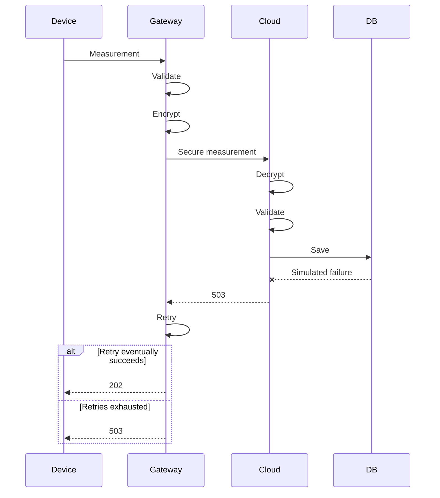

---

# 60. Cross-component invalid-data example

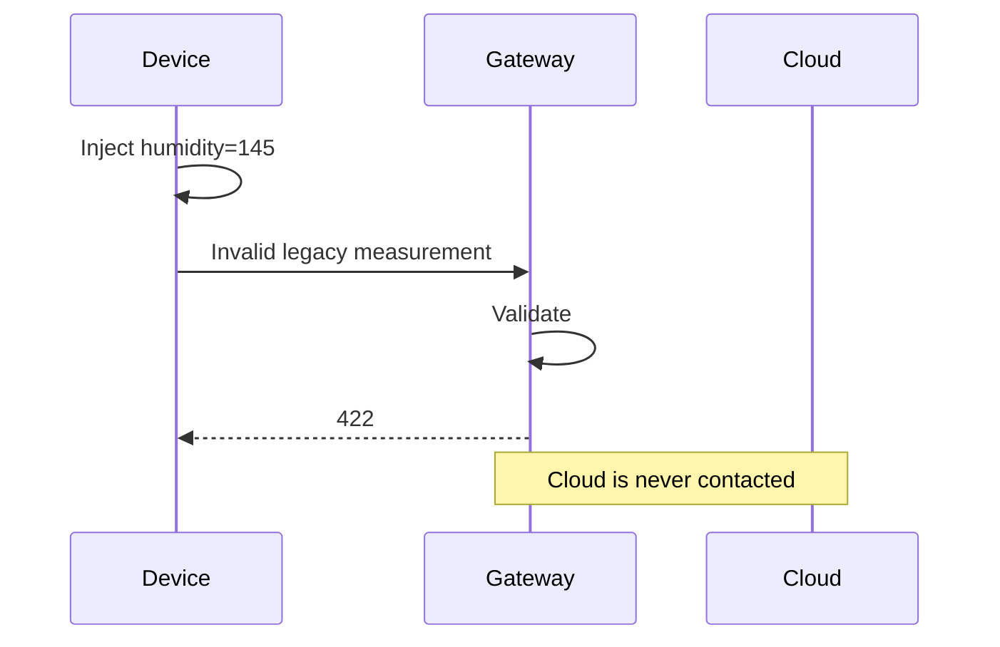

---

# 61. Cross-component crypto-failure example

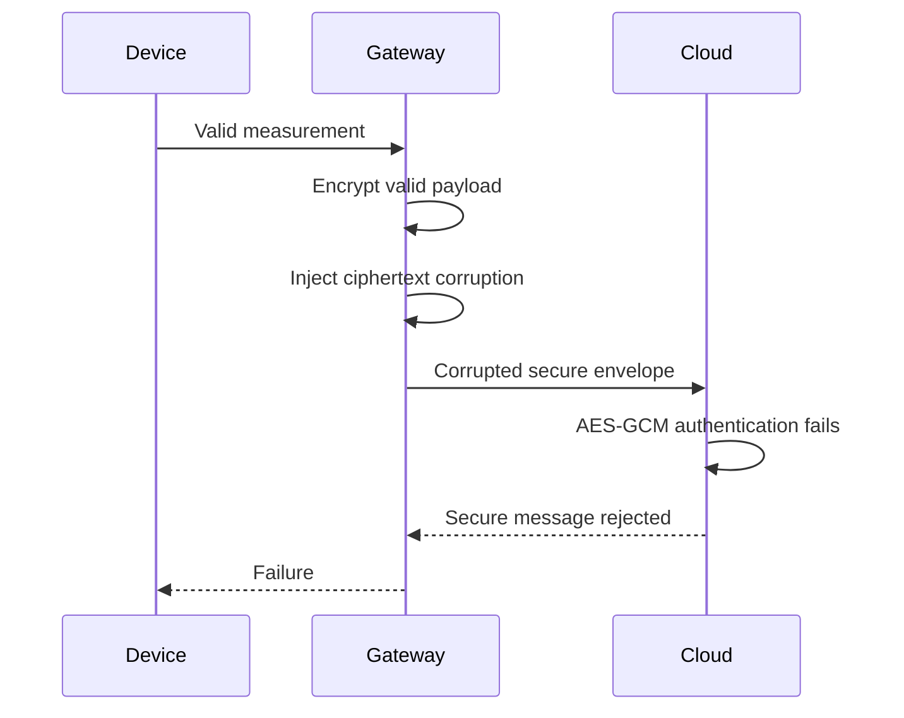

---

# 62. Full system normal sequence


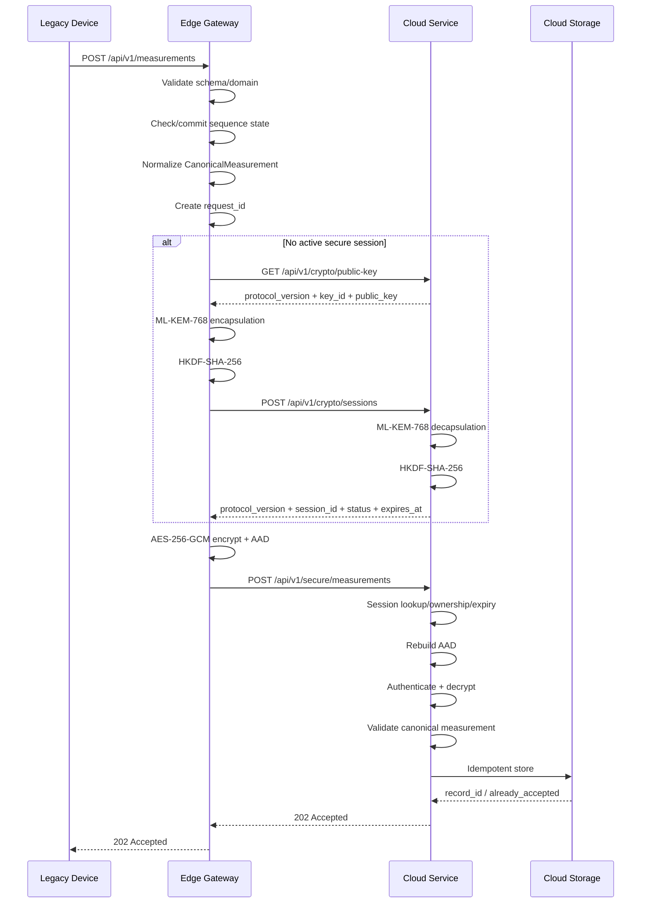

---

# 63. Baseline sequence


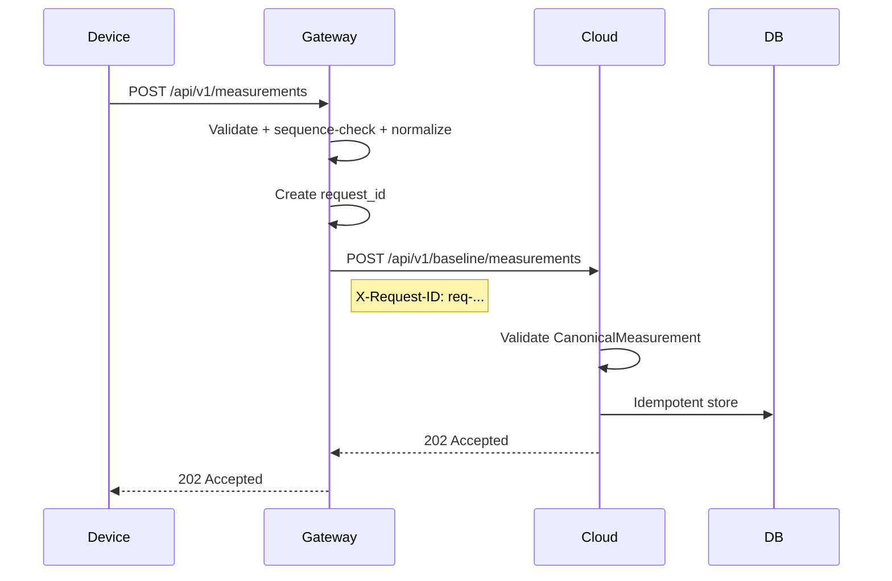

This is the direct baseline comparison counterpart to Modernized Mode.

No crypto/session operation occurs in Baseline Mode.

---

# 64. Security-mode compatibility


Gateway and Cloud deployments must agree on the intended run mode.

```text
Baseline run:
Gateway SECURITY_MODE=classical
Cloud SECURITY_MODE=classical
→ Gateway uses /api/v1/baseline/measurements
```

```text
Modernized run:
Gateway SECURITY_MODE=mlkem
Cloud SECURITY_MODE=mlkem
→ Gateway uses ML-KEM session + /api/v1/secure/measurements
```

The Cloud implementation may contain both endpoints for testing/comparison, but its configured run mode must be explicit and observable.

Forbidden behavior:

```text
Gateway expects ML-KEM
Cloud interprets failed secure input as plaintext
```

The secure endpoint accepts `SecureEnvelope` only.

---

# 65. No silent downgrade rule


If:

```text
SECURITY_MODE=mlkem
```

then:

```text
ML-KEM/session failure
→ fail closed
```

Never:

```text
ML-KEM/session failure
→ try /api/v1/baseline/measurements automatically
```

Initial policy:

```text
PQC_FAILURE_POLICY=fail_closed
```

This is the only supported PQC failure policy in protocol version `1`.

A switch to Baseline Mode requires an explicit configuration/operator decision, not an automatic runtime fallback.

---

# 66. Migration mode selection — no runtime fallback


Protocol version `1` does **not** implement runtime classical fallback.

Migration is demonstrated by explicitly running the system in two configurations:

```text
Baseline Mode:
SECURITY_MODE=classical
```

and:

```text
Modernized Mode:
SECURITY_MODE=mlkem
PQC_FAILURE_POLICY=fail_closed
```

The baseline endpoint remains available for controlled comparison and migration demonstrations, but Modernized Mode never calls it automatically after cryptographic failure.

This keeps the course implementation simple and prevents downgrade ambiguity.

A future protocol version could define an explicit authenticated/observable fallback policy if needed, but that is out of scope here.

---

# 67. Retry semantics across protocols


## Legacy Device → Gateway

Retry:

```text
network error
timeout
500
502
503
504
```

Do not retry:

```text
400
409
422
```

## Gateway → Cloud

Normal transport retry:

```text
timeout
connection failure
500
502
503
504
```

Do not blindly retry:

```text
400 malformed/protocol/security rejection
422 validation failure
unsupported protocol version
cryptographic rejection
```

Session recovery:

```text
409 SESSION_INVALID
409 SESSION_EXPIRED
```

means:

```text
invalidate local session
↓
new ML-KEM session
↓
retry same logical request once
```

This recovery is separate from normal HTTP retry and is bounded.

---

# 68. Backoff

For both legacy and gateway:

```text
attempt 1
↓ failure
wait 1 sec

attempt 2
↓ failure
wait 2 sec

attempt 3
↓ failure
stop
```

No infinite retries.

---

# 69. Request timeout

Frozen initial defaults:

```text
Legacy → Gateway:
3 seconds

Gateway → Cloud:
3 seconds
```

These can be separately configurable.

---

# 70. Time format

All timestamps:

```text
ISO-8601
UTC
timezone explicit
```

Preferred:

```text
2026-09-21T13:45:31.218Z
```

Do not send locale-specific timestamps.

---

# 71. Clock assumptions

The simulation assumes system clocks are reasonably synchronized.

We do not implement NTP synchronization.

Cloud may validate obviously impossible timestamps, but should not enforce extremely strict timing.

---

# 72. API versioning

All external routes use:

```text
/api/v1/
```

This separates API version from secure protocol version.

For example:

```text
HTTP API version:
v1

Secure envelope protocol version:
"1"
```

They can evolve independently later.

---

# 73. Complete endpoint matrix


| Component | Method | Endpoint | Purpose |
|---|---|---|---|
| Gateway | POST | `/api/v1/measurements` | receive Legacy measurement |
| Gateway | GET | `/health` | liveness |
| Gateway | GET | `/ready` | readiness |
| Gateway | GET | `/metrics` | metrics |
| Cloud | GET | `/api/v1/crypto/public-key` | ML-KEM public key |
| Cloud | POST | `/api/v1/crypto/sessions` | establish secure session |
| Cloud | POST | `/api/v1/secure/measurements` | secure measurement |
| Cloud | POST | `/api/v1/baseline/measurements` | Baseline Mode measurement |
| Cloud | GET | `/api/v1/measurements` | demonstration/query |
| Cloud | GET | `/api/v1/measurements/{record_id}` | query one record |
| Cloud | GET | `/health` | liveness |
| Cloud | GET | `/ready` | readiness |
| Cloud | GET | `/metrics` | metrics |

---

# 74. Logging correlation

Minimum common fields:

```text
event
request_id
gateway_id
device_id
sequence_number
```

When relevant:

```text
session_id
key_id
record_id
```

Never:

```text
shared_secret
session_key
private_key
password
token
```

---

# 75. Example full trace

Gateway:

```text
event=legacy_measurement_received
request_id=req-123
device_id=sensor-001
sequence_number=184
```

Gateway:

```text
event=cloud_delivery_started
request_id=req-123
session_id=sess-55
```

Cloud:

```text
event=secure_measurement_received
request_id=req-123
gateway_id=gateway-001
```

Cloud:

```text
event=measurement_stored
request_id=req-123
record_id=rec-900
```

Now you can trace one message end-to-end.

---

# 76. Metrics consistency


Gateway:

```text
gateway_measurements_received_total
gateway_measurements_accepted_total
gateway_measurements_rejected_total
gateway_duplicate_measurements_total
gateway_out_of_order_measurements_total
gateway_sequence_gaps_total

gateway_cloud_requests_total
gateway_cloud_failures_total
gateway_cloud_retries_total
gateway_cloud_request_duration_seconds

gateway_mlkem_handshakes_total
gateway_mlkem_handshake_failures_total
gateway_mlkem_handshake_duration_seconds
gateway_session_reestablishments_total
gateway_encryption_failures_total
gateway_active_session
gateway_pqc_fallback_total

gateway_injected_failures_total
```

For protocol version `1`, `gateway_pqc_fallback_total` should remain zero because the only supported policy is `fail_closed`. Keeping the metric can help detect accidental downgrade behavior.

Cloud:

```text
cloud_baseline_requests_total
cloud_secure_requests_total
cloud_secure_requests_rejected_total
cloud_request_duration_seconds

cloud_mlkem_sessions_created_total
cloud_mlkem_session_failures_total
cloud_mlkem_decapsulation_duration_seconds
cloud_active_sessions
cloud_expired_sessions_total

cloud_decryption_failures_total
cloud_authenticated_messages_total

cloud_measurements_stored_total
cloud_storage_failures_total
cloud_duplicate_measurements_total

cloud_injected_failures_total
```

Metric labels must remain bounded; never use `request_id`, `session_id`, or other unbounded identifiers as Prometheus-style labels.

---

# 77. Metrics comparison

You should later be able to answer:

```text
How often does ML-KEM fail?

How long does session establishment take?

How much additional latency does secure mode introduce?

How often are malformed legacy measurements rejected?

How often does cloud storage fail under injected faults?
```

This contributes directly to the operational side of the assignment.

---

# 78. Error-body convention


Use one common application error structure:

```json
{
  "error": {
    "code": "INVALID_MEASUREMENT",
    "message": "measurement validation failed"
  }
}
```

Possible codes:

```text
INVALID_JSON
INVALID_MEASUREMENT
DUPLICATE_SEQUENCE
OUT_OF_ORDER_SEQUENCE
SESSION_INVALID
SESSION_EXPIRED
SECURE_MESSAGE_REJECTED
UNSUPPORTED_PROTOCOL_VERSION
CLOUD_UNAVAILABLE
STORAGE_UNAVAILABLE
SERVICE_UNAVAILABLE
INTERNAL_ERROR
```

Clients should classify behavior primarily from the HTTP status and stable `error.code`, not from free-text messages.

---

# 79. Security-safe errors

External response:

```json
{
  "error": {
    "code": "SECURE_MESSAGE_REJECTED",
    "message": "secure message could not be processed"
  }
}
```

Internal log may record:

```text
authentication tag verification failed
```

but without exposing keys or plaintext.

---

# 80. Content limits


Initial request-size limits are:

```text
Legacy payload:
<= 16 KiB

SecureEnvelope JSON:
<= 64 KiB
```

These limits are intentionally far above the expected sensor message size while still rejecting obviously unreasonable input.

If implementation/framework constraints require a small adjustment, the change must be made deliberately in this protocol document and in contract tests.

Oversized input is rejected before expensive processing where practical.

---

# 81. Canonical field naming

Use `snake_case` everywhere in JSON:

```text
device_id
temperature_c
humidity_pct
sequence_number
gateway_id
session_id
request_id
```

Do not mix:

```text
deviceId
device_id
DeviceID
```

---

# 82. Component configuration consistency


Application-level common names inside each process:

```text
LOG_LEVEL
FAILURE_MODE
FAILURE_RATE
FAILURE_SEED
```

Legacy-specific:

```text
DEVICE_ID
GATEWAY_URL
SEND_INTERVAL_SECONDS
REQUEST_TIMEOUT_SECONDS
MAX_RETRIES
```

Gateway-specific:

```text
GATEWAY_ID
CLOUD_URL
CLOUD_TIMEOUT_SECONDS
CLOUD_MAX_RETRIES
SECURITY_MODE
SESSION_TTL_SECONDS
PQC_FAILURE_POLICY
```

Cloud-specific:

```text
CLOUD_ID
DATABASE_URL
SECURITY_MODE
SESSION_TTL_SECONDS
```

Gateway and Cloud must have matching:

```text
SECURITY_MODE
session TTL assumptions
crypto suite
protocol version
```

For protocol version `1`:

```text
PQC_FAILURE_POLICY=fail_closed
```

is the only supported Gateway policy.

## Root Compose/.env naming

Because all three processes internally use generic names such as `FAILURE_MODE`, the root Compose configuration should use service-scoped source variables to avoid collisions:

```text
LEGACY_FAILURE_MODE
LEGACY_FAILURE_RATE

GATEWAY_FAILURE_MODE
GATEWAY_FAILURE_RATE

CLOUD_FAILURE_MODE
CLOUD_FAILURE_RATE
```

Compose maps those into each container's internal:

```text
FAILURE_MODE
FAILURE_RATE
```

This allows different failure scenarios to be enabled independently.

---

# 83. Shared constants


Avoid duplicating protocol literals inconsistently.

Canonical protocol constants include:

```text
PROTOCOL_VERSION = "1"

SECURITY_MODE_CLASSICAL = "classical"
SECURITY_MODE_MLKEM = "mlkem"

CRYPTO_SUITE = "MLKEM768-HKDFSHA256-AES256GCM"

DEFAULT_SESSION_TTL_SECONDS = 300

HKDF_INFO =
"ml-kem-project:v1:gateway-cloud-session"

AES_GCM_NONCE_BYTES = 12
```

These values should be implemented independently by Gateway and Cloud according to this protocol specification.

Do not create a shared Python application-model dependency merely to share constants unless duplication becomes problematic.

This document is the source of truth.

---

# 84. Should Gateway and Cloud share Python models?

My recommendation:

**Do not directly import application models from each other.**

Bad:

```python
from edge_gateway.models import SecureEnvelope
```

inside cloud.

That creates tight coupling.

Better:

```text
Both implement the same documented protocol contract.
```

Optionally later create a tiny independent:

```text
shared_protocol/
```

package if duplication becomes problematic.

But don't start with it unless needed.

---

# 85. Contract testing

Since the components don't import each other's internal models, add contract tests.

Examples:

```text
Gateway SecureEnvelope
     ↓
serialize
     ↓
Cloud parser
     ↓
accepted
```

and:

```text
Cloud public key response
     ↓
Gateway parser
     ↓
accepted
```

These tests ensure implementation matches the protocol.

---

# 86. Protocol test fixtures

Create representative test fixtures, not production secrets.

For example:

```text
tests/fixtures/
├── valid_legacy_measurement.json
├── invalid_humidity_measurement.json
├── valid_public_key_response.json
├── valid_session_request.json
└── valid_secure_envelope.json
```

For crypto fixtures, avoid hardcoding real private keys.

Generate temporary test keys at runtime where possible.

---

# 87. Contract test matrix

-  Valid legacy payload accepted.
    
-  Missing legacy field rejected.
    
-  Invalid temperature rejected.
    
-  Duplicate sequence behavior matches design.
    
-  Cloud public-key response parses correctly.
    
-  Session request schema matches both sides.
    
-  Session response schema matches both sides.
    
-  Secure envelope generated by Gateway parses in Cloud.
    
-  AAD construction identical on both sides.
    
-  Same KDF parameters used.
    
-  Gateway ciphertext decrypts in Cloud.
    
-  Unknown protocol version rejected.
    
-  Expired session handled consistently.
    
-  Duplicate cloud measurement handled idempotently.
    

---

# 88. Full testing layers

```text
Unit Tests
    ↓
Component Tests
    ↓
Contract Tests
    ↓
Gateway ↔ Cloud Integration
    ↓
Legacy ↔ Gateway Integration
    ↓
Full End-to-End
    ↓
Failure / Security Tests
```

---

# 89. End-to-end acceptance test

The strongest normal-system test should be:

```text
1. Start Cloud
2. Start Gateway
3. Start Legacy Device
4. Device generates known measurement
5. Gateway receives it
6. Gateway establishes ML-KEM session
7. Gateway encrypts it
8. Cloud decrypts it
9. Cloud stores it
10. Query Cloud
11. Stored value equals original measurement
```

---

# 90. End-to-end security test

Example:

```text
1. Establish valid ML-KEM session
2. Gateway encrypts measurement
3. Corrupt ciphertext
4. Send to Cloud
5. Cloud rejects it
6. Verify no database row added
7. Verify failure metric increments
8. Verify no secret appears in logs
```

---

# 91. Failure injection matrix


| Injection location | Scenario | Expected result |
|---|---|---|
| Legacy | invalid humidity | Gateway rejects with `422` |
| Legacy | malformed timestamp | Gateway rejects with `422` |
| Legacy | duplicate sequence | Gateway detects/rejects with `409` |
| Legacy | out-of-order sequence | Gateway detects/rejects with `409` |
| Gateway | processing error | Legacy receives failure |
| Gateway | ML-KEM failure | no session; fail closed |
| Gateway | ciphertext corruption | Cloud rejects; no storage |
| Gateway | Cloud timeout | bounded retry |
| Gateway | Cloud unavailable | bounded retry |
| Gateway | drop message | no Cloud record; no false success |
| Gateway | forced session expiry/missing session | re-establishment path |
| Cloud | public key unavailable | Gateway handshake cannot start |
| Cloud | simulated ML-KEM wrapper/decapsulation failure | session establishment fails; no session created |
| Cloud | unknown session | `409 SESSION_INVALID` |
| Cloud | expired session | `409 SESSION_EXPIRED`; Gateway re-establishes |
| Cloud | decryption failure | no storage |
| Cloud | storage failure | Gateway receives retryable error |
| Cloud | service unavailable | Gateway retries |
| Cloud | drop response | Cloud may store once; Gateway retry remains idempotent |

---

# 92. Baseline vs modernized comparison


The project should compare equivalent workloads in the two explicit modes:

| Attribute | Baseline Mode (`classical`) | Modernized Mode (`mlkem`) |
|---|---|---|
| Legacy→Gateway | same | same |
| Gateway→Cloud endpoint | `/api/v1/baseline/measurements` | `/api/v1/secure/measurements` |
| Gateway→Cloud payload | canonical JSON | SecureEnvelope |
| Session establishment | none | ML-KEM-768 |
| Key derivation | none | HKDF-SHA-256 |
| Payload confidentiality | none at application layer | AES-256-GCM |
| Payload authentication | none at application layer | AES-256-GCM |
| PQC key establishment | no | yes on Gateway↔Cloud |
| First-message overhead | lower | includes session establishment |
| Steady-state overhead | lower | measurable AEAD/session lookup overhead |
| Message size | smaller | larger |
| Complexity | lower | higher |

Measurements must use equivalent message counts, payloads, failure modes, and environment.

The first secure message should be measured separately from steady-state secure messages.

---

# 93. Technical-debt implications

The shared protocol deliberately leaves several production concerns out:

```text
No full PKI
No persistent Cloud ML-KEM identity
No HSM
No persistent session store
No dedicated cryptographic anti-replay counter/window
Simple retry strategy
No offline message queue
No multi-region Cloud
No high-availability Gateway
Legacy path still weak
```

These are not hidden problems.

They are explicitly documented limitations.

---

# 94. Security boundaries

```text
┌──────────────────────────────────────┐
│ Legacy Device → Gateway              │
│                                      │
│ Legacy trust assumptions             │
│ No PQC                               │
│ Potential plaintext                  │
└──────────────────────────────────────┘
                  │
                  ▼
         MODERNIZATION BOUNDARY
                  │
                  ▼
┌──────────────────────────────────────┐
│ Gateway → Cloud                      │
│                                      │
│ ML-KEM                               │
│ KDF                                  │
│ authenticated encryption             │
│ session handling                     │
└──────────────────────────────────────┘
```

Do not describe the entire system as end-to-end post-quantum secure.

Only:

```text
Gateway ↔ Cloud
```

uses the PQC modernization.

---

# 95. Security invariants


These are explicit implementation rules:

- ML-KEM private key never leaves Cloud.
- ML-KEM shared secret never traverses the network.
- Session key never traverses the network.
- Session key is never intentionally written to disk.
- No secret appears in logs.
- No secret appears in metrics.
- No secret appears in AI-history files.
- Secure endpoint never accepts plaintext.
- Authentication failure prevents storage.
- Unknown/expired session prevents secure-message decryption.
- Unknown session returns `409 SESSION_INVALID`.
- Expired session returns `409 SESSION_EXPIRED`.
- ML-KEM/session failure in Modernized Mode always fails closed.
- Runtime plaintext fallback is not implemented in protocol version `1`.
- AES-GCM uses a 12-byte nonce.
- A nonce is never intentionally reused with the same session key for a new logical message.
- `request_id` is authenticated as AAD in Modernized Mode.
- Gateway and Cloud use identical HKDF-SHA-256 parameters including `salt=None`.
- Gateway and Cloud construct byte-identical AAD.
- Cloud storage is idempotent on `(device_id, sequence_number)`.

---

# 96. Protocol state diagram


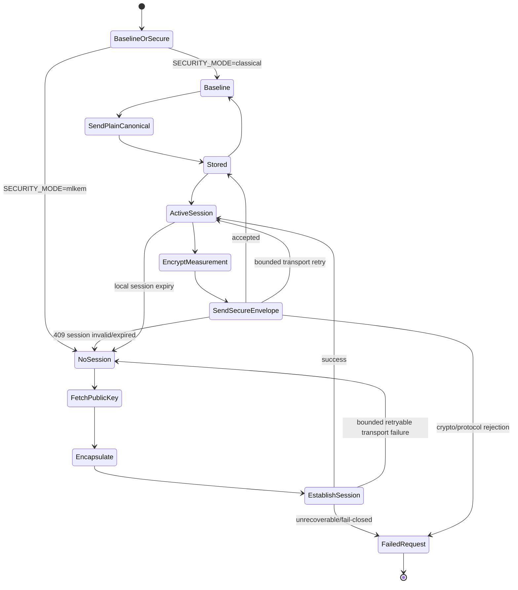

There is intentionally no state transition from Modernized Mode to Baseline Mode after cryptographic failure.

---

# 97. Repository documentation

I recommend creating:

```text
docs/
└── architecture/
    ├── system-overview.md
    ├── legacy-device.md
    ├── edge-gateway.md
    ├── cloud-service.md
    └── protocol-specification.md
```

The specification we just designed belongs in:

```text
docs/architecture/protocol-specification.md
```

That should become the team's **source of truth for interfaces**.

---

# 98. Protocol change process

Once implementation starts, protocol changes should be deliberate.

If someone changes:

```text
field name
endpoint
status code
crypto parameter
session behavior
```

they should:

```text
1. discuss with team
2. update protocol specification
3. update Gateway
4. update Cloud
5. update tests
6. record AI-history if AI assisted
```

Do not let one agent silently change the contract.

---

# 99. Pull-request protocol checklist

For a PR affecting an interface:

-  Does it change JSON schema?
    
-  Does it change an endpoint?
    
-  Does it change status code semantics?
    
-  Does it change crypto parameters?
    
-  Does it change session lifecycle?
    
-  Does it change retry behavior?
    
-  Does it change failure-injection behavior?
    
-  Are both sides updated?
    
-  Are contract tests updated?
    
-  Is `protocol-specification.md` updated?
    

---

# 100. Final cross-component architecture


```mermaid
flowchart LR

    subgraph Legacy["Legacy Device"]
        SG[Sensor]
        SER[Serialize Measurement]
        LF[Payload Failure Injector]
        LC[HTTP Client]

        SG --> SER
        SER --> LF
        LF --> LC
    end

    subgraph Gateway["Edge Gateway"]
        API[Legacy API]
        GV[Validation]
        GS[Sequence Tracking]
        GN[Normalization]
        RID[Request ID]

        GF[Failure Injector]

        SM[Session Manager]
        GML[ML-KEM-768 Encapsulation]
        GKDF[HKDF-SHA-256]
        GAEAD[AES-256-GCM Encryption]

        BCLIENT[Baseline Transport]
        SCLIENT[Secure Transport]

        API --> GV
        GV --> GS
        GS --> GN
        GN --> RID
        RID --> GF

        GF --> BCLIENT

        GF --> SM
        SM --> GML
        GML --> GKDF
        SM --> GAEAD
        GAEAD --> SCLIENT
    end

    subgraph Cloud["Cloud Service"]
        BAPI[Baseline Measurement API]
        CPI[Public Key API]
        CSI[Session API]
        CSA[Secure Measurement API]

        CF[Failure Injector]

        CML[ML-KEM-768 Decapsulation]
        CKDF[HKDF-SHA-256]
        CSM[Session Manager]
        CAEAD[AES-256-GCM Decryption]

        CV[Canonical Validation]
        IDEMP[Idempotency]
        DB[(SQLite)]

        BAPI --> CV

        CPI --> CML
        CSI --> CF
        CF --> CML
        CML --> CKDF
        CKDF --> CSM

        CSA --> CSM
        CSM --> CAEAD
        CAEAD --> CV

        CV --> IDEMP
        IDEMP --> DB
    end

    LC -->|POST /api/v1/measurements| API

    BCLIENT -->|POST /api/v1/baseline/measurements + X-Request-ID| BAPI

    SCLIENT -->|GET /api/v1/crypto/public-key| CPI
    SCLIENT -->|POST /api/v1/crypto/sessions| CSI
    SCLIENT -->|POST /api/v1/secure/measurements| CSA
```

---

# 101. Shared protocol acceptance checklist


Before implementation, the whole team should approve this checklist.

### Legacy contract

- `/api/v1/measurements` agreed.
- Legacy schema agreed.
- Temperature range agreed.
- Humidity range agreed.
- Timestamp format agreed.
- Sequence semantics agreed.
- Sequence state records the last valid value observed by Gateway.
- Duplicate/out-of-order behavior is `409`.
- Gateway response codes agreed.
- `400` is reserved for malformed/unparseable JSON/body syntax.
- `422` is used for parsed JSON with missing, wrongly typed, or domain-invalid required fields.
- Legacy retry behavior agreed.

### Canonical model

- `measured_at` agreed.
- `received_at` agreed.
- `gateway_id` agreed.
- Exact field names frozen.
- `request_id` is explicitly **not** part of `CanonicalMeasurement`.

### Baseline protocol

- `SECURITY_MODE=classical` means Baseline Mode.
- `/api/v1/baseline/measurements` agreed.
- Baseline payload agreed.
- `X-Request-ID` propagation agreed.
- Baseline is entered only through explicit configuration.

### ML-KEM

- `ML-KEM-768` agreed.
- Existing maintained library will be used.
- Public-key endpoint agreed.
- `protocol_version`, algorithm, key ID, and Base64URL public key agreed.
- Session endpoint agreed.
- Versioned session request schema agreed.
- Versioned session response schema agreed.
- ML-KEM implicit-rejection caveat documented.
- Tests do not assume every modified valid-length ML-KEM ciphertext must raise an exception.

### KDF

- `HKDF-SHA-256` agreed.
- `salt=None` agreed.
- 32-byte output agreed.
- `info = "ml-kem-project:v1:gateway-cloud-session"` agreed.
- Gateway and Cloud implementation semantics identical.

### Symmetric encryption

- `AES-256-GCM` agreed.
- 12-byte nonce agreed.
- Cryptographically secure nonce generation agreed.
- AAD fields agreed.
- Canonical AAD serialization agreed.
- Same-envelope retransmission behavior agreed.

### Secure envelope

- `protocol_version` agreed.
- `gateway_id` agreed.
- `session_id` agreed.
- `request_id` agreed.
- `nonce` agreed.
- `ciphertext` agreed.
- Base64URL encoding agreed.

### Session

- TTL = 300 seconds by default.
- Gateway ownership agreed.
- expiry behavior agreed.
- `409 SESSION_INVALID` agreed.
- `409 SESSION_EXPIRED` agreed.
- bounded one-time session recovery agreed.
- in-memory limitation documented.

### Cloud storage

- Stored schema agreed.
- canonical `received_at` maps to stored `gateway_received_at`.
- `cloud_received_at` agreed.
- idempotency key `(device_id, sequence_number)` agreed.
- duplicate behavior agreed.
- `/api/v1/measurements/{record_id}` agreed.

### Errors

- Structured error-body format agreed.
- retryable vs non-retryable agreed.
- session-invalid behavior agreed.
- crypto rejection behavior agreed.
- unsupported protocol behavior agreed.

### Failure injection

- Legacy scenarios agreed.
- Gateway scenarios agreed.
- Cloud scenarios agreed.
- `FAILURE_RATE` semantics identical.
- `FAILURE_SEED` semantics identical.
- default is disabled everywhere.
- service-scoped root Compose failure variables planned.

### Observability

- request ID propagation agreed.
- secure `request_id` is authenticated as AAD.
- common log fields agreed.
- Gateway metrics agreed.
- Cloud metrics agreed.
- no secrets in observability.
- no high-cardinality request/session IDs in metrics.
- Gateway readiness does not require an active secure session.
- Cloud readiness does not require an active Gateway session.

### Testing

- contract tests planned.
- baseline E2E test planned.
- ML-KEM E2E test planned.
- invalid Legacy test planned.
- duplicate/out-of-order test planned.
- KDF interoperability test planned.
- AAD byte-equality test planned.
- corrupt ciphertext test planned.
- modified-AAD test planned.
- expired-session test planned.
- unknown-session test planned.
- Cloud storage failure test planned.
- dropped-response/idempotency test planned.
- fail-closed/no-baseline-call test planned.
- no-secret-log test planned.

### Security

- no secret logging.
- no secret persistence.
- no silent downgrade.
- protocol version `1` supports `fail_closed` only.
- secure endpoint cannot accept plaintext.
- auth failure prevents storage.
- Cloud public-key trust limitation documented.
- Legacy→Gateway path is not claimed to be PQC-secured.

---

# 102. Final specification summary


The resulting protocol is:

> The system uses two deliberately different communication protocols. The Legacy Device communicates with the Edge Gateway through `POST /api/v1/measurements` using a simple HTTP/JSON measurement containing device identity, temperature, humidity, a UTC timestamp, and a sequence number. The Gateway validates the payload, applies per-device sequence policy, records the last valid sequence it observed, and transforms the Legacy representation into a `CanonicalMeasurement` containing `measured_at`, `received_at`, and `gateway_id`. A separate `request_id` is created for tracing and is not part of the canonical business object.
>
> In **Baseline Mode** (`SECURITY_MODE=classical`), the Gateway sends the canonical JSON to `POST /api/v1/baseline/measurements` and propagates the correlation ID through the `X-Request-ID` header. In **Modernized Mode** (`SECURITY_MODE=mlkem`), the Gateway obtains the Cloud's versioned ML-KEM-768 public key, performs ML-KEM encapsulation, derives a 32-byte session key using HKDF-SHA-256 with `salt=None` and the fixed context `ml-kem-project:v1:gateway-cloud-session`, establishes a short-lived Cloud session, and protects canonical measurements using AES-256-GCM with a 12-byte nonce.
>
> Every secure message uses a versioned `SecureEnvelope` containing `protocol_version`, `gateway_id`, `session_id`, `request_id`, `nonce`, and `ciphertext`. The four visible metadata fields `protocol_version`, `gateway_id`, `session_id`, and `request_id` are authenticated as deterministically encoded JSON AAD. Binary crypto values transported through JSON use Base64URL. The Cloud validates the envelope and session, reconstructs the same AAD, authenticates/decrypts the payload, validates the canonical measurement again, and stores it idempotently.
>
> Cloud storage maps the canonical Gateway field `received_at` to `gateway_received_at`, adds `cloud_received_at` and `record_id`, and prevents duplicate logical records using `(device_id, sequence_number)`. Unknown and expired sessions return `409 SESSION_INVALID` and `409 SESSION_EXPIRED`; the Gateway performs one bounded session re-establishment and retries the same logical request once. Transport retries are separately bounded.
>
> Protocol version `1` implements **fail-closed** PQC behavior only. A failed ML-KEM/session/secure operation never causes an automatic call to the baseline plaintext endpoint. Baseline and Modernized Mode are selected explicitly through configuration. The Cloud ML-KEM identity and sessions are intentionally in memory for the course implementation, and the simplified public-key trust model is documented as technical debt rather than treated as production-grade PKI. ML-KEM failure handling also distinguishes malformed/wrapper failures from modified valid-length ciphertexts, which may follow implicit-rejection behavior rather than raising an explicit decapsulation exception.
>
> All three components support controlled local failure injection, structured secret-safe logging, meaningful metrics, health/readiness behavior, contract tests, integration tests, and end-to-end failure/security tests. This document is the source of truth for cross-component fields, endpoints, status codes, crypto parameters, session behavior, retries, and migration semantics.

---
